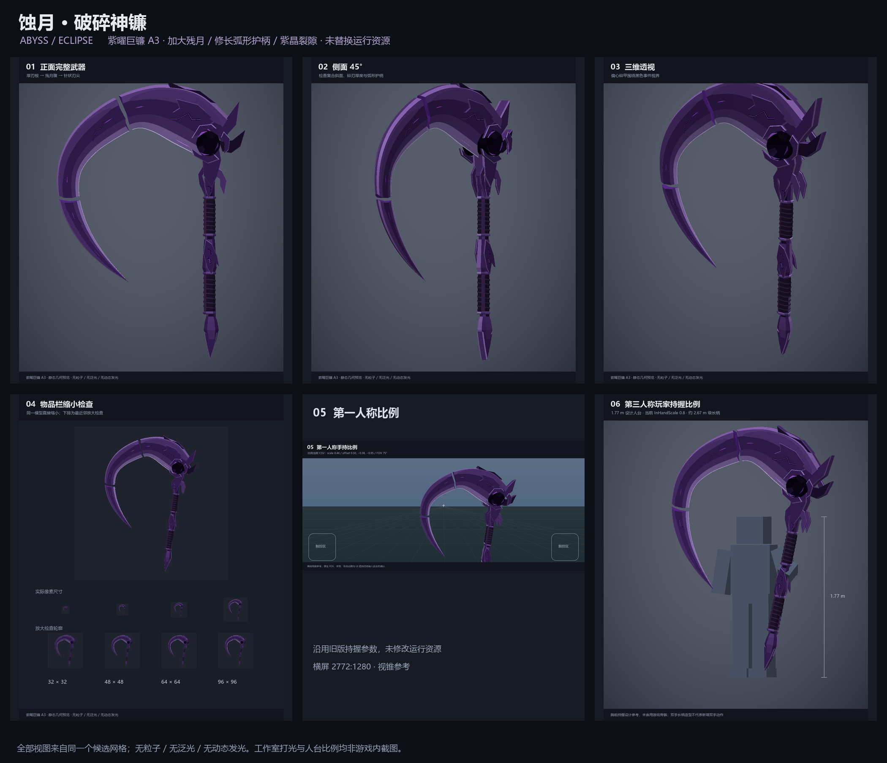

# 阿比斯 · 终焉之镰：蚀月设计候选 A3

2026-10-29；基于 `port/scnet-x25.01.17`，运行版本仍为 0.16.1 / 神器 v0.1.1。

**这是独立设计审阅目录，不是运行资源，不进入 `.netmod`。** 用户要求先确认几何与多角度预览；
中途已认可初版模型方向，并进一步要求紫色主体、更大的镰刃，以及参考遐蝶长柄镰刀的设计。
本候选将这些反馈合并为“紫曜巨镰”，等待最终配色/比例确认后再接入。

本目录也可独立提交到 main；main 当前不包含 port 分支的阿比斯运行功能。预览脚本在 CSV 不存在时
使用 port v0.1.1 的记录值，不能据此认为 main 已集成该物品。



## 设计规格

- 三段独立残月刃：厚重刃根、下坠刃腹和长尖刃末。轮廓由内外独立控制曲线定义，
  没有用同心圆等宽裁片制作；13 点厚度剖面包含脊背、隆起脊线、主面、切削斜面和薄刃口。
- 相比初版候选，刃部横向缩放 1.38、纵向 1.13、刃腹宽度额外增加 18%、厚度增加 10%。
  镰柄没有跟着整体放大。主刃三个断口位置和轮廓各异，刀尖收敛至真正的单顶点。
- 核心为双面内凹的暗色事件视界，偏心开口碎甲与少量紫色碎屑围绕凹腔。
  取消旧运行模型的同心靶环；没有球形宝珠或发光平面替代凹腔。
- 长柄为多棱暗紫金属骨架、双握区螺旋包覆、弧形开口护柄、偏心腰甲、实体符文槽和金属尾锥。
  参考大型长柄战镰的弧线连续性，保留本武器自己的破碎残月结构。
- 配色遵循用户最新意见：主体由虚空黑改为深紫与紫罗兰金属，冷紫切削斜面，少量浅紫刃口，
  黑色只集中在核心与凹槽。亮紫能量嵌片约占总表面积 3.29%，不使用整片高亮发光材质。
- 32 个独立 geometry / 9,260 三角形 / 27,780 个展开顶点，全部挂到一个 identity 根骨骼。
  DAE 为 Y_UP，meter=1，所有变换烘焙到顶点与法线；PNG 为不透明 RGBA 256×16。
- 包围盒约 2.248 × 3.336 × 0.492 模型单位；按现有 InHandScale=0.8，武器总高度约 2.67。
  这是大型双手武器的造型规格；当前游戏仍为原生单手挂点，未新增双手握持动画。

## 审阅图

| 内容 | 文件 |
|---|---|
| 正面完整武器 | [01-front.png](previews/01-front.png) |
| 侧面 45° | [02-side45.png](previews/02-side45.png) |
| 三维透视 | [03-perspective.png](previews/03-perspective.png) |
| 图标 / 32、48、64、96 像素检查 | [04-inventory.png](previews/04-inventory.png) |
| 第一人称持握比例 | [05-first-person.png](previews/05-first-person.png) |
| 第三人称人台比例 | [06-third-person.png](previews/06-third-person.png) |
| 核心细节 | [07-core-detail.png](previews/07-core-detail.png) |
| 无色灰模 | [08-clay.png](previews/08-clay.png) |

所有图片读取同一份候选 geometry 和 palette，使用有深度缓冲的软件光栅器输出。
没有额外的高模、概念画替代品、粒子、泛光或动态发光。工作室照明包含固定方向光与微弱镜面项，
**并非 SCNET 引擎内截图，也不承诺目标原生材质路径能产生相同镜面效果**。

第一人称使用运行 CSV 中未修改的 scale=0.46、offset=(0.50,-0.38,-0.95)、yaw/roll=(-8,-8)，
横屏 2772:1280，画面使用候选垂直 FOV=75°。65°/75°/85°三种假设视锥内，
静止主刃均完整可见；65°时刀尖接近下沿，动画与实际 UI 仍须设备检查。
准星可见只描述当前离线静止画面，不代表奔跑、三连斩和重斩时无遮挡。
第三人称为原创 1.77 单位人台、1.22 单位腕高的胸前持握设计姿态，使用当前物品缩放，
并未套用原生人物骨骼或分发游戏人物资源。实际垂手、走跑、挥砍时的尾锥离地距离需接入后检查。

## 来源与生成

模型、调色板、纹路和人台均为本项目参数化原创，不包含第三方模型、游戏贴图、APK 或程序集。
根据用户所提遐蝶武器调整大刃/长柄的视觉比重与弧线。外部公开参考入口：
[官方遐蝶预告 Epitaph](https://www.youtube.com/watch?v=0FPvfC8g6-Q)、
[长柄镰刀道具参考图页](https://dokidokicos.com/products/dokidoki-game-honkai-star-rail-cosplay-castorice-scythe)。
后者为第三方道具展示，仅用于辅助理解比例，不作为游戏模型尺寸的精确依据；未下载其网格或纹理。

从本目录运行：

```powershell
python generate.py
python preview.py
python validate.py
powershell -NoProfile -ExecutionPolicy Bypass -File Test-NativeImport.ps1 -GameDir '<已核验的 SCNET x25.01.17 Windows 目录>'
```

`generate.py` 只依赖标准库。预览依赖 Pillow、numpy；验证依赖 Pillow。
字体默认使用 Windows 微软雅黑。每次生成只写本目录的 assets/ 和 previews/，不会改正式 Assets。
模型/贴图 SHA-256 记录在 [manifest.json](assets/manifest.json)，原生导入结果记录在
[native-import.json](native-import.json)，网格完整性证据记录在 [validation.json](validation.json)。

## 验证与接入边界

| 项目 | 状态与实际证据 |
|---|---|
| 候选模型完整性 | 已确认：无退化面、法线单位化、闭合流形边、相邻绕序一致、正有向体积、UV/索引/PNG alpha 检查通过。 |
| 原生离线导入 | 已确认：固定哈希 Windows `Engine.Media.ModelData.Load` 实际导入 1 bone / 32 meshes / 9,260 triangles。 |
| 六视图及灰模 | 已确认：由真实候选网格生成并检查，不是游戏截图。 |
| 正式资源替换 | 未执行：旧 DAE/PNG/CSV、代码、物品 ID、存档结构、技能/伤害和版本号保持原样。 |
| Release 与 `.netmod` | 未执行：按照用户指定的设计确认阶段，尚不打包候选资源。 |
| Android 游戏画面与性能 | 待验证：新包接入后，由用户在真实客户端验收。 |
| 双手武器动作 | 未实现：仅设计长柄造型，本阶段不修改动作或战斗逻辑。 |

获准接入后，仍需核对候选 palette 的材质分组与现有 `AbyssReaperBlock` 的高光/自发光映射，
不得把整个紫色主体标为自发光；更新正式资源数量守卫，依次做 Test-Environment、Release、
`.netmod` 资源校验，再安排 Android 第一/第三人称、图标、攻击动画裁切和低光场景验收。
9,260 三角形高于旧版 2,480，实际移动端开销尚未测量，不宣称无性能下降。
