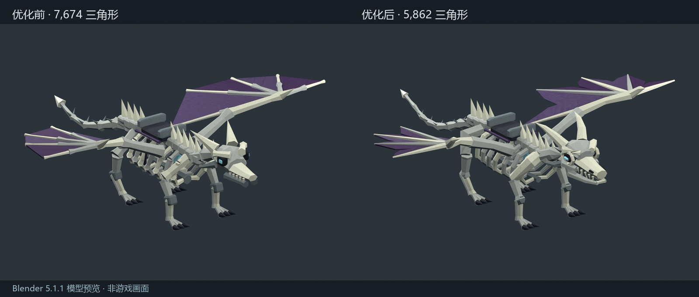
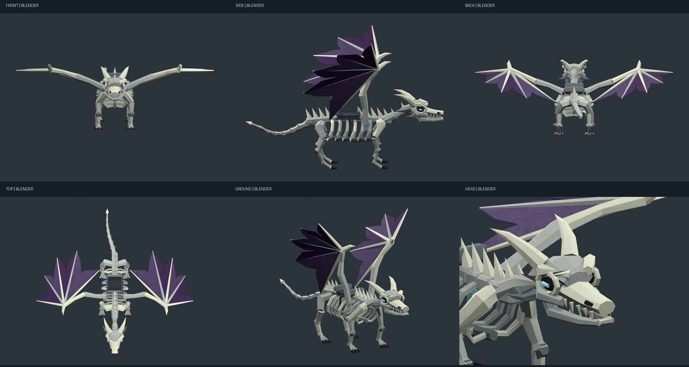

# 骨龙 Blender 优化 / 0.84.0

2026-11-12，基线main `5f429e1700c7ba44a0d823c8d237edfcc2caffe4`，开始时工作区干净。使用用户要求的Blender技能，经官方Blender MCP在本机Blender 5.1.1中实际创建网格、闭合拓扑、分区UV、渲染与导出。保留原默认Scene，新增独立Baseline/Optimized场景。没有外部模型、贴图、游戏素材或新增插件依赖。

## 形体与预算

保留骨龙长吻、青色魂眼/胸核和紫色翼膜。头骨改为颅顶、开放颧弓、眼眶与分离下颌；后掠龙角使用弯曲渐细截面。肋骨改为连续六边截面弧线；尾椎分段渐细；翼指连续渐细，实体翼膜边缘增加凹弧和破口。膝关节改为多面骨节。鞍座、缰带、脚爪与游戏风格保持。

| 项目 | 基线 | 本版 |
|---|---|---|
| 三角形 | 7674 | 5862（减少1812，23.61%） |
| 原生骨骼 / 网格 | 7 / 7 | 7 / 7 |
| 贴图 | 512×256 RGB | 原图字节保持 |
| 加载器 / 网络 / 存档 / 战斗 | 0.83.0 | 保持 |

游戏坐标Y_UP、单位1格；Blender映射`(x,y,z)→(x,-z,y)`，导出还原顶点/法线/UV，并保留7个原始节点矩阵。原生矩阵预算已满，头/颈/尾仍属于Body。翼尾继续伸出既有`2.1,2.7,5.8`碰撞盒，不提供精细碰撞；本次没有扩大这个既有功能边界。

`MountOffset=0,2.1,0.16`、上下马、动画角度和XDB不变。鞍座与缰带沿用原始顶点；保留骑手空间不代表已通过真实人物/衣物实测。没有重做技能表现，所以不新增PixelFX/图标，也不改伤害、冷却或权限。

## 实际预览

所有图片和GIF均为Blender预览，**不是游戏或Android画面**；对比使用相同图集、光照和视角。预览材质不添加游戏不存在的辉光/PBR贴图。





[12相位振翅预览](flight-preview.gif) · [完整飞行视图](blender-flight.png) · [头部](blender-head.png)

## 复现与来源

当前建模入口为`scripts/Optimize-BoneDragonBlender.py`；`New-BoneDragonAssets.py`只作为原始几何基线，直接运行旧脚本会覆盖优化模型，不能用于当前正式再生。Blender 5.1.1已移除内置Collada导入操作符，管线通过项目原创几何定义建模，并从实际Blender Mesh数据导出严格的SCNET Collada，不依赖未经验证的导出插件。

在干净Blender进程中：

```powershell
blender --background --python SCIE-Port/scripts/Optimize-BoneDragonBlender.py
python SCIE-Port/scripts/Complete-BoneDragonDesign.py
```

第一步生成模型、分视图、12姿态帧及几何/UV/坐标报告；第二步应在下述Release构建后运行，组合已有渲染和校验包差异。MCP执行时分阶段调用`build()`、`render_view()`、`render_pose_frames()`、`export_game()`，重复导出DAE哈希一致。

可编辑工程保存在忽略目录`SCIE-Port/artifacts/bone-dragon-blender/AbyssBoneDragon.blend`，已内嵌原始图集；建模脚本、运行DAE、预览和报告提交到源码库。原始来源与脚本哈希在`reference_manifest.json`，调色板在`atlas_regions.json`，轴心在`registration_report.json`，最终资源哈希在`manifest.json`。

## 已执行验证

- `validation/geometry_report.json`：七网格全部0边界边、0非流形边、0零面积三角形、正有向体积；5862个面的所有UV角点落在各自有留边的图集区域，覆盖正反面、封口与侧面。
- `validation/multiview_fit_report.json`：前/侧/后/顶/展开翼/收翼全模型在镜头内；头部为明确的局部特写。人工检查对应多视图，没有缺翼、缺肋骨或错误镜像。
- `validation/pose_report.json`：沿现有`.20+.35*sin(phase)`振翅公式检查12相位，收翼角1.12另行渲染；轴心及动画代码保持。未虚构游戏中的蒙皮、实体运行或骑乘测试。
- `native-import.json`：真实目标Engine.ModelData.Load为7骨骼/7网格/5862三角形、32字节顶点；顺序/父级/轴心、鞍座与碰撞参数校验。游戏/引擎SHA保留在报告。
- 固定目标环境、完整Release及包检查；`package-comparison.json`核对新旧包所有条目，仅模型、DLL版本、modinfo版本和来源声明改变。云天书典、家居、工业家具、PixelFX及其它资源与0.83.0包字节一致。

实际Windows命令（PATH中的dotnet为本机9.0.300）：

```powershell
$env:FrameworkPathOverride='D:/Dev/Tools/net472/build/.NETFramework/v4.7.2'
$env:DOTNET_ROOT='C:/Users/85196/AppData/Local/Microsoft/dotnet'
$env:DOTNET_ROLL_FORWARD='Major'
$env:PATH=$env:DOTNET_ROOT+';'+$env:PATH
powershell -NoProfile -ExecutionPolicy Bypass -File SCIE-Port/scripts/Test-Environment.ps1 -GameDir D:/Games/SCNET-x25.01.17
powershell -NoProfile -ExecutionPolicy Bypass -File SCIE-Port/scripts/Read-BoneDragonResources.ps1 -GameDir D:/Games/SCNET-x25.01.17
powershell -NoProfile -ExecutionPolicy Bypass -File SCIE-Port/scripts/Build-NetMod.ps1 -GameDir D:/Games/SCNET-x25.01.17 -Configuration Release
python SCIE-Port/scripts/Complete-BoneDragonDesign.py
```

首次环境检查未设置FrameworkPathOverride而失败，补上已有net472引用目录后通过；没有改变TargetFramework。原生导入成功。最终构建日志在根`artifacts/bone-dragon-0.84.0-release-final.log`。固定Windows元数据/构建 **已确认**；Android7723单人/房主/普通客户端显示、低光、骑手衣物、触屏飞行与存档恢复 **待验证**。

## 交付

统一输出`荒野探险家.netmod`及字节一致的`荒野探险家-0.84.0.netmod`；不生成独立书典或其他DLL。安装时用新包替换旧荒野探险家，保留书典缓存，各端统一版本。源码按项目规则提交本地main，由用户推送；提交到GitHub可访问后再创建该提交的预发布Release，不将本地包冒称旧提交构建。
