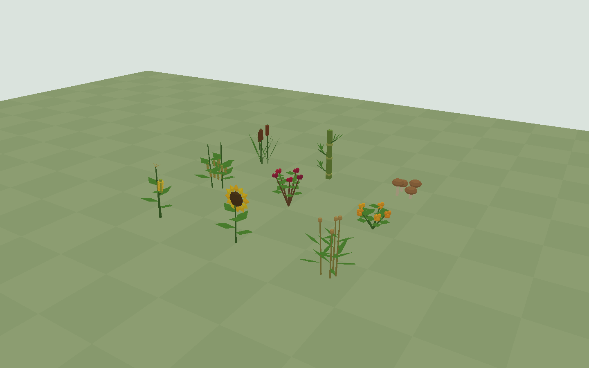
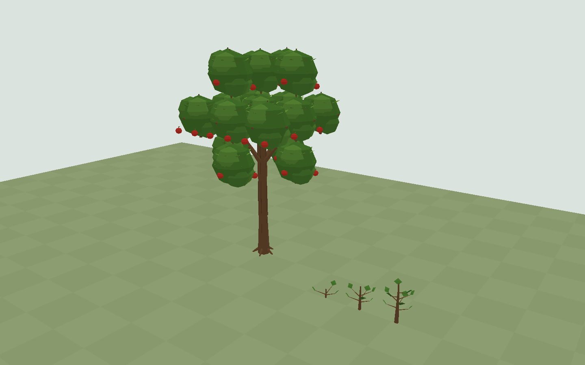
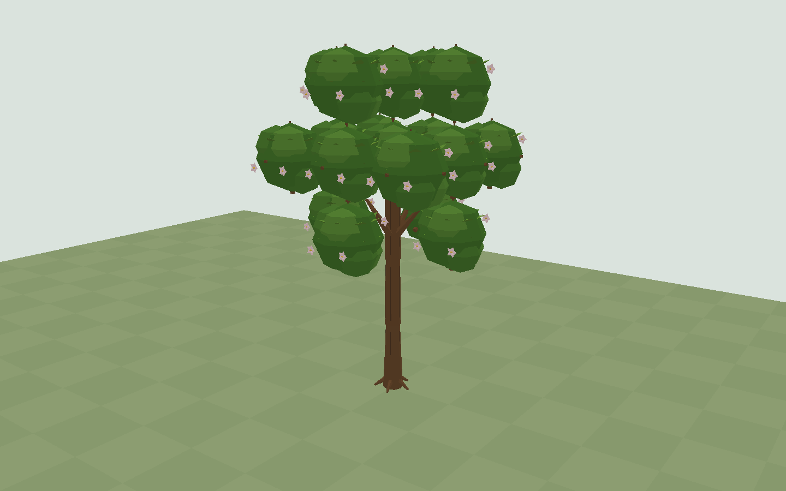
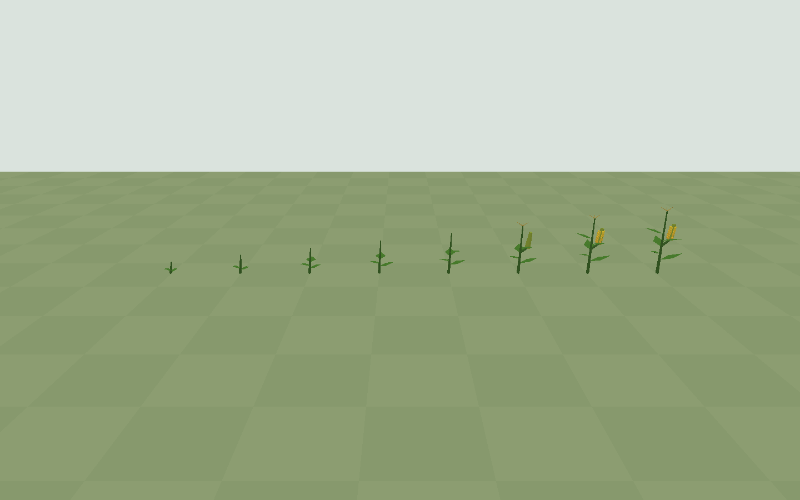
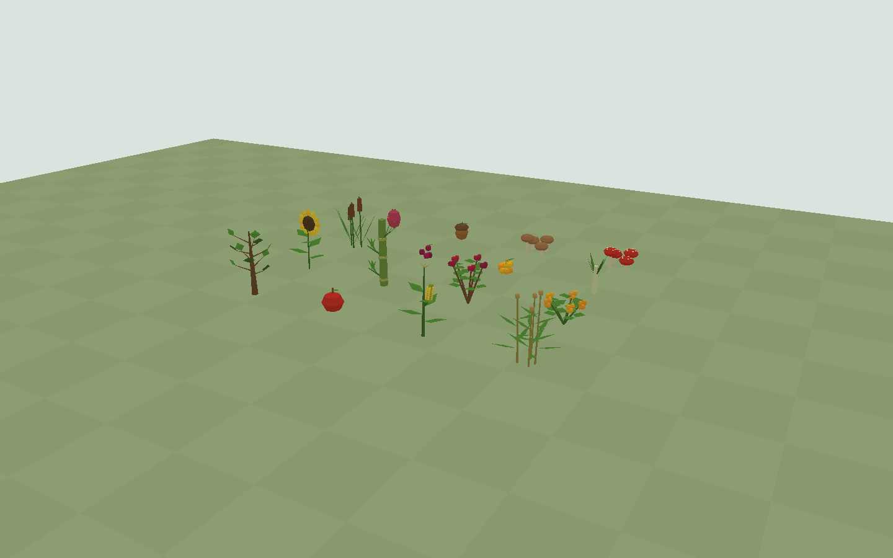

# 植物模型设计与预览

2026-11-16，荒野探险家0.89.0。编辑源为 `src/SCIEPort/Features/Plants/PlantGeometry.cs`，没有外部模型或新素材依赖。场景复现源为 `tests/SCIEPort.Plants.NativeTests/PlantGpuProbe.cs`，入口 `scripts/Test-PlantsGpu.ps1`。指纹与版本记录在 [validation.json](validation.json)。

以下图片由本机固定目标Engine/OpenGL渲染真实网格。`native-items` 进一步调用16种实际Block.Initialize/DrawBlock，验证模型加载、纹理与原生绘制路径。网格测试、线程和实际内存地形测试见 [规则与验收](../../docs/PLANTS-0.89.0.md)。这些不是完整游戏/Android截图，手机视觉、触控、联机与密集果园帧率待验证。预览与设计文件不会打入netmod。

## 作物

从前到后为玉米/向日葵/亚麻，大豆/野莓/云莓，香蒲/竹/蘑菇。

## 苹果树与幼苗

## 玉米阶段与原生物品绘制

