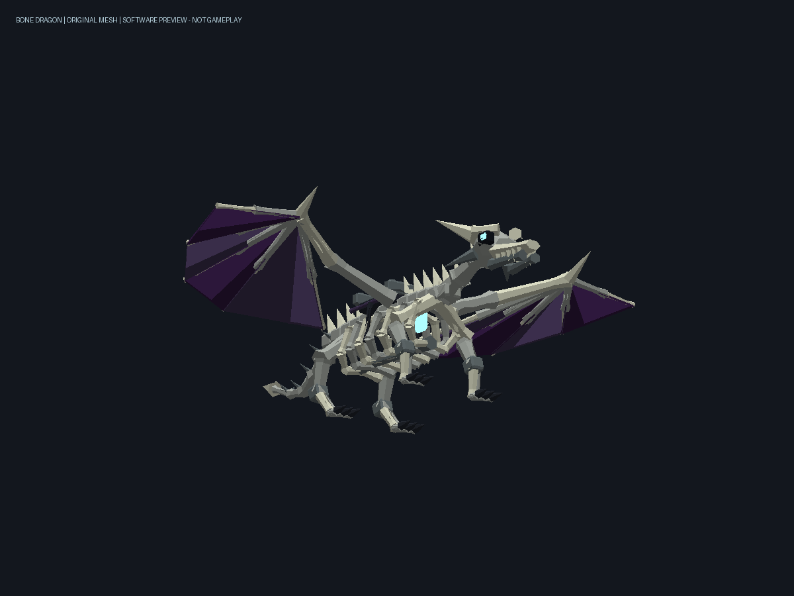

# 死亡权柄唯一召唤物：骨龙 / 0.67.0候选

2026-11-01，基于main `942b614` / 0.66.0，开始时工作区干净。回退点`backup/abyss-0.66.0-before-bone-dragon`，旧0.66.0包保留。用户确认本版基础数值；延续用户亲自测试的安排，只执行Release和只读资源/ABI检查，未启动游戏、Android、GPU或真实联机会话。

## 召唤与唯一性

死亡权柄 → 冥界军势 → 顶部类型按钮切换到「骨龙 · 可飞行（唯一）」→ 召唤。需要附近有容纳大体型的已加载安全空地。它和已有生物共用30秒新召唤冷却、每人七只/世界24只名额。

每位主人最多一条：现世、次位面、待加载记录一起参与检查，收纳不能绕过唯一性。召唤、转化认领、恢复契约和读档都检查；解除或死亡后才能重新召唤。列表支持单只召出/收回、全部管理、召回友军及解除契约；有乘客时禁止移除。旧猎犬、战马、刻尔柏洛斯保持。

| 参数 | 本版值 |
|---|---|
| 生命基准 | 444 |
| 单次近战基础伤害 | 37，保留原生护甲/韧性结算 |
| 攻击间隔 / 距离 | 1秒 / 4格 |
| 地面 / 飞行速度参数 | 7 / 16 |
| 附加主动技能 | 无 |

复用跟随、保护主人、主机寻敌、64格/20秒逃敌追击保留、玩家/友军/承载体/领地保护；近战37不叠加原专属生物×2倍率，模型不执行伤害。现世不自然回血，次位面每2秒恢复1点游戏生命，死亡蔓延加97并封顶，沿用0.66的存档余数及单只管理。

## 骑乘与飞行

靠近侧面、面向身体，用原生骑乘按钮上马。背部低鞍位于双翼根之间：MountOffset=`0,2.1,0.16`；人物原生男性根偏移Y=-0.71，根位置约1.39，腰部落在约2格高的鞍上。DismountOffset=`1.8,0.3,0.16`，沿用原生安全侧向下马。复用0.66的原生骑姿腿部加宽，身体/手臂/衣物保持原生链路，不隐藏人物。坐骑和骑手落地耐受最低12，未提供高空下马免死。

骑上自己的骨龙后，查看控件左侧显示原生文字控制按钮，支持左右手布局和控件避让，无新增技能图标：

- **起飞**：向主机请求切换飞行模式，短暂自动抬升；方向摇杆控制前后飞行和转向。
- **上升 / 下降**：按住改变高度，松开后悬停；原生跳跃输入也可上升。
- **降落**：保持受控向下飞行，接地后回到原生地面移动，避免空中直接关闭飞行造成自由落体。
- **自动追击**：沿用0.66开关，默认关闭；开启后主机选目标并发送移动计划，移动、跳跃、升降操作优先，停止输入约0.85秒后恢复。未开启飞行时，骑乘自动追击保持地面移动；开启飞行后可空中追击。打开对话框/面板停止手动水平飞行，飞行模式中保持悬停，降落模式仍缓慢下降。

原生`FlyOrder`是世界向量，`FlySpeed>0`时原生移动会关闭该帧重力并趋近目标速度。自定义Locomotion在原生Locomotion更新阶段生成命令，不依赖创造飞行、不改玩家飞行权限。最高限制约Y246、下探已加载区域，原生实体物理继续处理碰撞；实际极端速度/区块边缘/狭窄地形仍需实机确认。未骑乘时复用原生Pilot的飞行寻路和落地逻辑。

## 原创模型及视觉边界

独立原创长吻龙颅、双角、开放肋骨、分节脊柱/骨尾、四只爪足、双翼骨架、凹陷暗紫翼膜、魂火眼与胸腔核心及低鞍。没有复制/放大原版狼、犀牛或其他生物网格；只继承已安装Rhino模板的组件参数和声音引用，不分发游戏资源。

七根刚性骨骼：Body、WingL、WingR、Leg1–4；头、颈、骨尾固定于Body，四足独立摆动，双翼独立收展/振翅。7网格、7674三角形、512×256不透明PNG原创UV图集；无无限粒子、动态光照或新Shader。模型加载和包构建均守卫七矩阵原生上限。源码、SHA及相同网格生成的软件预览在`design/bone-dragon/`。

碰撞体是躯干周围的2.1×2.7×5.8原生单AABB，骨翼和尾端有装饰性外伸。**外伸翼/尾不各自参与碰撞**：若把8格展翼全包进同一碰撞体，人物无法在原生上马搜索距离内靠近中央鞍位。这里沿用生物核心碰撞体方案，翼尖在墙边可能穿入装饰，必须实机评估；不宣称复合骨骼碰撞已实现。地面收翼高度和骑手/衣物融合也未获得Android画面证据。

## 网络、保存与生命周期

目标/伤害/契约/飞行模式由主机管理。SCNET原生骑乘实体的移动物理由实际骑手客户端承担；本地上升/下降只改变本人的移动输入，不允许客户端提交伤害。主机0.25秒的自动计划沿用0.66来源/世界/期限/修订校验和1秒失效停驻；手动输入通知沿用Action12。

252布局/包ID不变：Kind3 Flags128标识骨龙，既有空闲C=0/1同步飞行模式；Action15在既有Target携带契约键请求起飞/降落，主机复核连接、序列、主人和实际骑手并限流。v1/v2契约继续读、v2写，新增可选DragonFlight（旧值false），模板名固定`SCIEPortBoneDragon_Saddled`、GUID`d1a4db02-ea81-5a9b-9d6f-412bea048fb1`。`_Saddled`使原生Steed行为自然启用，无反射插入组件。247/249/250/251和星门存档保持，无新方块/生成蛋/物品ID。

卸装/切换权柄保留契约，收纳保留实体快照与健康元数据；下马/主人离线时关闭骑乘飞行模式，原生Pilot负责无骑手落地，退出释放HUD及自有属性。骑乘时隐藏不可用的阿比斯技能区，给飞行控件留位置；修复0.66骑乘HUD向带状态布局传null标签导致空引用的问题，改用无状态布局。升降按压读取实际原生Clickable子控件。

同房主机与所有客户端必须统一0.67.0；旧版缺少骨龙模板/组件，混装不支持。含新骨龙的世界降级时应恢复对应旧版世界备份。

## 只读检查和待验收

`Read-BoneDragonResources.ps1`只读解码本机内容、合并新XDB、调用目标Engine.ModelData.Load和读取类型元数据，不创建实体/GPU。确认7骨/7网格、7674三角、32字节原生顶点、正确类/贴图/座位/444/7/16；报告`native-import.json`保留游戏/引擎SHA。资源导入不等于真实游戏显示。

**全部待用户实测**：新召唤/旧档恢复、隐藏不能重召、删除后重召、触屏升降/松手悬停/地面与空中骑乘、平滑降落、第一/第三人称人物与衣物、翼尖穿墙边界、房主/普通客户端移动和主机一次伤害、手动优先、回血与单只管理、死亡/断线/退出无残留。按用户安排，本版没有运行游戏或行为测试，不把候选包标为Android兼容已确认。
