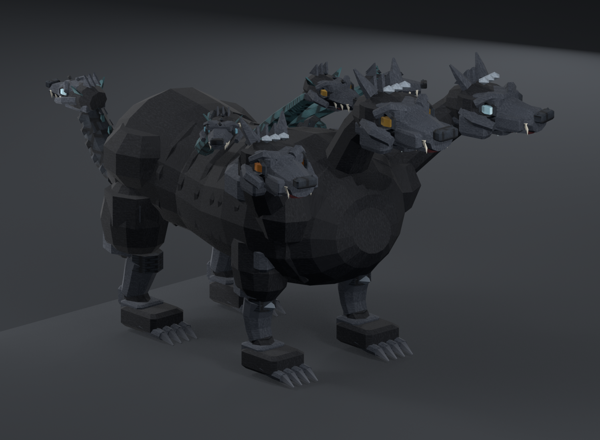

# 地狱三头犬·刻尔柏洛斯 / 冥府守门重构 / 0.84.0

0.84.0把7骨低模替换为24骨完整多头骨架：三套独立颈/头/颌、蛇鬃、分段蛇尾与尾首、胸腔呼吸，十态动画、6.5秒登场、三头连击、尾击与低血狂暴。沿用唯一契约坐骑、军势面板、骑乘/自动追击和252网络包。资产、代码和文档统一在荒野探险家包内，不新增独立Mod或版本分支。

## 古典依据与现代扩展

原典特征：三颗犬头（伪阿波罗多洛斯《书库》）、蛇尾与背部蛇头、青铜般嗓音与蛇鬃（维吉尔《埃涅阿斯纪》第六卷）、冥界毒涎与白沫（奥维德《变形记》第七卷）、巨大蛮力与食生肉。赫西俄德《神谱》的五十头是另一传统，本模型不采用。

现代扩展：暗金/青白/琥珀三色眼芒、半透明毒涎、受击尘土与咆哮屏震。未加入熔岩皮肤、火焰鬃毛或恶魔角；毛皮保持黑曜石冷色，身体正常受光，不整体发光或染紫。

## 外形与体型

- 三头：中央头最大且最高，目光暗金；左头略低、口吻较长、眼青白；右头颈部更粗、咬肌更重、眼深琥珀。三颈分别连接胸腔，无共用下颌。
- 蛇鬃：中央主蛇头可开颌，左右蛇身沿颈根生长；另有背部蛇群，警戒时竖起。
- 蛇尾：TailA–C 三段连续链，根粗端细，尾端 TailHead/TailJaw 独立张口。
- 体态：宽胸、隆起肩背、收紧腹部、巨爪厚垫；四足关节为刚性分件，膝/跗折角在静态网格中体现。
- 包围尺寸（资产实测）3.43宽 × 3.16高 × 5.67长格，与三头展开/站高/全长目标一致；碰撞体按 `2.2×2.8×4.6` 收紧，避免卡门。
- 配色：黑曜石毛皮、石墨灰过渡、冷银高光；蛇鳞深灰黑带暗青反光，蛇腹骨灰；口腔深红黑、獠牙骨白、舌暗紫、毒涎半透明。

## 24骨骨架

`Body` 为根；`Chest`；`NeckC/L/R` → `Head`/`HeadL`/`HeadR` → `Jaw`/`JawL`/`JawR`；`Leg1`–`Leg4`；`TailA` → `TailB` → `TailC` → `TailHead` → `TailJaw`；`SnakeC` → `SnakeJaw`，加 `SnakeL`、`SnakeR`。

SCNET模型为刚性分件：每个mesh绑定一根骨骼，顶点固定 POSITION/NORMAL/TEXCOORD，32字节步长，无权重与剪辑导入。`ComponentCerberusModel` 逐帧写入相对枢轴的旋转/缩放，平移保留；`Body` 的父级变换由引擎组合，子骨继承。动态头部、蛇群和尾链因此不依赖额外Shader或骨骼权重。

## 十态动画

| 状态 | 主要表现 |
| --- | --- |
| Idle | 胸腔慢呼吸、三头错峰扫描、尾链延迟轻摆、蛇身微伏 |
| Alert | 蛇群先竖起，三头逐个抬高并前倾 |
| Walk | 原生四足步态之上叠加肩背配重与头部点头，避免滑步感 |
| Run | 身体前倾、颈头收拢、尾部拉直 |
| Roar | 三头错峰（0/0.55/1.15秒）张口后仰，胸腔扩张，蛇群全竖 |
| Bite | 左→右→中三头依次前扑咬合，与命中层一致 |
| TailAttack | 尾链横扫、尾首张口，0.45秒命中点 |
| Hit | 局部后坐+头部偏转，短促不打断步态 |
| Stagger | 前肢弯曲、躯干下沉侧倾，随后恢复 |
| Death | 三层倒下：前腿屈曲、躯干侧倾、颈部垂落，最终静止 |

模型组件关闭原生 `AttackOrder` 冲撞命中，伤害只由主机在咬合时刻结算。死亡与四足步态仍走 `ComponentFourLeggedModel.Animate`，自定义层只在其后叠加，避免覆盖原生死亡姿态。

## 登场（6.5秒，可跳过）

1. 0–2.5秒：主人屏幕渐暗、三对眼芒由暗转亮、低吼与呼吸，蛇群开始抬头。
2. 2.5–4.2秒：前爪重踏、尘土扬起、局部屏震，躯干与尾部轮廓显现。
3. 4.2–5.6秒：左头0秒、右头0.55秒、中央头1.15秒错峰三重咆哮，每次咆哮造成一次局部震屏。
4. 5.6–6.5秒：蛇群转警戒，三头锁定，前身压低进入战斗。

主机在 `IntroDuration` 内冻结该兽AI（停止寻路、转向与水平速度），不禁止受伤。主人界面显示全屏暗幕和“跳过”按钮；点击发送 Action 19，主机立即结束冻结并向所有客户端广播 Kind 13 Action 2，因此不会出现单端继续播放或战斗状态不同步。非主人不显示按钮，也不能跳过。

## 战斗

- **三首噬魂**：1.6秒周期，三段命中 0.24/0.52/0.80秒，每段18基础伤害，逐段重新校验存活、敌对、距离、遮挡与权限；任一段目标失效则该段落空，后续段仍可命中新位置。不是一次43点或三倍伤害。
- **蛇尾横扫**：目标在侧后方，或3.2格内出现至少2个敌人时触发；6秒冷却，0.45秒命中，最多6个敌对目标各受30伤害，范围以水平距离3.2、垂直2.6为界。
- **冥府怒吼**：首次进入战斗触发一次，随后生命降至50%和35%各触发一次，8秒最小间隔；只做演出，不结算伤害。
- **狂暴**：生命 ≤35% 时呼吸加快、头颈动作更凶、蛇群更活跃、毒涎加长、眼芒增强；没有全身变红、着火或伤害倍率。
- 所有原生 `ComponentMiner.AttackBody` 调用保留护甲/韧性与伤害Hook，实际扣血可能低于基础值；友军、领地与原生保护规则不变。

## 网络与存档

252包布局不变。新增：

| Kind | 用途 | 字段 |
| --- | --- | --- |
| 8 | 咬合演出 | A=经过秒数 |
| 11 | 尾击演出 | A=经过秒数 |
| 12 | 咆哮演出 | A=经过秒数 |
| 13 | 登场/狂暴 | Action 1开始 / 2跳过 / 3狂暴，A=状态或年龄 |
| 0 + Action 19 | 主人请求跳过登场 | 仅请求，由主机执行 |

客户端只接受来自当前服务器/世界、归属当前契约、时间与递增修订有效的演出包；只播放，不结算伤害。重连快照会补发进行中的咬合、尾击、咆哮、登场与狂暴状态。契约v1/v2读取、写v2；新增可选冷却/生命字段保持兼容，未知或损坏契约继续保留。

## 渲染容量与Android边界

原生 `ModLoader.GetMaxInstancesCount()` 默认7，`SubsystemModelsRenderer.Load` 取所有已注册加载器最大值，传给 `ModelShader` 的 `MAX_INSTANCES_COUNT` 与 `ShaderTransforms`。本加载器注册 `GetMaxInstancesCount` 并返回24；只重写不注册仍会保持7并在绘制24骨模型时抛 `Invalid instances count.`。

`Model.vsh` 实际只有 `u_worldMatrix[24]` 与 `u_worldViewProjectionMatrix[24]` 两个mat4数组，24骨约204个顶点uniform向量，处于GLES3最低256以内；GLES2最低128不足，且着色器用动态整数索引，本就依赖GLES3级能力。低端Android驱动、真实GPU编译与帧率**待验证**；若实测失败，回退方案是把模型降到7骨并合并颈/颌/蛇群，而不是伪造已完成的多头动画。

顶点合并上限为ushort索引65535。0.84.0资产24网格合计53,490个导出顶点、17,830三角形，低于19,000硬预算；单模型合并后仍须在打包时复检。

## 资产与Blender管线

- `scripts/New-CerberusBlender.py`：Blender 5.1.1后台建模、分层材质、16色板UV、多视角渲染、严格SCNET Collada导出、闭合/流形/体积校验与manifest。
- `src/SCIEPort/Assets/Models/AbyssCerberus.dae`：Y_UP、LF、Collada 1.4.1、24节点24网格，4,722,277字节，SHA256 `2F62D2B4E6FB4276AE41A7D9C42283FA68C0CC107AF95ECCBE6C214D691B6BAB`。
- `src/SCIEPort/Assets/Textures/AbyssCerberus.png`：1024×512 RGB不透明，16个256×128色板分区，562,945字节，SHA256 `B4F2F3BABD4ECAA8A8C0FFBE2A13664D28CEC5781BE3509BEC15813D926941DE`。
- 最终修形：悬浮肋板改为贴合躯干壁的浅肋纹并删除臀后尾根鳍片；TailA根部下移至臀部后先下探再上翘；SnakeC舌仅留口腔内；胸板前突收窄融入胸腔；后腿加大腿肌、膝前折/跗后折且脚掌贴地；背部小蛇补颈根嵌入。低面数下肋纹仍有轻微硬边。
- `design/cerberus/AbyssCerberus.blend`：可编辑源工程；`blender-*.png` 六视角；`validation/` 几何/DAE/构图/动效报告。
- `design/cerberus/manifest.json`：骨骼父子、枢轴、网格、三角面、UV、贴图与SHA。

模型为原创几何，未读取或复制游戏狼/犀牛网格；声音只引用已安装游戏的 `Audio/Creatures/WolfBark` 与 `WolfGrowl`。

## 构建与验证状态

已完成：net472 Release编译（24骨/24网格/17,830三角/32字节顶点布局）、原生 `ModelData` 导入与UV[0,1]校验、加载器容量读取24、模板BoxSize/Mount/Steed/无蛋索引静态解析、`荒野探险家-0.84.0.netmod` 打包与SHA校验（13,676,964字节，SHA256 `A48CAF5E0D72A9B1B5B3C0B11B3B7BAAAC42221B644A6BE147A071BFBC00165E`，包内DAE/PNG与源一致）。`design/cerberus/render-compatibility.json` 记录24骨/24网格/17,830三角与 `fits_native_shader: true`。

**未验证**：Android 7723真机帧率与GLES驱动、真实双端联机下的登场冻结/跳过/三段命中/尾击/狂暴同步、骑姿与新背高的贴合、高低分辨率下暗幕与“跳过”按钮可达性。未完成这些实测前不得标记“兼容”。

## 历史

0.65.1 为解决9骨超过原生7骨上限导致的绘制中断，合并为7骨（三头共用Head、三颌共用Jaw）；0.66.0 增加骑乘/自动追击。0.84.0 保留模板GUID、资源路径、契约与网络布局，升级后旧契约直接使用新模型。详见[骑乘规则](ABYSS-RIDING-0.66.md)与 `TEST-RESULTS.md`。
