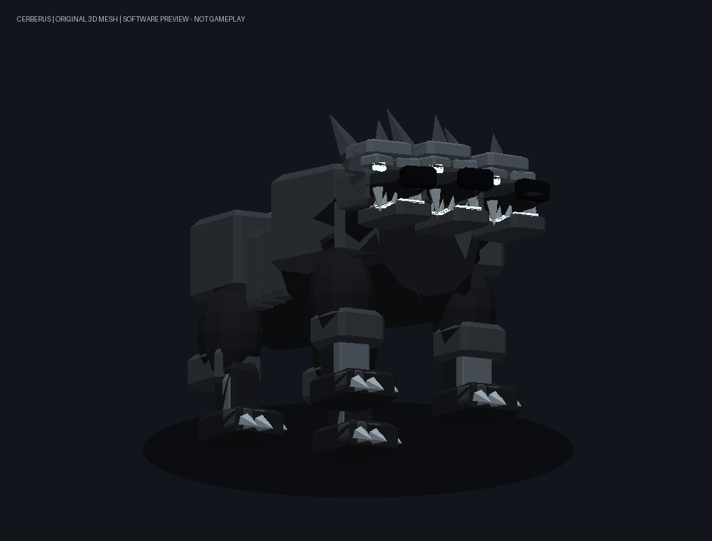

# 地狱三头犬·刻尔柏洛斯 / 第一阶段 / 0.65.2

基于本地main `d412283`（军势面板修复）；开发前fetch确认origin/main没有更新，本地该修复保留。回退点 `backup/abyss-0.64.1-before-cerberus`，旧0.64.1包保留。仅本地提交，不自动推送。

0.65.2更新：37基础伤害、1秒攻击间隔、移速参数7；军势生命列和旧契约更新规则见[军势0.65.2](ABYSS-ARMY-0.65.2.md)。

## 0.65.1：召唤成功却不可见的修复

用户确认0.65.0面板有契约记录并提示成功，但大世界看不到三头犬，随后补充多只猎犬只显示一头。目标原生`ModLoader.GetMaxInstancesCount()`默认返回7，本工程继承该值；旧模型实际导入9骨骼。原生`SubsystemModelsRenderer.DrawInstancedModels`逐实体设置`ModelShader.InstancesCount`，9超过7时抛出`Invalid instances count.`，能够中断同一模型批次的后续生物绘制。这也能解释猎犬受影响，但猎犬症状是否完全由此引起仍待用户实测确认。

0.65.1将三副同步下颚合并到一个Jaw骨骼，三头共用Head，四条腿保留独立骨骼，总数降至7。原始形状、尺寸、贴图、三头同步咬合和6,628三角形保持。三副下颚原本具有相同Y/Z转轴，绕X旋转可共用一个转轴而保持原动作。模型组件加载时拒绝超过七骨骼的资源，让资源不匹配在创建阶段失败，避免显示“召唤成功”后再破坏绘制。

`Read-CerberusRenderCompatibility.ps1`用目标Engine实际导入，并读取本Mod继承的原生上限，检查非空网格、骨骼索引和原生32字节顶点布局；资源变更打包时自动执行。对照旧包9/7不满足，新包7/7满足，记录见`design/cerberus/render-compatibility.json`。这是只读资源/ABI检查，不是游戏、GPU、Android或联机验收。

回退点`backup/abyss-0.65.0-before-render-fix`和旧包保留。模板名/GUID、资源路径、实体身份、契约v1/v2及网络布局保持；已经召唤或存入次位面的实体重新加载时使用新模型，无需删除契约。安装0.65.1后重新进入世界；联机各方一起更新。若猎犬仍缺失，需继续区分现世、次位面和待加载记录，不把本次资源修复当作多实体实测通过。

## 使用和唯一性

死亡权柄 → 左侧「冥界军势」 → 点击顶部召唤类型，依次在冥界猎犬、夜魇战马、**地狱三头犬·刻尔柏洛斯**之间切换 → 点击召唤。

唯一性按**每位主人最多一头**实现。现世、次位面、待加载的契约均占用唯一名额，隐藏不能再召一头。主机在召唤、转化/认领、恢复契约及读档时校验；解除或死亡后可重新召唤。它与其他契约共用每人七只/世界24只预算，保留原有猎犬和战马。召唤按钮仍共用30秒召唤冷却；这与兽自身1秒攻击冷却不同。

支持原有跟随、保护主人、自动寻敌、召回、解除、次位面及世界保存。主人切换权柄或卸下镰刀后继续存在；离线/死亡时停止进攻并停驻，恢复后继续跟随。敌对筛选与领地/玩家/友军/玩家承载体保护复用原契约系统。解除直接消失，不恢复野生。

## 原创模型

- 原创身体、三条颈根、三颗犬首、骨甲、利齿、角、四肢与重爪；不是放大或复制原版狼/犀牛。`New-CerberusAssets.py`从原创轮廓和几何体生成，未读取游戏模型。
- 视觉包围尺寸：长3.6、宽1.8、高2.5格。黑灰骨甲、冷白嘴部魂火/眼睛及少量暗紫裂纹；身体保持正常受光，不整体染紫。魂火用固定9个全亮三角形表现，无无限粒子、动态光照或高级Shader依赖。
- Y_UP、7个刚性骨骼、7个网格、6,628三角形、512×256原创不透明UV贴图。三头共用Head骨骼，强制相对身体不转动；三副下颚共用Jaw骨骼同相开合，四条腿复用目标原生四足行走动画。身体碰撞体1.8×2.5×3.6。
- 只继承原生Rhino实体的**组件参数结构**，覆盖为原创DAE/PNG和自定义模型组件。无犀牛网格/贴图拷贝；声音只引用已安装游戏的WolfBark/WolfGrowl名称。无新方块、生成蛋或物品ID，EggTypeIndex=-1，避免复用犀牛蛋索引。
- 生命韧性300、质量1800保持，模板步速升为7；契约绑定时校正原生随机加载因子，使本功能的基础WalkSpeed参数为7。

模型、UV来源和SHA见 `design/cerberus/manifest.json`；原生模型导入/模板静态解析记录见 `native-import.json`。同目录的front/side/rear图片及walk/bite GIF直接使用原创网格生成，均为**软件模型预览，非游戏或Android画面**；GIF只循环动作，不表达真实冷却/AI。

## 唯一战斗技能：三首噬魂

三首同时张口、同时闭合。基础攻击力37、单目标、攻击距离3格、冷却1秒；距离以自身碰撞中心到目标碰撞体最近点计，避免大型敌人的身体中心在接触时仍超距。0.24秒咬合点执行一次原生AttackBody，保留原生护甲/韧性与伤害Hook，因此有护甲目标的实际扣血可能低于37。

没有三次37点伤害，没有每头独立命中，没有原有专属生物×2倍率。刻尔柏洛斯分支直接绕过原每秒军势普攻；模型组件关闭原四足冲撞命中时刻，不通过绘制回调造成伤害。不设计其他主动攻击或被动伤害技能。

主机锁定一个目标，开始1秒冷却；咬合时重新检查存活、敌对、距离、地形遮挡和权限，先消费待命中记录再调用伤害。目标离开范围/失效则本次落空，过期咬合不迟到补伤害。收纳/存档保留未结束的攻击冷却，恢复后继续等待，防止通过隐藏或重载绕过1秒。旧v2的0–4秒剩余值读取后截到新上限1秒。

## 网络和保存

伤害、寻路/实体状态与唯一性由Local/Server主机处理。252保留原字节布局，新增Kind8只同步咬合演出，友军Flags新增16标识刻尔柏洛斯；客户端校验来自当前服务器、世界、契约归属、时间和递增修订，只播放动作，不结算伤害。重连快照补发仍在进行的咬合演出。

旧249大招、250星门及其他神器协议和数据不变。军势仍读取v1/v2、写v2；刻尔柏洛斯行的可选BiteCooldown缺省为0，0.65.2新增可选HealthFraction/HealthMaximum供面板显示，原有模板/主人/实体指纹与稳定契约键保持。新模板有独立确定性GUID，不修改原版Rhino/Wolf模板。未知或损坏契约仍按原规则保留。

**房间各方须统一0.65.2**。0.65.0存在骨骼超限问题，0.65.1使用旧数值且没有新生命同步语义，更旧的包没有新模板/模型。含刻尔柏洛斯的世界不应直接降级旧包，须恢复升级前的世界备份；仅保留旧netmod不能替代世界备份。

## 第二阶段：骑乘待开发

本版没有Mount/Steed组件，**刻尔柏洛斯目前不可骑乘**。后续独立完成骑手落座/尺寸/姿态、上马/下马、坐骑控制及与护卫AI的切换。原夜魇战马继续可骑乘。

## 构建与验收状态

沿用用户“我亲自测试”的要求，本轮不运行自动化行为套件、GPU或游戏。已完成原生Engine静态DAE导入（7骨/7网格及其平移）、原生渲染骨骼上限和顶点布局检查、实际数据库合并/模板解析（正确模型类、BoxSize、无Mount、无蛋索引）及net472 Release编译/打包；这不是伤害、AI、联机或真机验证。

用户验收重点：切换三种召唤、唯一性在现世/隐藏/保存重开后保持；四足行走与三首同步咬合；单目标37基础伤害与1秒间隔、不叠加旧普攻；保护玩家/友军/领地；召回、解除、死亡、断线和次位面恢复；Android大模型的接地、遮挡、魂火及帧率。完整命令、包哈希见TEST-RESULTS.md。
