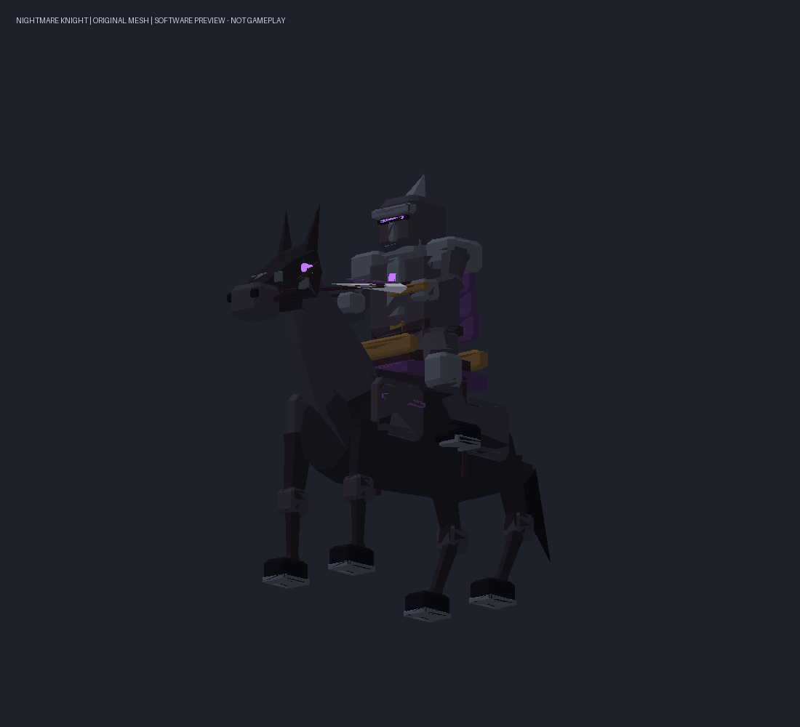

# 夜魇骑士 / 0.71.0

当前0.72.0已移除本文初版的指定类型入口及30秒召唤冷却；骑士改为15%随机召唤，成功/失败均进入60秒冷却，详见[随机召唤规则](ABYSS-RANDOM-SUMMON.md)。以下保留0.71.0开发及模型证据。

2026-11-02，基于 main `da6f715` / 0.70.1。用户已确认持续贴身砍杀的常规骑兵设计。只提交本地 main，不推送 GitHub。以下区分代码实现、离线证据与待设备验收，不把软件预览当成游戏画面。

## 使用与定位

手持终焉之镰 → 死亡权柄 → 冥界军势 → 顶部类型切换到「夜魇骑士」→「召唤」。类型选择新增第5种（内部kind4），只显示名字，无数值、唯一性或机制提示。沿用30秒新召唤冷却和每人7只/世界24只上限；常规单位可重复召唤，不参与三头犬、骨龙的唯一性限制。

| 参数 | 本版值 |
|---|---|
| 共享生命基准 | 70 |
| 剑击基础伤害 | 15，保留原生护甲/韧性结算 |
| 攻击间隔 | 1.2秒，从挥剑开始计时 |
| 普通/冲锋移动参数 | 8 / 10 |
| 开始冲锋距离 | 8～16格 |
| 近战停止/命中距离 | 脚底位置距2.2 / 2.65格，命中高差不超过1.5格 |
| 挥剑命中时刻 | 开始后0.22秒，下劈阶段 |

冲锋负责接敌，靠近后减速并连续挥剑，不主动后撤绕圈。没有额外撞击伤害，也不把专属生物的×2倍率应用到15基础伤害。每次挥剑只有一个待命中目标；命中前再次检查目标归属、存活、距离、朝向、领地与地形/移动方块遮挡。目标离开、玩家/友军保护、切换自由行动、死亡、主人不可用或帧伤害预算耗尽时不会补发失效伤害；命中记录在调用原生AttackBody前消费，防止重复结算。

骑士和战马是**一个完整NPC实体**：共同生命、一个契约和一个名额，统一死亡、收纳、现身和解除。战马由模型中的骑士使用，没有额外的原生玩家Mount、Rider或Steed实体，不会留下游离战马、占用第二个名额或让现有“有乘客禁止收纳”规则误判。未实现下马步战或拆分成两个可独立受伤的单位。

## 既有军势机制

护卫、自由行动、攻击模式全部沿用0.70：护卫跟随并攻击敌对目标，自由行动安全漫游且不自动归队/攻击，攻击模式纳入中立生物；玩家、全部契约友军、玩家承载体及保护领地继续排除。全部/单只收回、召出、召回与解除沿用同一管理链。现世限制自然净回血，次位面每2秒恢复1点游戏生命，死亡蔓延恢复97点并封顶。

近身保持停步和水平刹车，取消冲锋自有增量；没有向外让路目标、朝玩家冲撞或新增跌落免伤。冲锋加速只附加自有+2，重复更新不累乘；停止、切换模式、收纳、死亡、归队和世界退出均归还。客户端使用同一自有增量规则恢复远端姿态/参数，不覆盖其它功能的额外速度。

## 冲锋安全与预算

目标处于8～16格、垂直高差≤0.5、方向点积≥0.995（约5.7度）、脚下站稳、浸水比例≤0.2且未卡住时才考虑加速。方向/距离/站立/水中条件每帧复核；每0.25秒重新验证移动计划和前方3格支撑走廊。走廊覆盖整个身体占地并额外向两侧扩0.4格，每0.5格采样，要求同高完整稳定地板、身体净空为空气、已加载且非领地；另验证至目标的直线遮挡。不是朝目标直接写Position或Velocity。

走廊与自由漫游共享每帧4096格检查预算，单次最多1024次检查，军势处理顺序轮转；预算不足或路线不适合时保持普通寻路速度。仍共用每帧128目标候选/24次伤害预算，沿用24格新目标、64格/20秒追击租期和原有卡住/远离归队限制。复杂斜坡/台阶可能不触发冲锋，原生战斗寻路、外力和物理碰撞仍需要真机验证。

## 原创模型与动画

独立原创战马躯干、颈部/长口鼻/耳/鬃尾、轻甲/缰绳/鞍具/马镫，配跨坐黑铁铠甲骑士、封闭头盔和暗紫魂火、右手长剑。未复制游戏马、人物皮肤、武器或第三方模型。生成器及素材来源见 `scripts/New-NightmareKnightAssets.py`、`New-NightmareKnightTemplate.py` 和 `design/nightmare-knight/manifest.json`，可随Mod分发。

七骨/七网格/4924三角：Body、Leg1～4、Rider、SwordArm。四足独立步态，骑士随冲锋前倾、轻微随步幅起伏，挥剑独立下劈；模型Update抑制原生AttackOrder/IsAttackHitMoment，不生成伤害。纹理为256×256完全不透明原创材质图集，无粒子、动态光照、新Shader或额外技能图标。

原生Body为1.8×3.65×3.8的单AABB。目标Engine实际导入的静态模型和软件动画采样均在该范围内；没有声称精确马腿/剑刃逐部件碰撞。脚底、骑姿、缰绳、持剑、转向和地形接触的游戏视觉还需Android验收。

[冲锋与挥剑软件动画](../design/nightmare-knight/charge-and-sword.gif)。软件预览使用同一份生成网格，不能证明实际游戏渲染、碰撞或网络时序。

## 模板、网络及存档

模板 `SCIEPortNightmareKnight`，GUID `740568e9-bb43-529c-9495-bc4da4e2ca98`；模型/贴图 `Models/AbyssNightmareKnight`、`Textures/AbyssNightmareKnight`。仅继承安装端Rhino的原生组件默认值，马音引用已核实的`Audio/Creatures/Horse`，不分发游戏模型、数据库或声音。生成蛋索引-1且隐藏，不新增方块/物品/蛋ID，无创造栏或神器背景条目变化。

252包ID及读写字节布局保持，扩展既有字段语义：

- Kind3 C：原0/1骨龙飞行语义保持；非骨龙C=2表示骑士、C=3表示冲锋骑士，其它旧召唤仍为0。D继续只表示护卫/自由/攻击0/1/2。拒绝NaN、无穷、小数及未知组合。
- Kind10：主机广播的挥剑演出，Caster是实体、Target是契约键、Owner是主人、A为动作年龄。沿用来源服务器、连接Token、世界和修订校验；还核对当前契约、实体和主人，动作过期不重播，重复/旧修订不重启。客户端只表现，不生成伤害。
- Summon Action4沿用既有Target字段取kind4，不增加请求动作。新单位仍由主机创建/维护/攻击，既有所有权与请求限流保持。

契约继续读v1/v2、写v2；模板识别骑士，新增可选`KnightCooldown`保存0～1.2秒的剩余攻击间隔，缺省0。次位面、待加载和现身/重绑定恢复该值；不保存短暂冲锋及未命中的剑击，避免重进后补伤害。未知/非法元数据保留原数据，不静默覆盖。Mode、生命、治疗余数、星门及原247/249/250/251保持。

各方需统一0.71.0，旧版缺模板/模型类和新演出语义，混装 **不支持**。含骑士的世界降级应使用引入骑士前的备份，不要直接移除新模板后读取。

## 已有证据与待验收

环境固定Windows Net_x25.01.17/net472，三个程序集SHA-256见 [军势模式说明](ABYSS-ARMY-MODES.md#验证状态)。`Test-NightmareKnightResources.ps1`只读导入实际Engine网格、编译合并模板、核查骨骼/网格/顶点格式、尺寸、纹理、无玩家坐骑/生成蛋及模型类ABI，并对最终包逐字节核验；不启动实体、GPU或游戏。`native-import.json`保留精确游戏/引擎SHA与模板身份，构建与原生夹具结果见 [测试记录](TEST-RESULTS.md)。

Android7723、实际单人/房主/普通客户端全部 **待验证**。设备验收使用可丢弃新世界与备份：五种召唤选择、重复召唤和七只名额；骑姿/马腿/剑击和同步前倾；冲锋接敌后连续近战、1.2秒/15基础伤害、保护玩家友军、靠近停步、山地与狭窄路；三种模式、单只/批量次位面和共享生命、治疗、保存重进/区块重载；普通客户端请求由主机创建、观察者演出与一次伤害；死亡/离线/解除无游离实体或速度残留；不同分辨率触屏可达且不遮挡原生控件。本轮未运行游戏或真实联机会话，不能把离线证据标成Android兼容已确认。
