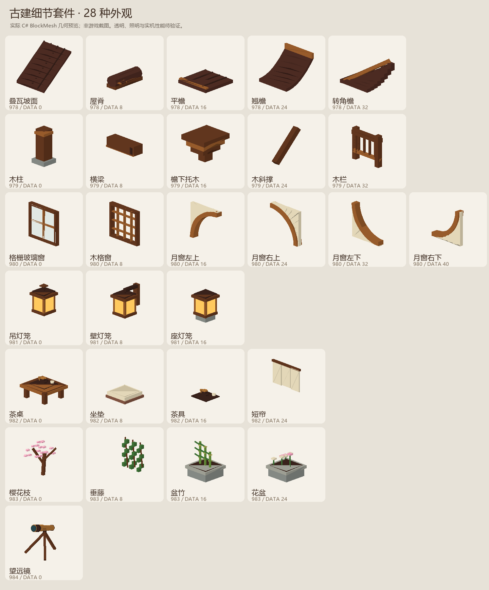

> 1.0.0 合并后的现行 ID：古建 1014–1020，猫生成器 1021；以下历史记录中的旧 ID 不适用于当前版本。

# 古建细节套件 / 0.89.0

## 2026-11-15 / 0.90.0更新

978新增variant5封边坡面（DATA40–47），关闭坡顶轮廓下方的三角空隙；979木斜撑端头延伸至格边附近、仍在本格内。古建现29外观/232状态，最大492三角形，旧28外观保持。绘卷另支持独立home族的973/976/960对称模块/961；974/975/977及隐藏上格仍未开放。当前精确能力见本目录两份*-blueprint-capabilities/architecture-block-capabilities矩阵及[YUNYA-COMPACT-V2.md](YUNYA-COMPACT-V2.md)。下文0.89.0为历史首次接入记录。

2026-11-15，依据用户的山崖书屋参考图补齐建筑部件。全部为原创 C# BlockMesh，与书柜、五分类、钓鱼、骨龙和统一云天书典共同维护。新增内容归入 `SCIEPort.Structures` / 建造与家居，不增加Tab、神器或独立Mod包。

## 部件与取证

| ID / 蓝图key | variant外观（从0开始） |
|---|---|
| 978 / AncientRoofBlock | 叠瓦坡面、屋脊、平檐、翘檐、转角檐 |
| 979 / AncientTimberBlock | 木柱、横梁、檐下托木、木斜撑、木栏 |
| 980 / AncientWindowBlock | 格栅玻璃窗、木格窗、月窗左上、月窗右上、月窗左下、月窗右下 |
| 981 / AncientLanternBlock | 吊灯笼、壁灯笼、座灯笼 |
| 982 / AncientTeaBlock | 茶桌（含茶具）、坐垫、茶具、短帘 |
| 983 / AncientGardenBlock | 樱花枝、垂藤、盆竹、花盆 |
| 984 / AncientTelescopeBlock | 望远镜 |

7种方块、28种创造外观、224种几何状态。固定Windows原版实际程序集260个方块、最大ID263；新增978–984经原版和本工程常量扫描无冲突。原ID、DATA、GUID、协议与存档键保持；同房统一0.89.0，与外部Mod的同号冲突待验证。

创造栏取得后正常触屏放置，由玩家朝向决定旋转；掉落保留款式与镜像，清除朝向。当前不增加合成、坐姿、喝茶、望远镜缩放、植物生长或新UI。盆竹为固定装饰，原有可生长竹子独立保留。部件可自由搭接，不自动删除悬空部件。



## 自动建造接口

仅荒野探险家0.89.0及以后新增 `f="detail"`，继续使用schema3、`kind="builderassistant.blueprint"`。

`d = rotation | (mirrorX ? 4 : 0) | (variant << 3)`：低2位朝向0..3、bit2左右镜像、bit3..5款式。款式按上表逐材料限制；负数、保留位和越界款式硬拒绝。一次蓝图90°旋转将rotation减1模4；X镜像将rotation取负模4并翻转bit2。每种实际网格的顶点变换都有检查。机器清单：[architecture-block-capabilities.json](architecture-block-capabilities.json)。

```json
{"schemaVersion":3,"kind":"builderassistant.blueprint","name":"吊灯笼","cells":[{"x":0,"y":0,"z":0,"key":"AncientLanternBlock","f":"detail","d":0}]}
```

保留原10个家具模板，并增加以下 `furniturePlacements` 组合：

| templateId | X×Y×Z | 实际格数 |
|---|---|---|
| AncientMoonWindow_A | 2×2×1 | 4 |
| AncientTeaCorner_A | 3×1×1 | 3 |
| AncientObservatory_A | 3×2×3 | 15 |

月窗上排左到右d16/24，下排d32/40，形成直径约1.72格的真实圆洞、木框和白色墙角填充。四格均显式列入蓝图，无隐藏占位或关联写入。组合模板沿用占地、相交、净空、旋转/镜像与引用保存规则。

**Builder Assistant独立工程不支持detail族或这些Mod方块**，原版81材料矩阵不变。已有973–977及963 bit7也仍不能写入绘卷cells；新增detail族没有开放多格家具生命周期。

## 运行边界

单个状态最多480三角形，初始化缓存网格和碰撞，无每帧几何重建。全部顶点与碰撞限制在本格[0,1]，每格碰撞盒不超过128个，短帘/垂藤可穿过并保留选择框。斜撑、薄屋面和圆窗用分段包围盒近似碰撞。白色1×1纹理配顶点色，不添加外部PNG/DAE、XDB、行为Hook或网络包。

格栅玻璃窗分离不透明木框和透明玻璃，使用实际 `TerrainGeometry.SubsetTransparent`、alpha62/255。灯笼亮芯IsEmissive，`GetEmittedLightAmount=12`接原生地形照明，无动态光源、粒子或泛光。不涉及神器技能特效和PixelFX。

绘卷运行时核对精确程序集、完整类型、ID和ArchitectureBlock基类；复制保留全部DATA。所有施工、清障、取消、异常回滚和撤销仍走主线程事务，每帧32格、每事务32768格、每轴128；清障扫描262144格、清空32768格。新块没有库存、实体或伴生格，普通客户端走原生ID7，原生保护继续生效。

## 示例与验证

- [古建细节展台](../blueprints/ancient-detail-kit.json)：406格、18×2×21，展示全部28种外观。
- [书屋细节组合](../blueprints/ancient-bookhouse-corners.json)：结构与月窗、茶席、观景台三个模板组合。
- 复制JSON全文→绘卷“导入”→保存→预览→选落点→确认。清障默认开启，先用可丢弃世界。
- `Test-Architecture.ps1 -MeshOutput`导出实际C#网格；`Preview-Architecture.py`生成接触表、示例和机器矩阵。预览不是游戏截图。

原云崖书屋9670格蓝图保持原样，本次交付通用部件和自动建造接口。Windows环境/ABI、编译、全部几何/朝向/镜像、复制、模板与示例、Local/Server/Client事务、原生ID7、取消/撤销/异常回滚分别记录于[测试记录](TEST-RESULTS.md)。Android7723、真实触屏操作、内外透明排序、照明、不同分辨率、性能和真实联机均**待验证**。
