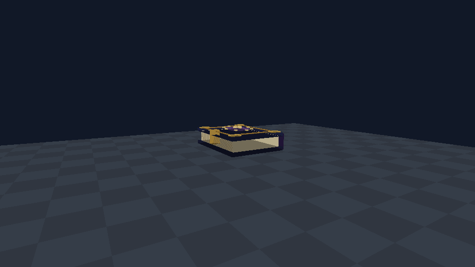
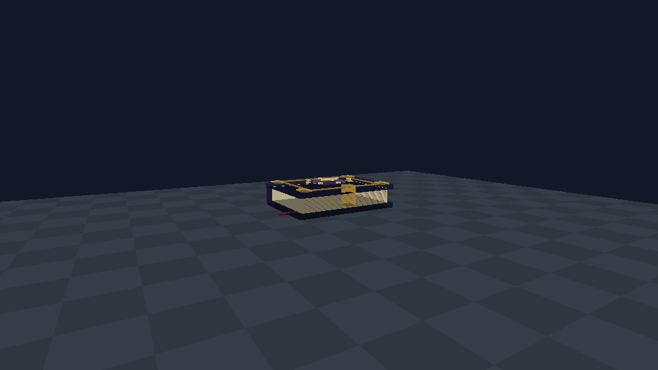

# 神器图谱 / 0.74.0

基于main e879928，新增955/DATA0、254协议和独立SCIEPortArtifactCodex子系统。外观为紫蓝皮革封面的立体书，分层象牙纸页、金角、书脊束带、金属锁扣、红色书签与凸起封印。模型由本项目原创代码构造，无外部书籍素材或新技能图标。

## 使用与解锁规则

在创造栏“神器”页获取“神器图谱”，持有后点击使用/原生交互打开双页图谱。左侧选择神器，右侧查看原物品3D预览、资料和状态，点击“解放真名”。现有生存世界可由房主提供图谱；本版不增加掉落或合成配方。

按用户确认：每位玩家在当前世界分别解锁一次，之后永久有效；不消耗图谱或神器，不需要持有目标神器，也不要求解锁后继续携带图谱。死亡和换物品不清除进度；切换世界使用该世界自己的记录。图谱本身无需解锁。

| 条目 | 物品ID | 范围 |
|---|---|---|
| 妙尔尼尔 | 942 | 攻击、附伤、三技能、持有能力 |
| 雷神之锤·伪 | 943 | 普攻、雷电附伤、蓄力雷击、持有能力 |
| 昆古尼尔 | 948 | 近战/投枪、加护、命运裁断、永恒裁决与持有能力 |
| 全知之眼 | 949 | 开启解析与视界、持有能力 |
| 吞噬之眼 | 950 | 识别、提交回收、持有能力 |
| 波塞冬 | 951 | 攻击、水中能力、护盾、全部技能与持有能力 |
| 阿比斯·终焉之镰 | 952 | 普攻/重击、双权柄技能、星门操作与军势管理 |
| 圣剑·Excalibur | 953 | 普攻、附魔、下劈、阿瓦隆与持有能力 |

**原世界没有图谱记录时，上述神器均默认封印**。物品仍保留，可拿取、存入箱子、交易、在悬浮陈列器中展示；未解锁仅限制使用，不没收/删除/替换物品。普通工具、材料、载具、四圣兽套装与陈列器不属于这八个神器，不受本规则限制。

解锁不改变神器原有的冷却、伤害、权限、友伤、领地或存档约束。吞噬之眼普通客户端依旧只读，解锁不授予管理员权限。既有军势契约和星门不会被删除，原生坐骑实体也不删除；通过神器进行管理/技能和星门操作需解锁阿比斯。

## 默认属性与展示

图谱本身具有专属“紫蓝皮革/古金”物品栏主题、神器分类、持有WalkSpeed自有增量+20%与近战攻速×1.1。按根规范，本次改造同时补齐全知之眼/吞噬之眼的默认持有步速+20%、近战攻速+10%，均在解锁后生效；其基础近战威力仍为0，实用功能不增加战斗伤害。其它神器沿用各自已有默认属性，未解锁时不加成。

移动增量每次先归还自身旧值，再按当前基数重算，不反复累乘；攻速沿既有m_lastHitTime缩减，与四圣兽频率相乘。图谱无攻击技能按钮；使用原生交互打开，可触屏选页、滚动资料与点击解放。双页面板随可用尺寸缩放，不依赖键盘、鼠标悬停。不同分辨率与手机实际触控仍待验证。

## 权威与持久化

主机以玩家PlayerGuid保存独立位掩码到世界子系统TrueNames。客户端只提交目录项，不能提交任意解锁掩码；主机检查连接绑定玩家、GUID/实体ID、实际持书、存活、合法条目、序列号与限流，主线程每帧消费最多8项，入站队列32项。每位玩家完整状态由主机同步，普通客户端不自行授予权限。记录上限4096玩家；非法GUID和不可解析掩码被忽略，记录仅保留已知8位，旧记录缺失按未解锁处理。

新254包为请求/状态，保守载荷不超过40字节；既有240–253布局保持。普通客户端只接收node.Server发送的状态；玩家GUID与当前实体匹配后更新。单机与房主走同一权限表；世界退出释放运行引用，世界记录仍由原生保存机制持久化。

技能入口和原有角色/持有判定增加统一Allowed检查；原生OnMinerHit与AttackBody再次阻止未解锁神器的伤害。核验并新增OnMinerDig(ComponentMiner,TerrainRaycastResult,ref float,out bool) Hook，使封印武器的挖掘进度低于原生破坏门限。输入抑制在原生输入组装后、ComponentPlayer前执行。全知/吞噬的交互和回收提交均单独复核。

阿比斯原先的冻结源码检查仅允许剥离固定字面量的图谱权限谓词后，仍匹配原始SHA；未更新或删除旧的保护基线，不允许借新权限改动既有领域时间线/传送算法。既有战斗隔离夹具显式初始化为“已解放”，新图谱测试另行覆盖未解放拒绝路径。

## 构建与验收

准确命令、断言数、包SHA见TEST-RESULTS.md及assets/codex/validation.json。编译目标仍为固定Windows SCNET Net_x25.01.17 / net472 / API1.42 / SC2.4.10.6。所有端统一0.74.0，旧客户端缺955/254/新子系统，混装不支持。卸载/降级会失去图谱规则支持，应先备份世界。

以下为生产物品绘制入口在目标Engine中渲染的合成预览，不是游戏或Android截图：

Android7723安装、真实图谱触屏/滚动/分辨率、书籍第一/第三人称外观、完整游戏存读档、实际主机/普通客户端/晚加入与手机性能全部待验证；原生隔离和GPU合成不能替代实机证据。首次验证用新建可丢弃世界和备份，不用主存档。

955是不可放置的神器物品，不能用于Builder Assistant蓝图。新代码不批量改地形、不发放/扣除神器，不改变蓝图材料/族/DATA或施工能力。
