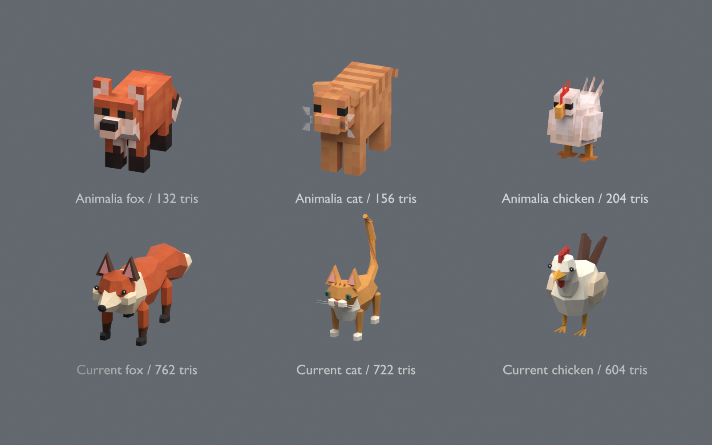

# 生物模型设计参考与美术验收

2026-11-16，用户认为0.91.0动物外观不够好，要求选择开源模组学习。本次实际拆解 Animalia 的狐狸、猫、鸡，将结果作为以后重做生物的项目参考。此文记录设计观察和改进方法；0.91.0模型、代码、ABI和安装包保持原状。

## 固定来源与研究证据

- 仓库：[ElCeejo/animalia](https://github.com/ElCeejo/animalia/tree/5895f403fd43a9464e06b3675af3495f50565a3f)，Basic Fauna for Minetest Game；固定提交`5895f403fd43a9464e06b3675af3495f50565a3f`。
- [仓库LICENSE](https://github.com/ElCeejo/animalia/blob/5895f403fd43a9464e06b3675af3495f50565a3f/LICENSE)：MIT，Copyright (c) 2022 ElCeejo。源模型/贴图只存于忽略的`artifacts/animalia-study/source/`，没有加入Mod资产或安装包。研究图保留来源声明和旁附的完整MIT许可。
- 实际读取`models/animalia_fox.b3d`、`animalia_cat.b3d`、`animalia_chicken.b3d`及各自`*_1.png`，并阅读对应`mobs/*.lua`。共10个源文件逐个按Git blob SHA-1验证，再记录SHA256，见[来源指纹](assets/animalia-study/source-manifest.json)。
- 自写只读B3D分析器核对块长、顶点布局、三角索引、节点、权重和关键帧；布局另对照[Assimp的B3D导入器](https://github.com/assimp/assimp/blob/master/code/AssetLib/B3D/B3DImporter.cpp)。没有执行下载的Lua或插件代码。
- 官方Blender MCP / Blender 5.1.1，在独立`Animalia-Design-Study`场景导入实际几何和UV；原`Wildlife-0.91`场景保留。研究Blend和脚本位于`artifacts/animalia-study/`。

上排Animalia，下排0.91.0；从左到右为狐狸、猫、鸡。相同相机、光照、粗糙度，分别按模型包围盒高度归一化，不表示游戏真实尺寸。显示源文件的静止网格，没有播放动画。研究材质显式接入贴图Alpha；源猫定义的`use_texture_alpha=false`与此预览设置不同，没有重现Luanti材质管线，因此本图不是任一游戏的实机画面。

## 拆出来的实际数据

| 模型 | Animalia三角形 | 0.91.0三角形 | 源贴图 | 源节点/实际有正权重的骨骼 |
|---|---:|---:|---|---|
| 狐狸 | 132 | 762 | 64×64 RGBA | 10 / 8 |
| 猫 | 156 | 722 | 64×64 RGBA | 15 / 8 |
| 鸡 | 204 | 604 | 64×64 RGBA | 9 / 7 |

三角形按B3D TRIS实际索引数计，0.91.0按实际DAE/Blender三角形计。骨骼统计排除了只带零权重的控制节点；例如猫有Root、Head.CTRL和肩胯控制节点，不能把15个NODE都说成15根蒙皮骨骼。三只模型的每个顶点最多归属一根正权重骨骼，体现的是刚性部件式动画。具体统计见[几何记录](assets/animalia-study/geometry-report.json)。该固定仓库没有兔子模型，本轮没有声称学习了其兔子资源。

## 从模型和贴图得到的设计观察

以下是对实际文件/研究图的观察与本项目的设计判断，不代表上游作者公开过完整创作流程。

1. **先控制块状轮廓。** 身体、颈、头、腿和尾部仍有明显分件。少量平面建立主要体积，配合头身比例和腿长即可形成统一风格。前一次建议把身体全部做成连续光滑网格过于笼统；对这种像素风生物，分件本身不是问题。应该检查颈肩衔接、关节遮盖和转动后的缝隙。
2. **贴图承担识别细节。** 狐狸口鼻/白颊/黑袜、猫脸/条纹、鸡眼睛/羽毛明暗都分配到明确UV区域。三张图的顶点UV分别有135、141、117个不同坐标，而0.91.0大部分面只在共享色条内取色。后者即使增加几何，也很难得到有层次的动物皮毛。不能仅凭PNG判断这些明暗由手绘还是烘焙产生。
3. **五官服从手机远观。** 眼鼻通过成组像素和块面建立，脸部特征集中。0.91.0猫的立体眼球、小眼神光和细胡须增加了几何，但在缩小后不一定更清楚。下一轮应先看常见游戏距离下的正面和四分之三视图，再决定哪些细节值得做成几何。
4. **把可见动作提前纳入设计。** 狐狸和猫的尾部有实际权重，颈/头有独立控制；不是只在躯干上固定一个尾巴。控制节点和变形骨骼职责分开，方便转头、坐姿与四肢运动。这是本项目固定尾巴与通用步态需要改进的部分。
5. **同一模型配多套贴图。** 猫的Lua列出多种毛色；鸡使用female/male/child贴图列表。源贴图存在透明区域，研究渲染中能看到它对薄片区域的影响。外观变体值得复用基础骨架和UV布局，但不能据此推断源引擎所有透明设置都正确或可直接用于SCNET。

## 从原生动画定义学习

原始定义：[狐狸](https://github.com/ElCeejo/animalia/blob/5895f403fd43a9464e06b3675af3495f50565a3f/mobs/fox.lua)、[猫](https://github.com/ElCeejo/animalia/blob/5895f403fd43a9464e06b3675af3495f50565a3f/mobs/cat.lua)、[鸡](https://github.com/ElCeejo/animalia/blob/5895f403fd43a9464e06b3675af3495f50565a3f/mobs/chicken.lua)。以下是代码定义，不冒充本轮播放过的动作：

| 动物 | 实际状态 | 值得学习 |
|---|---|---|
| 狐狸 | stand 1–39；walk/run 41–59 | 同一移动片段按30/45帧速度区分走与跑；单独头部跟踪 |
| 猫 | stand 1–60；walk 70–89；run 100–119；sit 130–139 | 坐姿和奔跑有独立片段，肩胯控制辅助姿态变化 |
| 鸡 | stand 1–39；walk/run 41–59；eat 61–89；fall 91–99 | 低头啄食、跌落表现和普通移动分开 |

Animalia的动作由B3D关键帧和Creatura/Lua驱动，SCNET当前动物由原生模型组件驱动，不能复制Lua帧号就宣称实现。狐狸/猫的源骨架也不能直接替代本项目已验证的6骨模型。后续必须先定义SCNET动作需求，再在实际目标骨骼、实例批次和网络限制下适配。

## 后续重做顺序

1. 先完成一只狐狸样板：明确与游戏一致的像素/块状风格，画出或收集正侧面比例参考。只做头身、颈肩、四肢、尾部的主轮廓；先检查小图剪影。
2. 建立动物自己的UV布局和像素贴图。64×64可作为参考起点，实际分辨率按细节与手机画面决定；统一像素密度，避免眼脸细节和身体纹理尺度不一致。需要的白颊、口鼻、耳内、腹部、袜毛、尾尖都应有明确区域。
3. 通过转头、迈步、摆尾、低头姿势检查部件衔接。猫另需坐姿设计，兔子另需跳跃节奏/落地重心设计，鸡检查啄食与双翼；本轮只提出需求，不把它们记成已实现。
4. 再细化几何，面数按轮廓和变形需要分配。132/156/204证明低面数也能表达清楚，但不能把这些数字设成所有动物的硬上限；也不再把“更多面”当成质量提升的证据。
5. 视觉验收和工程验收分别记录。视觉至少比较正/侧/后/四分之三、缩小画面、纹理与纯轮廓、连续动作关键姿态；工程再核对目标引擎真实导入、骨名/轴心、碰撞/脚底、材质透明、联机与手机帧耗时。通过编译和导入不表示外观满意。

本次学习的落点：以比例、UV分区和动作需求组织模型；先打磨狐狸样板，再统一其它动物的风格。研究资料不等同于新模型交付，也没有生成或替换0.91.0安装包。
