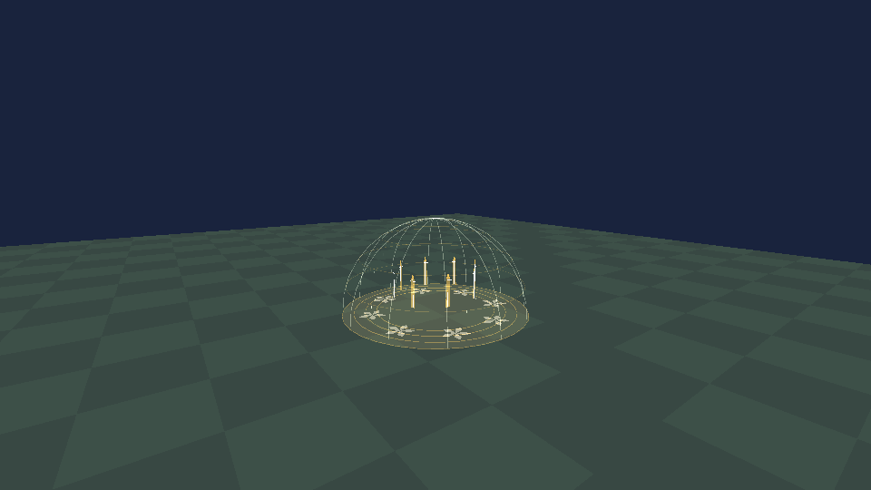
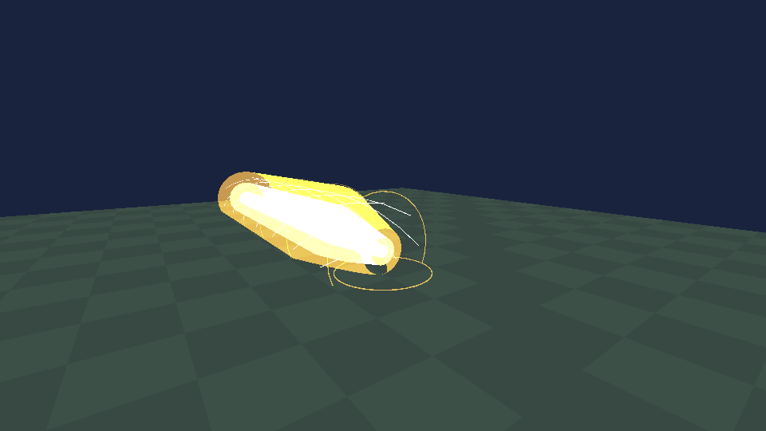

# 圣剑·Excalibur V2 / 0.70.0

2026-11-01，基于本地main `881fbaa`重设技能。物品953/DATA0、独立模型/银白剑刃/金护手/深蓝握柄和铭文、默认持有步速+20%与近战攻速×1.1保留。库存背景改为明暖金底、象牙金边，不再是深蓝主题。未改其它神器或Builder Assistant。

| 技能 | 当前效果 | 冷却 |
|---|---|---|
| 湖光附魔 | 8秒。实际手持剑刃变为自发光金色，附带金光；近战由原生2格到3格。成功近战造成扣血后，再独立追加15点基础圣光伤害。原图标逐字节保留。 | 25秒 |
| 誓约胜利之剑 | 旧三技能移到二技能，图标也沿用旧解放图标。整段4秒按比例缩为2.2秒，1.54秒释放；举剑、双臂、汇聚、巨型光剑、下挥及洪流保持原时间线形状。35格/宽8格、核心55/边缘25、每目标每次释放只一次。 | 35秒 |
| 阿瓦隆·遥远的理想乡 | 0.6秒展开，随后3秒保护持剑者，至4.2秒完全收束。黄金剑鞘碎片、光网穹顶、花纹、理想乡光岛与升光；在保护阶段分批恢复总计12%最大生命。整个施法期间不能攻击或释放其它技能。 | 90秒 |

阿瓦隆设计借鉴了亚瑟负伤后被带往疗伤之岛的传说意象，来源见[Camelot Project：Avalon](https://d.lib.rochester.edu/camelot/theme/avalon.html)。保护/恢复与黄金剑鞘投影为本Mod的原创游戏设计，不宣称复刻Fate的全部设定或使用其资产。此处是圣剑借来的短暂投影；完整阿瓦隆仍比圣剑珍贵十倍，并未添加独立阿瓦隆物品或掉落经济。

## 附魔的准确边界

固定目标原生ComponentPlayer的身体近战命中门限为2格，ComponentMiner的通用射线选择距离不能改变这一限制。因此本版在Input之后、Player之前接管持剑附魔时的触屏Hit/Dig，普通客户端只发方向；主机从实际眼位发3格射线、检查墙体/活动方块/已加载路径/领地/自身及骑乘关系/友伤设置，再调用真实ComponentMiner.Hit。保留原生工具门限、命中概率、基础攻击力、护甲、角色属性和原有Hook；额外主机攻速限制、序号和原生m_lastHitTime一起阻止洪泛重放。未附魔时仍为原生2格，不改通用交互、挖掘或其它神器的距离。

15点参照雷神之锤独立元素附伤的口径：近战前记录目标生命，延迟至少0.03秒，在主机观察到实际生命下降且目标仍存活后调用`Injure(15/AttackResilience, ..., false, ...)`。这是名义基础伤害，仍受原生伤害防护规则影响，不保证扣15生命点；用金色15数字单独显示。一次物理近战仅登记一个追加，不随网络确认再算伤害；未扣血、无敌、未命中、非近战的二技能洪流不会触发，附伤不递归。伤害调用前先出队，异常不重试。更换武器、死亡或施法会停止尚未执行的附伤。

附魔后的基础近战24+15=39，仍低于真雷神之锤40+25=65，持续时间仅8秒/25秒。二技能55/35约1.57点基础技能伤害/秒，低于锤110/8=13.75的15%；圣剑没有雷神雷电×2和12秒攻击增幅。防御大招不造成伤害，且禁止同时进攻，保持圣剑整体低于雷神之锤的定位。

## 理想乡的保护、恢复与清理

保护仅作用于当前持剑者；不保护整个地图、队友或结界内所有实体。复用已核验的AttackBody、OnCreatureInjure、AttackPowerParameter Hook，防止伤害并压制该攻击的击退/眩晕。直接伤害、持续环境伤害以及通过Injure入口的ignoreInvulnerability伤害在庇护阶段受保护；直接写Health、原生引擎外的实体删除等绕过这些入口的操作不在承诺内。绝不写永久IsInvulnerable标志、不传送、不换世界、不修改时间天气或地形。

0.6秒前仍可受伤；3.6秒结束庇护；4.2秒结束演出。换物品、死亡、睡眠、骑乘、外部行动锁定、移动超过3格或客户端快照失联1.6秒会取消。恢复每0.25秒按累计预算补足，仅Local/Server执行，不能复活、不能超出上限；尊重原生与四圣兽1/1.5/2最大生命，按施法时和当前上限的较小值计量，防止切装放大。客户端只接收原生生命同步，不自行回血。退出世界清除自有姿态、步速增量、UI、附伤队列和绘制资源，不覆盖新换神器的姿态。

## 触屏、网络与资源

继续使用统一ArtifactSkillHud/ArtifactSkillLayout：72/72/88逻辑单位、原生查看控件旁弧形排列、左右手镜像、圆形真实命中区、避让移动/快捷栏/查看等原控件；无安全位置隐藏。库存/对话/非角色相机隐藏按钮。8秒附魔剩余时间和理想乡状态直接显示在按钮上。

253字段顺序/数量保持，原`Blessing`浮点字段现在表示附魔剩余秒数；Kind0技能请求、Kind1完整快照，增加Kind2近战请求、Kind3主机挥剑/附伤视觉确认。Kind3的Age=0为挥剑，Age=1为附伤闪光，后者不重播挥剑动作。只认证From所绑定玩家；客户端仅接受node.Server的快照/视觉；有效载荷≤64字节。240–252布局及旧存档保持。因为253技能语义改变，同房必须统一0.70.0，旧版混装不支持。

8个同时施法、每次256身体检查/64命中；网络队列32项、每帧消费16项；独立附伤队列32项；绘制低档3072、中/高6144三角总预算。96格外不绘制，画质不影响判定。第一/第三人称剑刃发光通过实际DrawBlockEnvironmentData与玩家绑定，库存/地上物品不误继承别人附魔。未替换原模型/贴图文件，暂态使用独立的金光网格版本。

一技能图标不变，二技能重用原解放图标；新阿瓦隆图标由内置image_gen生成，[完整提示词](assets/excalibur-v2/avalon-prompt.txt)、原图、运行资源和[哈希来源](assets/excalibur-v2/avalon.json)均保留，处理仅缩放与圆形alpha。没有复制Fate模型、游戏截图、音频或图标。

## 验证状态

Release、目标程序集、离线和图形检查结果及最终包指纹见[测试记录](TEST-RESULTS.md)。目前：605项规则/逻辑触屏布局、471项目标程序集隔离、117项Engine/OpenGL合成检查通过。后者使用真实特效代码，不是Windows游戏/手机画面；伤害以记录Hook截停，不替代实机生命、音效与同步验证。

Android7723的安装、金色库存/第一第三人称金光、长按与多指操作、不同分辨率的可达性、不遮挡原控件，实际主机/普通客户端3格近战、一次15附伤、3秒庇护与12%恢复、取消/死亡/重进和手机性能均为**待验证**。首次使用可丢弃的新建世界和备份。

下图为实际特效代码在目标Engine中渲染的**合成场景**，没有加载游戏世界或玩家存档：

