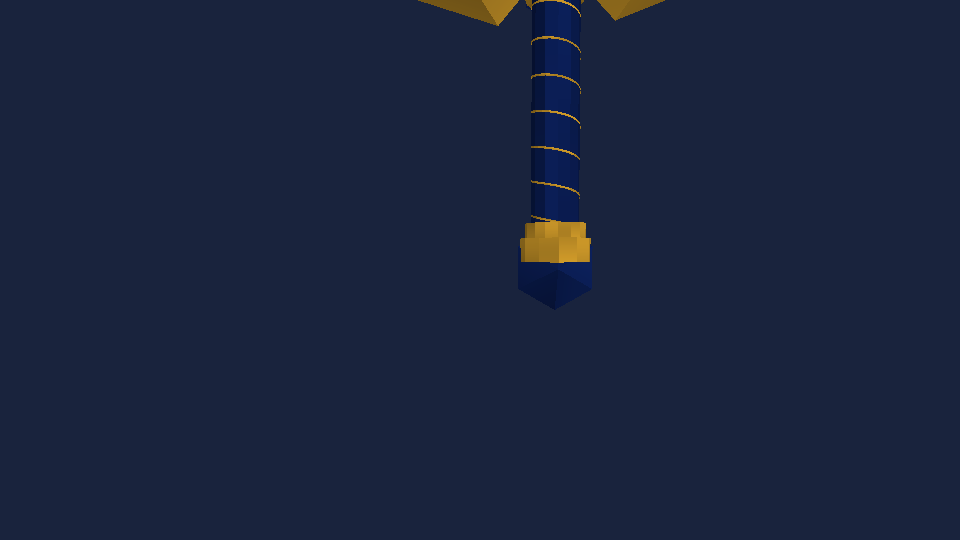
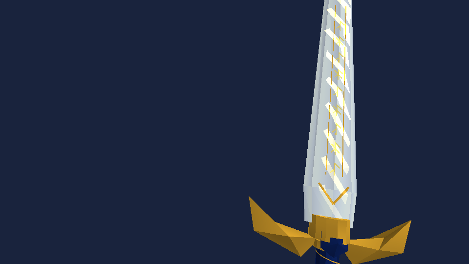
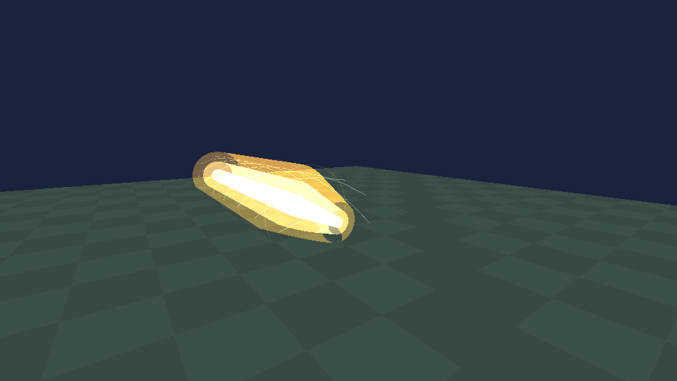

# 圣剑·Excalibur V3 / 0.71.0

2026-11-01，基于main `62e4bc0`（0.70.0），按用户反馈修正举剑、下劈和附魔偏左，并更新持续伤害与阿瓦隆回血。物品953/DATA0、XDB GUID、银白/金/深蓝模型、全部技能图标、暖金专属库存主题保持。持有步速+20%仍按自有增量归还/重算，近战攻速×1.1仍与外部攻速相乘；无其它神器或地形修改。

| 技能 | 本版效果 | 冷却 |
|---|---|---|
| 湖光附魔 | 8秒金光附魔，原生2格近战扩至3格；成功扣血的近战独立追加15点基础圣光伤害。图标保持。 | 15秒 |
| 誓约胜利之剑 | 0–0.6秒举剑，1.05–1.75秒连续下劈，1.75秒落下造成90点基础伤害，2.45秒完成收势。35格长、8格宽，固定路径余光保持6秒，每秒45点，最后2秒平滑淡出。 | 35秒 |
| 阿瓦隆·遥远的理想乡 | 主机接受施法时立即恢复20%当前最大生命，随后每秒恢复1点直到75秒CD结束。保留0.6秒展开、3秒个人庇护与4.2秒演出。 | 75秒 |

## 举剑、下劈与金光位置

重新核验固定目标的第一人称模型：原生绘制会叠加CSV的-12°持剑角度，并两次应用ItemOffset。旧的负俯仰在这个坐标系中使剑向前伸；本版第一人称使用独立姿态曲线，蓄力时剑刃竖直、握柄抬到眼位上方，下劈时穿过水平面再向下落，随后恢复。第三人称继续提交原生手臂和持剑姿态，巨型光剑按同一平滑曲线连续转动并保留下劈弧光，不再在释放帧追加原生Poke动作覆盖自有姿态。

附魔金光原先按人物眼位/方向估算，和实际手持剑矩阵不一致，导致偏左。现在在ExcaliburBlock.DrawBlock内以剑刃局部坐标生成金色流光，使用与DrawMeshBlock完全相同的缩放、绘制矩阵和可选投影。第一/第三人称、左右手、转向和动作均随剑移动；库存与掉落物不会借用玩家附魔状态。每把可见附魔剑额外96三角，无新的贴图、图标、模型或外部素材。

## 持续伤害与生命恢复

二技能初次落下90点，后续按主机游戏时钟每隔1秒结算45点，完整停留最多6次；同一目标同一阶段只结算一次，多身体、重复更新、重放包与异常不能重复扣血。每个周期重新检查目标是否仍在35×8格路径、垂直半高4格内，墙体、领地、未加载区块、友伤、自身及骑乘关系规则保持。伤害是传入原生AttackBody的名义基础值，仍受原生防御与其它Hook影响，不保证等量生命扣除。

主机长帧跳过错过的伤害周期，不把过去多秒伤害集中补到新进入路径的敌人；周期先消耗再调用原生Hook，异常停止该束余光。2.45秒收势后可以移动/普通攻击；余光留在服务器接受时的固定路径。换武器、死亡、退出、失去可施法角色状态会取消余光；施放阿瓦隆也先清除余光，避免庇护期间保留进攻。最后2秒仅降低视觉亮度，伤害周期保持45直到6秒结束。

回血点数沿用本工程四圣兽/生命显示口径：1点为原生Health的0.1，默认最大Health=1即10点；不是每秒回满原生Health=1。瞬回按接受时当前最大生命20%计算，周期回血为固定1点，不随最大生命比例放大。只允许Local/Server写入Health，尊重原生与四圣兽1/1.5/2上限，并由原生ComponentHealthPackage同步；普通客户端只显示状态。满血时消耗该次回血，不储存；换武器或施法演出取消后仍恢复至CD结束，死亡/断开/退出清除，不能复活。回血状态不写存档。

原先“每目标每次施法一次”的约束按用户此次明确要求扩展为“初次90一次、每秒45各一次”；旧V2的55/25伤害、25/90秒冷却及12%回血已被本版替代。基础近战仍24+15=39，低于现有真雷神之锤40+25=65；满6秒二技能上限90+6×45=360、35秒CD，约10.29基础伤害/秒，低于锤一技能110/8=13.75，但收益依赖敌人持续停留。圣剑没有雷神攻击/雷电×2增幅；新增恢复强化不能仅凭伤害/CD证明综合平衡，需实际战斗验收，旧文“低于15%”不适用于本版。阿瓦隆仍只是短暂投影，完整阿瓦隆珍贵程度为圣剑十倍，没有新独立物品或掉落。

## 联机、触屏与资源

复用ArtifactSkillHud/Layout、72/72/88按钮、圆形命中、左右手镜像与原生控件避让；一技能图标保持，恢复剩余时间显示在大招按钮。无安全布局时隐藏。没有键盘专用输入。

253保留请求认证与原字段顺序，尾部追加Regen、BeamId、BeamAge、BeamOrigin、BeamDirection，使余光不依赖已经结束的施法动画，并可由完整快照恢复。Kind0/2仍由From绑定玩家发起，Kind1/3仅接受Server；序号和1.6秒状态租约保持。实际压缩序列化的保守载荷守卫由64变为128字节。**同房必须全部0.71.0，旧版混装不支持**。240–252、存档、953身份、模板GUID与内部SCIEPort包身份不改，无新Hook/加载器ABI。

全局最多8个施法/独立余光，单伤害周期最多256身体候选、64实体命中；入站队列32项、每帧最多16项。世界特效低档3072、中高6144三角总预算及96格绘制范围保持；附魔剑模型流光另有固定96三角/可见剑的界限。无地形写入，无Builder Assistant材料、族或DATA能力变化。

## 验证与实机限制

具体命令、断言数、包SHA和目标程序集指纹见[测试记录](TEST-RESULTS.md)与[机器可读记录](assets/excalibur-v3/validation.json)。原生伤害测试用记录Hook截停，GPU测试使用目标Engine、真实剑模型/贴图和生产姿态/特效代码渲染合成场景；不是游戏或手机实拍。

下图依次为真实持剑模型的举过头顶、下劈中段、附魔绑定，以及余光淡出。附魔验证还逆变换检查三种朝向/两种缩放的全部流光顶点均在剑刃局部范围内。

Android7723安装、实际第一/第三人称动画和金光位置、长按/多指触屏与不同分辨率、不遮挡原控件、真实主机/普通客户端伤害/生命同步、换装/死亡/重进和手机性能全部**待验证**。首测使用备份与可丢弃新建世界，不使用玩家主存档。单机/主机/客户端的隔离验证不能替代实际完整游戏和联网验收。

## PixelFX选型（2026-11-06）

holy/blessing启动光锥、holy/sunburst释放光晕；按原CastId/时间窗接入，保留剑体/刀光/真实光束/阿瓦隆。固定MIT来源、候选源码/依赖核验与采用理由见[本轮选型记录](PIXELFX-ARTIFACTS-0.78.0.md)。按该记录先完成选型再改表现；所有伤害、冷却、默认神器属性/库存、存档和协议保持。
