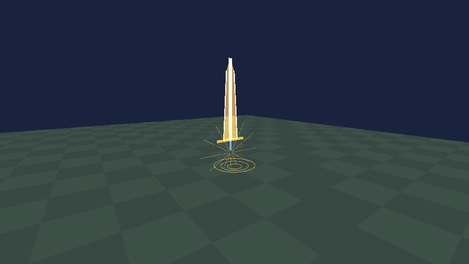
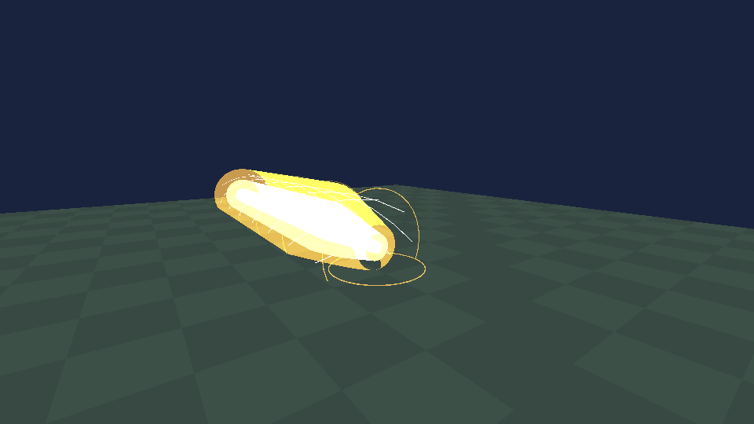

# 圣剑·Excalibur / 0.69.0

本页保留0.69.0历史实现与证据。当前0.70.0已重设计为湖光附魔、快速誓约解放和阿瓦隆，使用方法与限制见[圣剑V2](EXCALIBUR-V2.md)，不要沿用本页旧技能数值。

2026-11-01，直接基于 main `ab5e027` 开发。神器 Tab 的独立非放置物品953，DATA仅0；不迁移或复用其它神器身份。银白菱脊刃、立体金护手、深蓝细金丝握柄、蓝宝石和双面金色发光铭文。原创单骨模型实际导入88网格/1040三角；独立合成音效及内置image_gen生成的三枚圆形技能图标。来源、原图、完整提示词和SHA-256在[资源目录](assets/excalibur/)。预览是软件或GPU合成场景，不是实机截图。

## 数值与定位

| 内容 | 圣剑 | main真雷神之锤942（本轮只读核对） |
|---|---|---|
| 普攻基础 | 24 | 40物理+25雷电 |
| 默认被动 | 持有步速+20%、近战攻速×1.1 | 同样的默认移动/攻速 |
| 一技能 | 湖光剑气18，CD10秒，16格/宽2.4格 | 比较雷霆万钧：最高110，CD8秒、半径9格 |
| 二技能 | 王者加护：额外近战攻速×1.15，8秒，CD35秒 | 不复制雷神之躯/雷电增幅 |
| 三技能 | 誓约胜利之剑：35格、宽8格，核心55、边缘25，CD65秒 | 万劫天诛：核心220+4次18余震，CD55秒、半径8格；另有12秒雷神窗口和雷电×2 |

圣剑一技能名义每秒技能伤害1.8，对比锤二技能13.75；大招核心55/65≈0.846，对比锤(220+72)/55≈5.309。两项均低于锤对应技能的20%，普攻也明显更低，故不再下调用户指定数值。圣剑前方直线更远，锤近中距离范围爆发与持续增幅远强；不同场景的射程优势不等同于全面压制。原生护甲、抗性、四圣兽等公共规则仍参与最终伤害，这些数字是进入AttackBody的基础攻击力，并非保证扣除的生命点。

加护仅在存活持剑时有效，基础1.1×技能1.15=1.265；外部四圣兽攻速继续相乘。换物品、死亡、睡眠、骑乘、行动锁定或取消会结束当前演出/加护；步速仅归还本模块自有增量，不重设基值。加护不提供无敌、回血、减伤或额外伤害。阿瓦隆的珍贵程度固定为圣剑十倍，圣剑不是最强神器；本轮未引入阿瓦隆或虚构其掉落、制作经济。

## 解放演出与使用

复用ArtifactSkillHud/ArtifactSkillLayout；普通按钮72、大招88逻辑单位，原生查看控件左侧弧形排列、支持左右手镜像、实际圆形命中、避让原生控件，无安全位置隐藏。库存/对话/非角色摄像机隐藏按钮，施法中禁止再次施法与普通近战伤害。

约4秒：0–0.65秒举剑；黄金湖纹/多层法阵与汇聚光丝持续增强；0.85–1.9秒长出约10格巨型金白光剑和护手；2.65秒开始下挥；2.8秒释放并结算一次伤害；金白三层立体洪流、螺旋光带和推进光环在4秒归零。第一/第三人称分别使用已核验ItemRotationOrder/ItemOffsetOrder和InHandItemRotationOrder/InHandItemOffsetOrder，AimHandAngleOrder抬起双臂；取消后清零自有姿态。施法方向/起点在主机接受时固定，移动超过3格自动取消；按镜头瞄准可上下释放。在Input之后、Player之前消费施法中的攻击/挖掘/瞄准/交互输入。没有键盘依赖、全屏闪白、时间/天气/全局光照改变或地形破坏。

核心区域：沿射线0–35、横向±1.5、垂直±1.5；其余横向±4、垂直±4内为边缘25，按目标包围盒中心判定，不额外膨胀射程。墙体、未加载路径、原生领地/边界阻止伤害；地形深度遮挡视觉，光效不是独立的物理碰撞体。宽8格不代表会挖开8格通道。

## 权威与资源预算

新增独立253协议，其余240–252字节布局不动；认证From.PlayerData.ComponentPlayer与Caster，客户端只接受node.Server的快照。请求不带可被采信的起点、伤害、命中目标或冷却；主机验证Actor、单位方向、序号、冷却、容量和起点，锁定方向后在更新线程结算。每目标每次释放使用Entity引用HashSet，在调用原生伤害前记录；异常中止整个施法，不重试。客户端无法进入Strike伤害分支。

主机每0.4秒广播完整冷却、加护和当前施法ID/年龄；乱序/重复序号拒绝，1.6秒失联暂停客户端施法呈现和加护。服务器更新/网络回调通过32项队列交接，每帧最多消费16项；最多8个演出，每次最多检查256个身体、命中64个目标；低画质每视角3072、高/中6144三角总预算，96格外不绘制，质量不参与伤害。退出世界归还移动增量、清除姿态、UI、队列和几何。

## 验证与设备验收

执行命令和包指纹见[测试记录](TEST-RESULTS.md)。规则591项、真实目标程序集夹具443项、原生Engine/OpenGL合成场景69项通过；前者含十组逻辑分辨率/左右手布局与无空间隐藏，原生夹具含真实压缩序列化、原生+本Mod编号冲突、墙体、主机/客户端伤害分界、去重、异常、冷却、移速归还、双臂/物品姿态复原及切换其它神器时的姿态隔离。AttackBody由记录Hook截停，表示原生调用证据，不是完整游戏战斗验收。GPU用实际ExcaliburScene绘制升剑、汇聚、洪流、侧后视角、20:9、遮挡与结束清理，并验证三档三角上限；输出位于artifacts/excalibur-gpu，不打包为资源。

Android7723安装、实机第一/第三人称握持/举剑挥剑、不同分辨率多指操作、不遮挡原控件、声音、4秒观感、密集生物性能，及真实主机+普通客户端、加入中途、换物品/死亡/退出重进均为**待验证**。使用可丢弃新世界与备份。同房需统一0.69.0，旧版缺253与953不支持混装；其它Mod占用953/253的冲突也需单独核对。

以下两张是目标Engine渲染实际圣剑特效代码的**合成场景**，用于检查阶段、体积和遮挡，不是游戏/Android截图：

