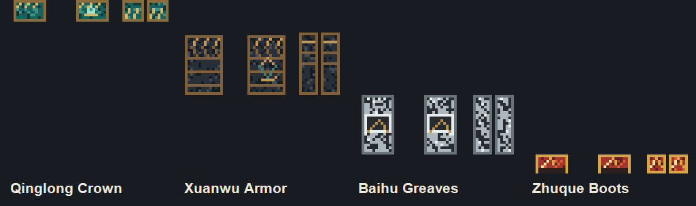

# 四圣兽神装 V2 外观审查

## x25.01.17 渲染取证

- `ComponentClothing.UpdateRenderTargets()` 将衣物以完整 UV `0..1` 合成到与当前玩家皮肤完全相同尺寸的 RenderTarget，并使用 `SamplerState.PointClamp`。固定目标内置人物皮肤与 38 张原生衣物贴图均为 64×64；因此 V2 保持 64×64 原生像素密度。单纯输出 128/256 图最终仍会在 64×64 内置皮肤上降采样，不会增加第三人称细节。
- `ClothingBlock.DrawBlock()` 在创造栏/装备栏使用同一衣物纹理和原生 inner/outer 人物网格；四件仍为 `IsOuter=True`，没有新增展示方块或改变原生槽位结构。
- `ComponentOuterClothingModel.Animate()` 按名字逐帧复制 `ComponentHumanModel` 的 Head、Body、Leg1、Leg2 骨骼变换，覆盖第三人称与远程人物模型。跑步、跳跃、游泳、骑乘的实际偏移仍需运行测试。
- `ComponentFirstPersonModel` 的空手模型只采样 `ComponentCreatureModel.TextureOverride`（inner clothed texture）；原生 outer clothing 不会单独画到第一人称手臂。V2 不篡改该路径，因此第一人称主要通过原生物品栏图标和能力反馈识别装备。
- `SubsystemModelsRenderer.DrawInstancedModels()` 在人物模型提交后调用真实 `OnModelRendererDrawExtra`；V2 的短时符纹使用 `AbsoluteBoneTransformsForCamera * camera.InvertedViewMatrix` 还原世界骨骼位置。该路径已经被项目内妙尔尼尔人物特效编译验证。

## 原创可复现美术

`scripts/New-FourSaintsAssets.ps1` 使用 System.Drawing 逐像素生成全部资源，没有第三方素材输入：

- 青龙冠：苍青神铁、青铜框、对称鳞片脊与额心青龙符纹。
- 玄武铠：黑曜石/玄铁底、古金分层龟甲、龟蛇结与肩部叠甲。
- 白虎胫甲：银白金属、石墨虎纹、折角膝甲与暗金扣件。
- 朱雀靴：赤红火羽、暗金护踝、暖白羽芯、分层脚尖与深色鞋底。
- `FourSaintsEffects.png`：青龙、玄武、白虎、朱雀四格透明符纹图集；符纹只在对应事件窗口出现。

上图是脚本生成的最近邻 UV 审查图，不是游戏截图，也不证明模型正面/背面/侧面已经在 Android 正确显示。

## V2 视觉反馈

- 青龙：权威回血真实增加生命时，头骨附近显示 0.8 秒青金符纹；纯客户端无法从既有包245准确区分青龙回血和其他回血，因此不伪造远端事件。
- 玄武：权威端确实拦截溺水/严寒或确实降低攻击伤害时显示 0.55 秒龟甲盾纹，并以 0.35 秒节流，避免寒冷环境刷屏。包245没有受击事件字段，普通客户端不能可靠重建该瞬间。
- 白虎：现有 `AwakenRemaining` 快照直接驱动腿部银白虎纹与短促漂移光纹，卸装、死亡或五秒结束后自然停止。
- 朱雀：现有 `RebirthRemaining` 快照驱动赤金凤凰纹与脚部羽纹，严格跟随现有一秒窗口。
- 没有更改包245字段、能力数值、治疗/伤害/无敌判定或物理碰撞。

## 性能与立体件边界

- 低/中/高最大动态符纹为 5/9/12；每符纹是实体刻印与柔光两层四边形。每个有效人物最多两个共享图集批次，32/48 米画质分档裁剪，无每帧列表分配。
- 世界卸载时按 Project 清理人物缓存；死亡、换装和效果结束时下一次人物绘制即停止提交。
- 本轮**没有交付立体龙角、胸甲、膝甲或羽翼网格**。虽然骨骼矩阵接口已确认，但当前离线环境不能验证男女模型局部原点、游泳/骑乘姿态、第一人称遮挡与 Android DrawCall；在没有实际多姿态画面前添加固定偏移几何会违反“不能用假立体模型充数”的要求。V2 先交付可靠原生服装贴图和骨骼跟随的短时符纹。

## Android / 联机验收清单（待验证）

1. 在新建备份世界取得衣物 200～203，分别检查创造栏、装备栏和快捷栏缩略图。
2. 男女角色分别拍摄单件及四件混穿的正面、背面、左右侧面；检查透明孔洞、镜像、错位和其他衣物覆盖顺序。
3. 第三人称完成站立、跑步、跳跃、潜泳、骑船/载具动作；确认 outer clothing 跟随原生骨骼且没有纹理游移。
4. 白天、夜晚、室内与雨天检查暗部可读性；主体金属应可读，符纹不能长亮盖住甲片。
5. 分别触发青龙真实回血、玄武攻击减伤/溺水/严寒免疫、白虎五秒觉醒、朱雀一秒涅槃；录像确认事件时长和结束清理。
6. 低/中/高画质分别记录多人同屏帧率；低画质仍应显示每种核心符纹，但不显示额外漂移层。
7. 主机和普通客户端各观察白虎/朱雀。青龙/玄武即时事件因包245未包含事件字段，当前只保证权威结算端准确；不得把缺失的远端反馈误报为协议错误。
8. 换装、死亡、重生、断线、重连、退出世界后确认没有残留符纹。与昆古尼尔和妙尔尼尔同时装备，确认 HUD、人物发光和属性互不覆盖。

