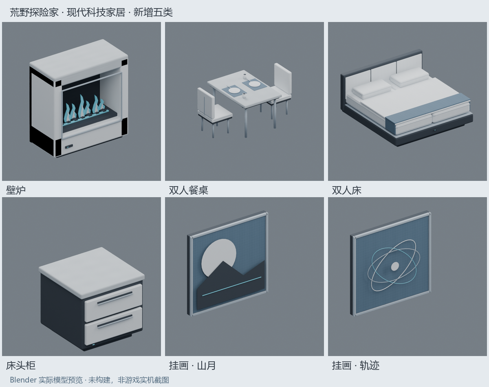

# 现代科技家居：壁炉、双人餐桌、双人床、床头柜、挂画

2026-11-08，已纳入 **0.79.0**。延续现代科技家居 V2：冰川白 `#E5EAEE`、钛银灰 `#A4B1BD`、石墨黑 `#303943`、深空蓝 `#546C80`、小面积冰蓝 `#65D5EC`。前两轮未提交的源码/资产全部保留并纳入本次构建，没有重置或覆盖为旧版本。

最初按用户限制只修改源码与资源；用户随后明确要求打包，本次已完成0.79.0 Release、环境/ABI、24模型Engine导入、完整既有检查及325项库存/存档/掉落/碰撞原生隔离检查。没有启动游戏或推送，手机与真实联机仍待验证。[实际命令、包哈希与证据](TEST-RESULTS.md)。

## 内容与身份

| Block ID | 名称 | 创造 DATA | 占位 / 源码行为 |
|---|---|---|---|
| 964 | 壁炉 | 0 | 一格；冰川白/浅石材外壳、石墨炉膛、钛银窄边；交互切换冰蓝曲线仿焰 |
| 965 | 双人餐桌 | 0 | 一桌两椅，2×2；浅灰石台面、钛银细腿、雾白软包椅、深空蓝餐垫和双份餐具；装饰/碰撞，无坐姿或进食系统 |
| 966 | 双人床 | 0 | 2×2；雾白双床垫/双枕、分层被褥、蓝灰床尾巾、软包床头、内缩石墨底座；站在本床上交互请求原生睡眠 |
| 967 | 床头柜 | 0 | 一格；冰川白双抽屉、石墨壳体、浅灰石台面、内嵌拉手；使用现有原生家居储物组件 |
| 968 | 挂画 | 0 / 8 / 16 | 山月挂画、山峦挂画、轨迹挂画；原创几何浅浮雕，钛银细框；仅允许垂直墙面放置，无实体碰撞 |
| 969 | 双人餐桌占位 | 无 | 965 的三个隐藏辅助格，无独立模型、物品或掉落；不是床 |
| 970 | 双人床占位 | 无 | 966 的三个隐藏辅助格，具原生睡眠适宜度，无独立模型、物品或掉落 |

全部属于现有 `SCIEPort.Home` / “家居”Tab。新增 7 个可创造外观（5 类，挂画 3 款），加上原 13 个共 20 个；运行时模型新增 8 个（壁炉两状态），加上原 16 个共 24 个。没有新增配方或改变旧配方，不属于神器，不添加移速、攻速或神器槽位主题。

新根方块沿用既有 DATA：低 2 位朝向、bit2 仅壁炉开关、bits3–5 挂画款式；掉落保留画作款式，清除朝向/开关。原 954、957–963、全部旧 DATA/GUID/存档键/组件名不变。新占位 969/970 的 DATA 单独定义为 `rotation | (partIndex << 2)`，partIndex 仅 1、2、3，不复用或修改旧上部 963 的编码。

## 实际资源流程

继续使用 `HomeBlock` / `BlockMesh` / `GenerateShadedMeshVertices` / `SubsetOpaque` 和现有 `Textures/HomeFurniture.png`。本轮不重写该 PNG、上一批 DAE 或它们的来源清单；新资源共享原图集及分区 UV，继承原单 identity 节点、Y_UP、米单位、位置/法线 `(x,z,-y)`、UV V 翻转和独立索引导出规则。

没有假定金属反射、PBR、透明玻璃、额外着色器或实时灯光。壁炉仿焰为有厚度的冰蓝/冰川白曲线几何，开关替换两套静态模型；没有燃料消耗、温度、烹饪、伤害、粒子或照亮周围的机制。挂画的画面是原创几何浅浮雕，不含外部图片、版权画作或额外贴图。Blender 预览采用颜色图集、非金属/无透射/无发光材质，不当作游戏效果证明。

实际通过 Blender 5.1.1 / 官方 Blender MCP 制作并导出 8 个 DAE，导出器记账共 10,988 三角面，单模型 464–2360；加上前批 29,244 共 40,232。这些是导出数据，不是目标 Engine 实际导入、骨骼数或 Android 性能结果。新的打包图集可编辑场景保存到 `artifacts/home-extension/ModernHomeExtension.blend`，原 V1/V2 `.blend` 保留。已经查看八个前视预览和五类背面接触表，仅属美术目检。

## 2×2 占位、碰撞和拆除

餐桌与床以根格为本地 `(0,0)`，其余三格为 `(1,0)`、`(0,1)`、`(1,1)`，随既有 Y 轴四朝向旋转。放置阶段检查全部四格为空、y 为 1–254、对应区块有效；坐标用 long 中间值检查溢出。不会只放根格而占用已有方块，也不允许用邻格碰撞代替真实占位。

主机沿用已有 `Update` 队列（128 项上限、每帧最多 32 项初始化）。每件新增家具最多规划 3 次占位写入，写入前一次捕获全部旧值，逐格使用原 `HomeCellTransaction` 条件提交；失败时逆序撤销自己写过且仍匹配的格子，保留第三方替换。回滚失败记录错误、停止后续放置队列并保留现场供排查，不盲目清空。施工/拆除重入用专用集合保护，避免放第一格时邻居回调误拆未完成结构。

模型仍只由根格绘制；碰撞按实际桌面/桌腿/椅子、床垫/床头形状裁切到四个占位格，并对各格旋转/平移。床垫碰撞上面为 0.64 格，软枕等小装饰不单独加碰撞。隐藏格只提供碰撞、选择和床的原生睡眠适宜度，不进入创造栏/背包。

拆除任一格会清理仍匹配本根、方向和 partIndex 的自有格，只回收一件根物品。新代码不扫描世界、不跨未知区块寻找家具，不覆盖外部替换。挂画仅贴垂直可碰撞墙面，方向取墙面法线；支撑失效后按原生物品掉落路径回收。

## 交互、睡眠及床头柜容量

沿用原 239 的 17 字节未压缩布局和 action 0/1，不新增或改号网络包；action 0 在新 ID 上用于壁炉切换或床睡眠，action 1 用于床头柜储物。主机继续验证玩家身份、期望值、距离、视线、领地与节流。床占位交互先解析到根，视线落到正确占位也可识别。旧 ID 的交互语义保持。

原生程序集静态取证：`ComponentSleep.CanSleep(out string)`、`Sleep(bool)`、`ComponentSleepPackage` 和 `Block.SleepSuitability` 字段存在；原生 CanSleep 会检查站立方块、浸水、疲劳、湿身和上方 3×3 遮蔽。床根及床占位的 CSV `SleepSuitability=1`，餐桌及其占位为 0。新床不瞬移玩家、不伪造私有睡眠状态、不直接设置复活点；要求站在当前床范围内，再由主机调用原生 CanSleep/Sleep，失败使用原生简短反馈包。唤醒、时间推进和醒后位置记录仍由原生系统处理。没有躺卧/坐姿动画，也没有新增双人独占分配协议。

床头柜复用 `SCIEPortHomeStorage`、`ComponentHomeStorage`、`HomeStorageWidget`。**可存入 8 格**，底层仍保留原 16 槽，后 8 槽若有历史数据则仅可查看/取出，不新增写入；不裁剪、清空或重排旧物。原冰箱/橱柜的 V2 8 格规则、单槽陈列器及所有原版箱子不变。继续保留[上一轮的原生加工包/直接写 m_slots 边界](HOME-FURNITURE-V2.md)。

## 静态取证与待验证项

只读扫描目标 `Net_x25.01.17` 的 260 个原版 Block.Index 常量，964–970 无原版条目；工作区既有常量未占该段。目标 `Survivalcraft.exe` SHA256 `3D14B8D698546F13E66FBF49DBCFAC45A2CDDFC97709D738050DF2E1CC74A7AD`，版本族/框架沿用原固定记录。取证仅为元数据/反编译读取，没有运行环境检查器、游戏或自动测试；不能据此确认其它 Mod 的占号或手机渠道包 ABI。

| 范围 | 状态 | 说明 |
|---|---|---|
| 新源码编译、24 模型目标 Engine 导入、包资源 | 已确认 | 0.79.0固定Windows目标Release与完整检查，24模型各1骨骼，28个家居资源源/包比对 |
| 四朝向分格碰撞、库存保存/取出/容量/拆除隔离fixture | 已确认 | 325项，调用实际DLL/原生组件和数据库；没有玩家世界/设备执行 |
| 2×2完整放置、跨区块/顶界/权限拒绝、取消、异常撤销、任意格拆除 | 待验证 | 单格条件撤销已有隔离测试；完整多格施工未在游戏执行 |
| 原生睡眠/醒来、双人同时使用、屋顶检查、醒后位置 | 待验证 | 已读取原生 ABI，未执行真实睡眠流程 |
| 床头柜完整世界保存重进/拆除掉落、并发存取 | 待验证 | V2真实实体隔离保存/重载/掉落已确认，不能代替实际世界与多人并发 |
| 挂画墙面选择/支撑变化、壁炉状态保存/同步、物品栏图标与 Android 多分辨率 | 待验证 | 颜色/几何预览不代表手机、实际光照或触屏 |
| 同房混用旧包 | 不支持 | 各端统一0.79.0，旧包缺新家具类型与占位处理 |
| 外部 Mod 964–970 冲突 | 待验证 | 仅核验固定原版/本Mod，未读取其它已装Mod的完整编号表 |

Builder Assistant 仍不支持这些 ID 或对应 DATA，不得直接写入其蓝图 JSON。两个项目没有跨源码/资产引用。新检查器路径、模型源哈希和美术记录不是“已通过”报告。

## 本轮修改文件

- 新增源码：`src/SCIEPort/Features/Home/HomeExtensionBlocks.cs`、`SubsystemHomeFurniture.Extension.cs`。
- 修改源码：同目录 `HomeRules.cs`、`HomeBlocks.cs`、`SubsystemHomeFurniture.cs`；上一轮的独立库存组件/面板和陈列器源码保留。
- 新增注册：`src/SCIEPort/Assets/Blocks/HomeExtension.csv`；没有修改任何 XDB/GUID 或旧 CSV。
- 新增模型：`Assets/Models/HomeFireplace.dae`、`HomeFireplaceOn.dae`、`HomeDiningSet.dae`、`HomeDoubleBed.dae`、`HomeNightstand.dae`、`HomeWallArt0.dae`、`HomeWallArt1.dae`、`HomeWallArt2.dae`。
- 新增制作脚本：`scripts/New-HomeExtensionAssets.py`、`Prepare-HomeExtensionPreviews.py`；`.gitattributes` 增加该生成脚本的 LF 字节保护。
- 维护并执行：`scripts/Test-Environment.ps1`、`Test-HomeGeometry.py`、`Test-HomeFurniture.ps1`、`tests/SCIEPort.Home.Tests/Program.cs`；本次新增并执行 `scripts/Test-HomeNative.ps1` / `tests/SCIEPort.Home.NativeTests/HomeNativeProbe.cs`，接入 `Build-NetMod.ps1` 后续流程。
- 文档：本文、`README.md`、`docs/HOME-FURNITURE.md`、`INVENTORY-STANDARD.md`、`COMPATIBILITY.md`、`TEST-RESULTS.md`、`THIRD-PARTY-NOTICES.md`，根 `docs/COMPATIBILITY.md` / `docs/blueprint-block-reference.md`。
- 来源和预览：`docs/assets/home-extension/manifest.json`、`reference_manifest.json`、`registration_report.json`、`atlas_regions.json`、`validation/multiview_fit_report.json`、`BUILD_NOTES.md`、`overview.png`。忽略的 `.blend`、各状态导出 JSON/PNG 和元数据取证在本机 `artifacts/`，不打包进 Mod。
