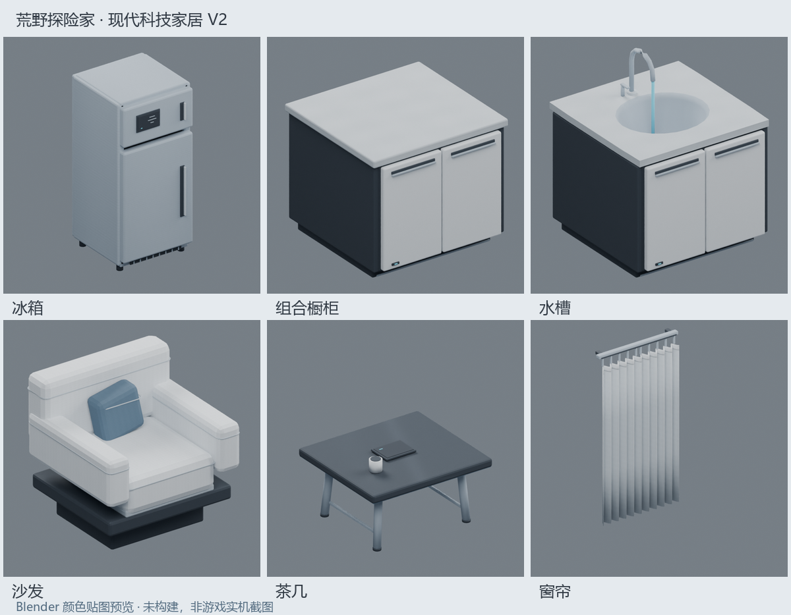

# 家居系列：现代科技 V2 / 0.79.0

当前0.79.0包含本页全部V2与下述扩展。固定Windows Release、环境/ABI、24模型实际Engine导入、完整回归和原生库存保存/容量隔离检查已通过；没有启动游戏/设备，Android和真实联机仍待验证。[构建证据与包哈希](TEST-RESULTS.md)。下方涉及“未构建”的句子为最初开发阶段记录，已由本条最新构建结论补充。

2026-11-08 继续新增壁炉964、双人餐桌965、双人床966、床头柜967、挂画968及隐藏占位969/970；共享本页原图集和风格，旧物品不改号。床头柜8格可存，床/餐桌2×2，挂画3款；当前共20个创造外观、24个模型状态。新增源码及运行行为仍待验证，本轮也未构建/自动测试/启动游戏。[扩展实现与文件](HOME-EXTENSION.md)。下文13外观/16模型为原六类家具范围。

基于本地 0.78.0 的冰箱、组合橱柜、水槽、沙发、茶几和窗帘进行 V2 美术重构。色板统一冰川白、钛银灰、石墨黑、深空蓝及少量冰蓝；仍属于独立“家居”Tab（`SCIEPort.Home`），没有神器属性。模型为项目原创，通过 Blender 5.1.1 与官方 Blender MCP 1.0.2 制作；V2 可编辑场景为 `artifacts/home-furniture-v2/ModernFurnitureV2.blend`，原 V1 场景保留。生成脚本为 `scripts/New-HomeFurnitureAssets.py`。本轮按用户要求未构建、未运行自动测试、未启动游戏；旧 0.78.0 包不包含这些修改。[文件清单、容量迁移和风险](HOME-FURNITURE-V2.md)。

图片来自真实 Blender 模型的颜色贴图预览，不是 Android/游戏画面；预览不启用金属、透射或发光材质。SCNET 仍使用原生网格光照与一张 512×512 不透明 PNG 图集，以纹理、倒角、明暗层次近似材质，不引入 PBR/反射/透明玻璃/实时光源。

| ID | 物品 | 创造 DATA | 行为 |
|---|---|---|---|
| 957 | 冰箱 | 0 | 下半部交互打开储物；8 格可存入，保留另 8 格历史物品只取；上半部交互开关门，开门前方两格必须为空 |
| 958 | 组合橱柜 | 0 / 8 / 16 / 24 | 直柜、转角柜、吊柜、抽屉柜；每柜 8 格可存入，另 8 格保留历史物品只取 |
| 959 | 水槽 | 0 | 交互开关龙头水流外观，不生成流体方块 |
| 960 | 沙发 | 0 / 8 / 16 / 24 / 32 | 单人、左座、中座、右座、转角模块；装饰与碰撞，不包含坐姿系统 |
| 961 | 茶几 | 0 | 深色玻璃外观薄台面、钛银支架与装饰平板/瓷杯，不包含独立可拿取物品 |
| 962 | 窗帘 | 0 | 交互开合；织物无实体碰撞，不改变地形光照 |
| 963 | 家居上部 | 无 | 冰箱/窗帘的隐藏占位；不可获得、不可独立放置、无独立掉落 |

目前冰箱不包含保鲜、制冰或耗电机制；橱柜门和抽屉通过储物面板使用，没有单独开合动画。玩家界面只显示物品名称与原生储物格，不增加常驻说明文字。以上操作机制写在本文，不塞进玩家界面。

## 模型与 DATA 契约

13 个可创造外观，16 个运行时模型（含冰箱、龙头、窗帘的状态）。导出仍写一个 identity 场景节点，目标 Engine 实际导入骨骼数待用户验证；所有 geometry 枚举追加到 `BlockMesh` 的 C# 路径保持。`Y_UP`、单位 1 米、前方负 Z。Blender `(x,y,z)` 转为 Engine `(x,z,-y)`，位置和法线同时转换，UV 的 V 转为 PNG 顶部原点。贴图逐部件映射到自己的图集区域；显式启用 `HomeUV`，不沿用 Blender 默认 UVMap。细节由倒角、独立柜门、内凹盆体、缝线、褶皱、拉手、细拉丝/石纹/布纹表现。V2 导出记账共 29,244 三角面，不是原生导入或性能实测结果。

DATA 低 2 位朝向，bit2 开合，bits3–5 模块，bit6 仅隐藏上部区分窗帘/冰箱。非交互模块清除开合位，非法模块归零，掉落保留模块而清除朝向/开合。旧内容 903–956、995–1000、GUID 与协议 240–254 均保持。新增 GUID 仅见 `Assets/Database/HomeFurniture.xdb`。

冰箱占一列两格，柜体与门轴分开；开启的门向前探出，柜体提供碰撞，门扇只作视觉表现。把手、转角侧门和水槽龙头可有少量装饰性突出。橱柜和沙发按一格模块拼接；吊柜由玩家放在所需高度。窗帘仍是两格高的独立模块，不自动改变相邻窗帘。

## 有界放置、回滚与拆除

普通家具 y 范围 1–254，双格家具 1–253。放置点必须为空；冰箱/窗帘的上格也必须为空，不覆盖其它方块。每项双格变更最多涉及 2 格；初始化/交互各有 128 项队列与每帧 32 项预算。入队后已删除的根方块不再执行。

上格写入前捕获旧签名，检查与计划一致，再写入并回读；异常时仅回滚仍等于自己写入值的格子，绝不清除第三方替换。回滚失败记录完整异常并停止后续放置批次。拆除上下任一部件只掉一份主物品，库存走原生 `DropAllItems`。配对清理使用实际 `ChangeCellNet` 与原生 `SubsystemTerrainPackage`：只清理已核对 ID/配对类型的自有部件，解决回调无 miner 时领地权限二次拒绝导致的孤立上格；不扩大为通用绕过权限入口。异常中断与条件撤销的纯规则测试不等于已在完整世界验证。

## 联机与存储 ABI

新增请求协议 **239**，载荷为 x/y/z/expectedValue 四个 Int32 与 action 一字节，未压缩为 17 字节；原生 `PackageStreamWriter.Data/PackageStreamReader` 负责压缩/解压，守卫执行真实双动作往返。目标 `PackageManager.basePackages` 长度只有 **255**，有效索引 0–254，255 不可注册；原生 39 个协议的 IL 常量审计确认 239 空闲，真实 `RegisterPackage/UnRegisterPackage` 守卫验证可注册。初稿曾误选 255，已在交付前修正，最终构建必须拒绝超出注册表容量。

客户端仅发送意图，处理线程只入队；主机 Update 核验已加载玩家、格子/状态、6 格距离、直视路径、原生领地权限及每玩家 250ms 间隔。按目标中心验证视线，不要求触屏点击必须落在屏幕准星。储物复用 `ComponentChest`、`ComponentBlockEntity`、原生保存与 slot 协议；回应使用 `BlockEditPackage`。V2 组件在主机限制前 8 格存入；仍保留全部 16 个底层槽和旧 `Slots/SlotN` 数据。正常显示 4×2，历史后 8 格有物品时显示 4×4，只能点按取到背包，取空后收起；不裁剪数组、不搬运或删除旧物。原生加工拖放的回填风险与不可信原生包边界见 V2 专项。开合通过主机 `ChangeCell` 和原生地形包同步，不宣称此 Mod 修复了原生箱子协议。

与旧版或其它模组占用239/957–970的混装没有兼容保证；联机各端统一0.79.0。Windows元数据、编译、导入和包检查不能替代Local/Server/Client实际世界测试。

## 验证与验收

仓库既有构建脚本会运行环境/ABI、`SCIEPort.Home.Tests`、`Test-HomeGeometry.py` 与目标 Engine 原生导入，并在包后检查 CSV/XDB、16 个 DAE、PNG 哈希和协议 239。**本轮没有执行这些脚本、编译或游戏**；来源及导出 SHA-256 见 `assets/home-furniture/manifest.json`，状态为待验证。`TEST-RESULTS.md` 中 V1 的通过记录不能作为 V2 结论。

Android 7723 首测使用可丢弃的新世界与备份，冷启动只装一份新版主包；至少验证：六类物品与全部模块、四朝向、上下任意拆除、顶格占用/高度边界、库存存取及保存重进、前方阻挡开门、窗帘/龙头状态重进、不同分辨率触屏拖放、墙后/远距交互拒绝、房主与普通客户端同时操作、拆除时另一玩家打开库存、退出/重进世界。测试设备与渠道程序集哈希未提供前，Android/实际多人状态为**待验证**。

这批家居尚未登记为 Builder Assistant 蓝图材料。不得把 957–963、模块 DATA 或隐藏上部直接写进 Builder Assistant 蓝图 JSON；双方源码/资产/产物保持独立。
