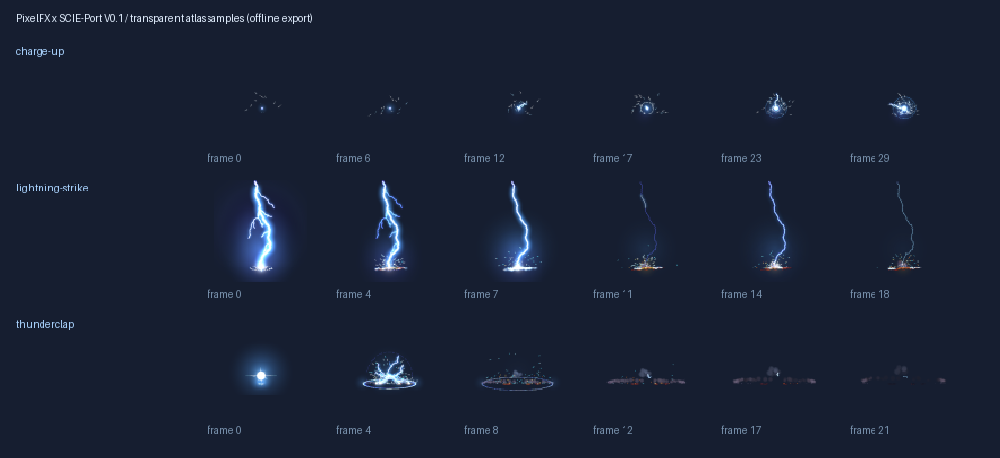

# PixelFX × SCIE-Port V0.1

2026-11-06：当前播放器优化见[0.77.1专项](PIXELFX-OPTIMIZATION-0.77.1.md)；以后神器特效开发前必须先读[选型规范](PIXELFX-DEVELOPMENT-STANDARD.md)并检索[固定效果目录](PIXELFX-CATALOG.md)。本页保留0.77.0的初始实现与历史证据。

2026-11-05，基于 Survivalcraft2/main `7b77b7c`，Mod版本 **0.77.0**。
目标仍为 SCNET `Net_x25.01.17` / Android / net472；Windows固定ABI、离线及原生GPU隔离范围**已确认**，Android/7723和真实联机**待验证**。

## 范围与触发

只给942/DATA0妙尔尼尔现有事件添加场景精灵：

| 现有表现事件 | 新叠加效果 | 位置与时间 |
|---|---|---|
| JudgmentCharge | charge-up 蓄力电弧 | 原事件中心上方1.15格，完整蓄力帧映射到原0.42秒 |
| UltimateStart | charge-up 蓄力电弧 | 原目标上方1.15格，映射到原0.28秒主雷前窗口 |
| JudgmentBurst | thunderclap 雷暴爆闪 | 原事件中心上方0.12格，1秒；强化状态仅扩大演出尺寸 |
| UltimateMainStrike | lightning-strike 落雷 + thunderclap | 原落点，落雷0.875秒、爆闪1秒；不增加落雷前摇 |

普通943伪锤、持续背景雷、雷霆王域和雷神降世继续使用原表现，本轮未给每个背景雷追加精灵。
原3D主雷/分叉/地面符文、粒子、天光、音效、相机设置和整个技能时间线保留；二维落雷只是叠层，不能替代立体雷柱。
不创建新物品、技能图标、按钮、常驻说明、Hook、实体模板或网络消息。

伤害、冷却、持有移速+20%的自有增量、默认近战攻速+10%与外部相乘、雷神库存主题、分类、ID/GUID、存档和240–254包代码保持。
已有事件去重之后才触发，Local/Server/Client走同一现有表现入口。没有额外发包，没有用离线测试推定真实网络到达次序；原本未收到事件的端不会被本功能补发。
原生版本握手未改，同房统一0.77.0，旧版混装**不支持**。

## 固定来源与离线导出

来源：[patch-gg/pixelfx](https://github.com/patch-gg/pixelfx/tree/a84159688af3ca37a4be05a0d422b94451b2e24e)，固定提交 `a84159688af3ca37a4be05a0d422b94451b2e24e`，MIT，Copyright (c) 2026 Patch / Hugo Duprez。
`tools/pixelfx/upstream/`保留未修改的16个core模块、3种效果、lightning/_lib、PNG写入器和package元信息/完整许可，共22文件。
`sources.json`按上游Git blob SHA-1校验原文；运行JSON同时记录各文件SHA-256。
无需安装npm依赖或启动浏览器；Node ≥18内置模块即可离线生成。未把上游技能当作执行指令，也未引入其开发依赖。

```powershell
node SCIE-Port/tools/pixelfx/export.mjs
# 可指定输出工程目录（用于临时重导出比对）
node SCIE-Port/tools/pixelfx/export.mjs SCIE-Port/artifacts/pixelfx-reexport
```

| 效果 | 种子 | 首个源时间 | 24fps帧数 | 帧号范围 | 锚点 |
|---|---:|---:|---:|---|---|
| charge-up | 4 | 0.25秒 | 33 | 0–32 | 核心(15,-21)，原图origin的局部坐标 |
| lightning-strike | 5 | 0.76秒 | 21 | 33–53 | 原图地面origin |
| thunderclap | 6 | 0.12秒 | 24 | 54–77 | 原图地面origin |

取源效果落雷/拍击已释放的首帧，省略其独立教程前摇；蓄力只选原1.6秒释放前的阶段。
模拟由上游createFx固定步进至采样时间。注入空actor mask，不绘制上游人物或背景；源代码不改。
按预乘RGBA面积过滤再恢复直通alpha，保留细电弧；96×96帧格、每边至少2像素透明留边、10列，共78帧。
输出为一张1024×1024 RGBA PNG（328,340字节，解压GPU纹理4 MiB）、JSON、完整MIT许可及匹配的C#帧表。


PNG SHA-256：`5c98c465989513c586451574ead260840a6f71b4290c218ffa36a825767f82f7`。
源时刻、帧数、帧率、锚点、朝向、优先级、图集布局、透明/混合策略和来源哈希均可读于JSON。
导出时验证固定源码，构建时重导出并逐字节比较PNG/JSON/C#/许可；打包前后都校验。

运行资源：

- `Assets/Textures/PixelFxStormhammer.png`
- `Assets/Effects/PixelFxStormhammer.json`
- `Assets/Effects/PixelFX-LICENSE.txt`

运行端不解析JSON。构建生成 `StormhammerSpriteClips.g.cs`，最终DLL反射校验其帧表与JSON一致，减少Android BCL依赖。
包内不含JS、Node、导出器、上游人物、测试夹具或游戏程序集。

## 通用播放器与原生接入

`Features/PixelFx/SpriteFxPlayer.cs`是无Engine依赖的固定池：不可变`SpriteFxClip`、可重用实例数组、世界GameTime时钟、帧采样、UV及优先级淘汰。
同一播放器可接收同图集的其它clip；更换图集可建立另一场景实例。
`SpriteFxScene`通过目标真实 `PrimitivesRenderer3D.TexturedBatch` / `TexturedBatch3D.QueueQuad`绘制，一次Load建立批次。
蓄力面对相机，落雷/爆闪保持竖直；锚点来自导出JSON。每个实例只绘制一个quad，按影响优先级先画落雷，再爆闪，最后蓄力；高优先级池满时拒绝低优先级进入。

`LightningScene`持有播放器，Load共享renderer，Update负责过期，Draw在原Flush前排队；沿用原105绘制次序。
原先只看ActiveBolts的Draw入口改为允许精灵独立绘制，因此蓄力或余辉不随最后一个3D雷柱消失而截断。
清理时归还所有池引用并清空顶点；ContentManager拥有图集，不在世界退出时Dispose共享纹理。
缺图/加载异常只禁用此精灵层并记录完整错误，原3D场景继续初始化。

已回到固定Windows目标验证：

- `TexturedBatch3D.QueueQuad(Vector3×4, Vector2×4, Color)`及`TriangleVertices`/`TriangleIndices`。
- `DepthStencilState.DepthRead`、`RasterizerState.CullNone`、`SamplerState.PointClamp`。
- `BlendState.Additive`的Color/Alpha均为SourceAlpha/One。
- 原生`Game.IContentReader.Texture2DReader.Get`调用`Texture2D.Load(Stream)`，目标默认参数`premultiplyAlpha=false`、`mipLevelsCount=1`，与本图集直通alpha一致。
- Camera.ViewPosition/ViewDirection/ViewProjectionMatrix与原场景已有调用保持。

## 性能分档

复用已有 `SCIEPortStormhammerVfxQuality` 设置，默认High；未增加设置存档字段或操作入口。
下表只计算新增精灵层，原3D雷电原有档位/预算保持，不能把精灵层测量当成总技能帧耗。

| 档位 | 最多存活实例 | 每相机每帧quad上限 | 三角形/顶点上限 | 帧采样 | 最远距离 |
|---|---:|---:|---|---:|---:|
| Low | 8 | 6 | 12 / 24 | 12fps | 32格 |
| Medium | 16 | 12 | 24 / 48 | 18fps | 56格 |
| High | 32 | 24 | 48 / 96 | 24fps | 80格 |

各档共用同一4 MiB图集、无mipmap，新增至多1个有内容的原生纹理draw batch/相机。
池满时先替换最低优先级中最老的实例；运行中降档立即修剪存活数，升档不复活已淘汰实例。
GameTime回退清空旧实例；暂停不推进动画，过期不等待Draw。
池/帧/UV路径无每帧LINQ、委托排序、集合增长或临时数组；GPU顶点容器可能在首次渲染扩容，未宣称全游戏零分配。
帧率采样只控制选帧频率，仍随相机每帧绘制，不以降采样制造动画积时跳帧。
背后锚点、0.65格内及超出档位距离不画；距离末8格、近端0.85格及生命末18%淡出。
世界尺寸上限32格，靠近相机时宽度封顶为距离×0.8，限制近距离填充；UV半像素内缩并加透明留边，避免相邻帧串色。
复用 `SCIEPortReducedLightningFlashes`：新层亮度系数由0.72改为0.25（原3D减闪策略保留），不会增加屏幕全覆盖闪白。

主机CLR测得10万次池/帧/UV循环150–205ms、0字节稳态分配；这是CPU微测，不是Android帧率或GPU耗时承诺。
目标Engine GPU夹具以200次生成压满三档，检查quad、真实顶点/索引数量、动画、遮挡和清理；结果见测试记录。

## 自动验证与复现

```powershell
powershell.exe -NoProfile -ExecutionPolicy Bypass -File scripts/Test-Environment.ps1 -GameDir E:/SCNET/SCNETx25.01.17
powershell.exe -NoProfile -ExecutionPolicy Bypass -File SCIE-Port/scripts/Test-Environment.ps1 -GameDir E:/SCNET/SCNETx25.01.17
dotnet run --project SCIE-Port/tests/SCIEPort.PixelFx.Tests -c Release --nologo
dotnet run --project SCIE-Port/tests/SCIEPort.Stormhammer.Tests -c Release --nologo
powershell.exe -NoProfile -ExecutionPolicy Bypass -File SCIE-Port/scripts/Test-PixelFx.ps1 -GameDir E:/SCNET/SCNETx25.01.17
$env:PYTHONUTF8='1'
powershell.exe -NoProfile -ExecutionPolicy Bypass -File SCIE-Port/scripts/Build-NetMod.ps1 -GameDir E:/SCNET/SCNETx25.01.17 -Configuration Release
powershell.exe -NoProfile -ExecutionPolicy Bypass -File SCIE-Port/scripts/Test-PixelFxGpu.ps1 -GameDir E:/SCNET/SCNETx25.01.17 -AssemblyPath SCIE-Port/artifacts/build/SCIEPort.dll -OutputDir SCIE-Port/artifacts/pixelfx-gpu-final
```

构建新增依赖仅为离线导出的Node ≥18和资源检查的Python/Pillow；项目原有net472 targeting pack、SDK及授权上游资源仍按环境脚本检查。
229项池/计时/非法输入/UV/分档/优先级/清理与分配检查；512项图集/源码blob/SHA/留边/重导出及35文件原实现保留守卫，包含3个坏清单负对照；751项原雷神规则。
461项目标Engine/OpenGL隔离检查涵盖三档、帧推进、减闪、墙体遮挡、侧视/俯视、20:9、蓄力时限、压力预算、距离/背后剔除与退出清理。
35文件守卫的基线为main `7b77b7c`，仅剥离明确添加的精灵接入行；现有机制、3D几何、包、CSV/XDB与库存规则必须逐字节一致（统一LF）。将来有意修改这些机制时须独立评审并重新记录基线，不能为本轮通过测试而覆盖基线。

## Android与实机联机验收（单列，全部待验证）

本轮未运行Android/7723客户端、完整Windows游戏世界或真实SCNET房间。
用可丢弃新单人世界，先备份；各端安装同版0.77.0，记录Mod DLL MVID、游戏程序集名称/版本/SHA、设备/系统、分辨率和图形档位。7723重打包不能继承公开Windows ABI结论。

| 场景 | 需要记录的验收 | 状态 |
|---|---|---|
| Android新世界、重进/切换世界 | 资源加载、透明/方向、原3D雷电保留、无白方块/残影/泄漏 | 待验证 |
| Android触屏 | 原技能可达、720p/1080p及20:9、原生移动/查看/快捷栏无新增遮挡 | 待验证 |
| 单人Local | 两种蓄力/拍击/主雷对时；伤害、冷却与持有属性对照0.76.2 | 待验证 |
| 房主Server + 普通Client + 旁观玩家 | 每端只随既有事件播放一次；房主伤害与客户端表现一致，无额外消息 | 待验证 |
| 延迟/重传/乱序、晚加入/退出 | 已有去重保持，无重复大爆闪；晚加入不补播历史；退出释放实例 | 待验证 |
| 多人同时释放、三档各连续10分钟 | 记录FPS中位/P95帧时间、峰值内存/发热、图集4MiB及新增batch；池/quad不超表 | 待验证 |
| 减弱闪光、暂停/恢复、前后台切换 | 两种闪光设置；GameTime暂停/恢复正常；纹理设备恢复及无陈旧帧 | 待验证 |
| 旧存档读取、退出重进、伤害/冷却/协议对照 | 无新字段/迁移；实际主机和普通端不改结算 | 待验证 |

没有新增地形操作，因而不引入边界/批次/取消/撤销的新路径；Builder Assistant蓝图能力无变更。
产物仍为 `artifacts/荒野探险家.netmod` 和同字节 `荒野探险家-0.77.0.netmod`；只本地提交，不推送或上传。
