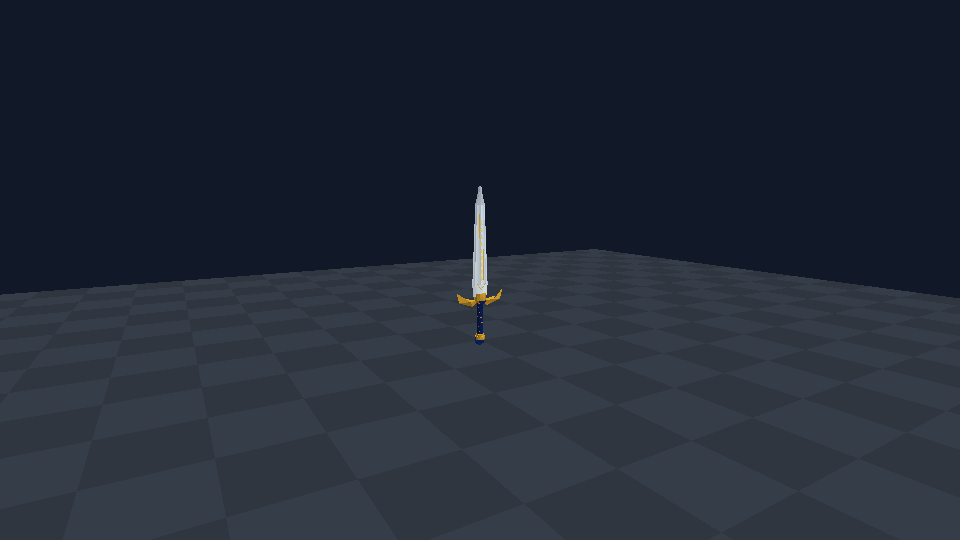
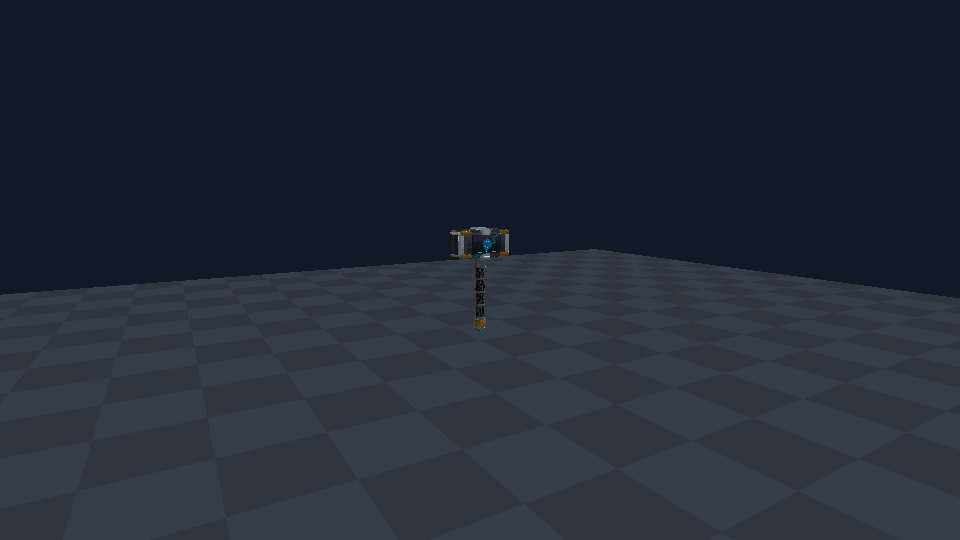
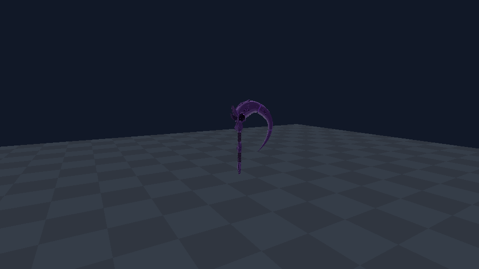

# 悬浮陈列器 / 0.72.0

2026-11-01，基于main `73a87f3`。新增物品/方块954，创造DATA0，归入“建筑装置”`SCIEPort.Building`，用于神殿或收藏室的悬浮陈列。

## 使用

1. 在创造栏“建筑装置”取出“悬浮陈列器”，放在希望物品悬浮的方格。它无需实体底座；较高位置可先搭临时辅助块，放好后拆掉辅助块。
2. 对准空装置的小晶体标记交互，在原生容器式面板中拖入一件物品。整组拖入也只放一件，其余留在背包。
3. 有物品时标记完全隐藏，只留下物品本体，约30秒旋转一周、上下浮动幅度0.065格。没有底座、支架、柜体或光柱。
4. 对准原方格内的物品再次交互，拖回背包；空槽恢复标记。拆除时，原物品和陈列器分别按原生掉落规则返还。

在神殿中，将陈列器放在祭坛上方一格即可形成“神器悬在空中”的效果。选择框覆盖原方格；模型较长时点握柄/中部，伸出方格的剑尖不是额外实体。

## 存储与外观

每个装置单槽、最多一件；支持大多数可入物品栏的材料、工具、武器、食物、衣物及本Mod神器。完整保存原物品value（含DATA、染色、损耗），不复制或生成替身。容器物品只保存其本身value，不将其它方块实体/箱内内容嵌套存进去。

已有3D模型的物品使用自己的真实模型/材质；只有平面图标的物品保留原生双面平面外观，不会自动生成3D模型。作者自己的图标居中/缩放规则被复用。外部Mod特殊自定义绘制仍需各自验证，不能保证所有Mod物品均支持。

装置可穿过、透光，光衰减0/阴影0，不形成隐形黑墙；储物方格仍被占用，不能同时放另一方块。没有电路输入或家具制作功能。它属于建筑装置，不是神器；陈列中的神器不视为玩家持有，不提供持有移速/攻速、不触发技能或借用周围玩家附魔。模型自身铭文和发光材质仍按原物品绘制。

## 原生存档、触屏与SCNET

独立实体`SCIEPortSuspendedItem`包含继承ComponentChest的ComponentSuspendedItem（SlotsCount1）与原生ComponentBlockEntity。物品存取复用InventorySlotWidget、ComponentInventoryPackage和BlockEditPackage；创建/移除、晚加入玩家与持久化使用原生EntityPackage和实体序列化。没有新网络包ID，240–253布局保持。

Local/Server负责实际存入、取出和拆除掉落；普通客户端请求原生开箱/转移，接收原生库存同步，不在本组件最终结算物品增减或创建掉落。服务端容量1、负数移除拒绝、已满拒绝追加；拆除后注销实体/库存，重复回调不再掉第二件物品。

面板沿用目标ChestWidget的原生布局和玩家背包，仅将本装置的容器格改为单格并替换标题；原生箱子保持。长按/单件/整组拖动和多指逻辑用原生控件，复用已注册GuiUpdate Hook适配客户端打开的本装置面板，无键盘/悬停依赖。

所有端须统一0.72.0，旧版混装不支持。含装置存档降级前先取回内容、拆掉装置并备份。正常手动放置和原生存档恢复受支持；外部编辑器仅写954却不创建实体的复制/粘贴，以及Builder Assistant蓝图写入不在支持范围。

## 绘制预算与验证

每帧最多绘制48格内视锥中的16个最近装置，超额/远处只停止绘制，不删除物品。每个物品单独Flush，避免多个复杂模型的原生DrawMeshBlock ushort顶点偏移溢出。沿用原格光照，下限8便于昏暗场所辨认，不改变世界光照；保留深度检测，墙后不会透视。某类物品绘制报错时停止绘制该类型并记录一次，不影响其它类型；退出释放本功能列表和绘制引用。外部单件复杂模型的成本仍由其作者决定。

空槽标记为72三角的原创代码几何与1像素白色贴图；无新的外部美术、技能图标或模型素材。原神器资产/技能不改。新代码无地形写入与伤害调用，放置/拆除仅走原生玩家操作；没有批量施工或撤销能力。954不能用于Builder Assistant蓝图，81材料/10家具模板/合法DATA和族规则保持。

精确目标为Windows Net_x25.01.17/net472/API1.42/SC2.4.10.6；命令、程序集/包指纹和断言数见[测试记录](TEST-RESULTS.md)与[验证清单](assets/suspension/validation.json)。下图使用生产DrawItem、真实模型/贴图和目标Engine渲染合成场景，未打开游戏世界或玩家存档：

Android7723安装/触屏、不同分辨率/左右手、实际神殿内模型大小/选择范围、完整单机/房主/普通客户端/晚加入同步、死亡/存读档与大量陈列手机性能全部**待验证**。首次验证用新建可丢弃世界和备份，不用玩家主存档。
