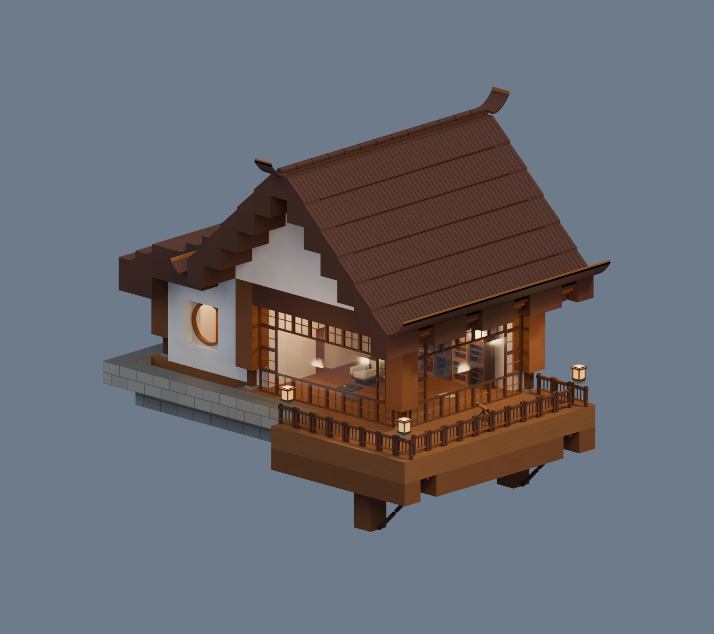
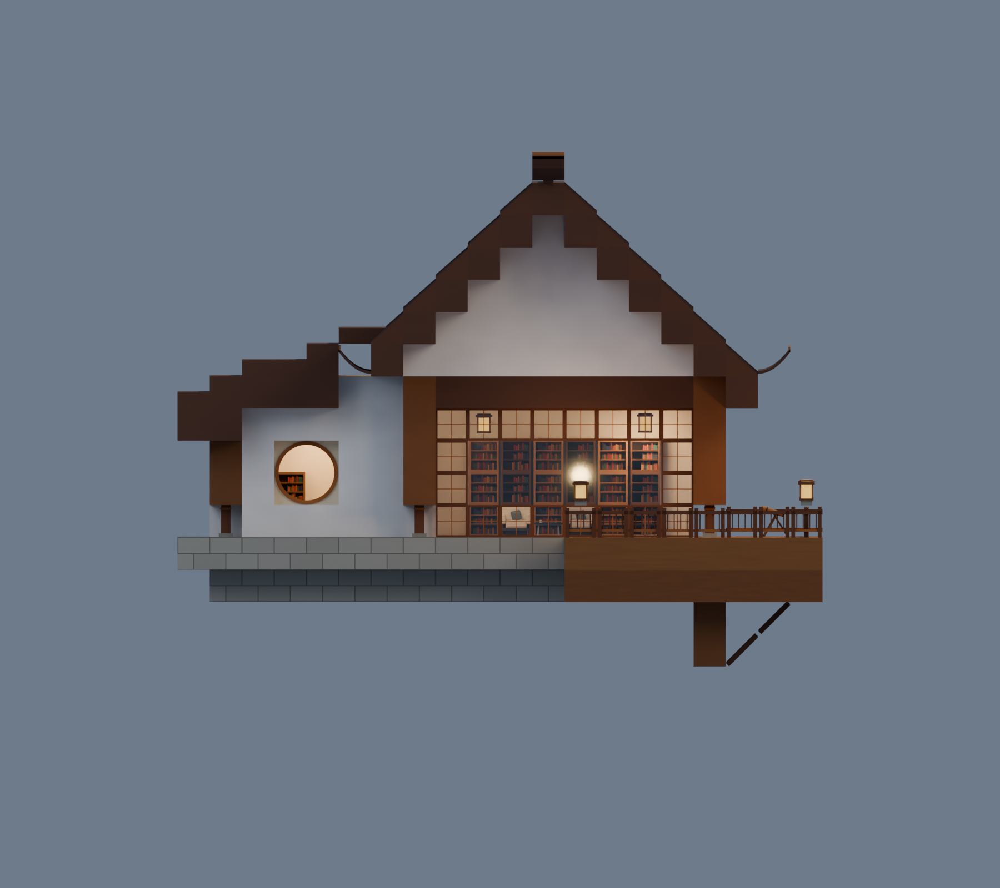
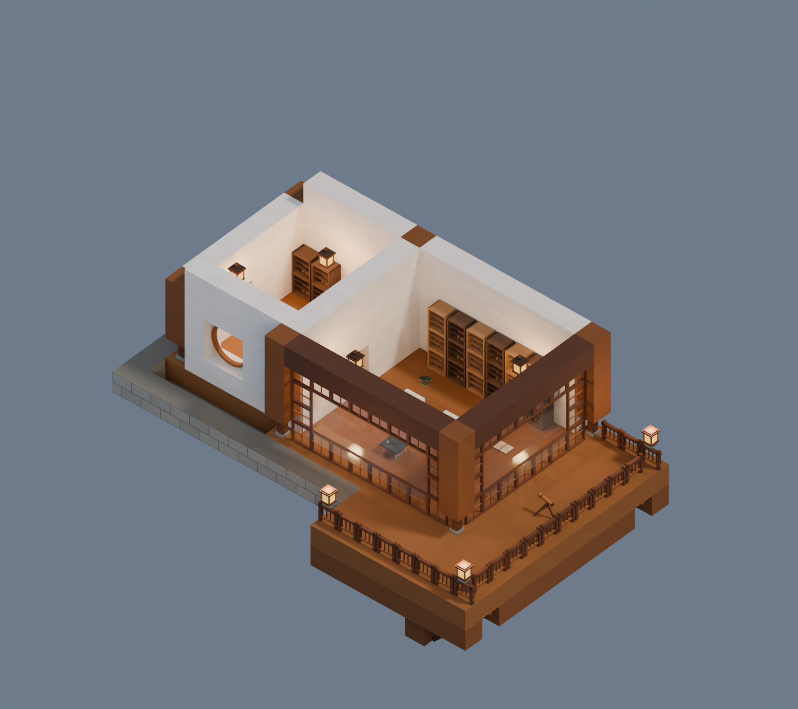

# 云崖书屋·紧凑版 V2 / 荒野探险家0.90.0

2026-11-15，按用户确认的房间关系重做。只生成建筑和相连木平台，不生成楼梯、雪松、樱花、山崖、地下室或阁楼。外包围盒20宽×16高×15深，1175个JSON根格；两扇原生木门各自动生成一格上半部。安装荒野探险家0.90.0及以上，旧0.89.0不支持新home族与封边坡面。

## 房间和平台

- 正面看左屋为茶室，正面2×2圆形月窗；前墙比主屋后退1格，两屋后墙均在同一深度。
- 两屋之间一扇木门。茶室左侧另留一扇侧门，供用户后续楼梯衔接；主屋正面和右侧不另加门。
- 主屋正面以真实玻璃和木框为主，右侧同样透光。后墙用现有单格自定义书架组合书墙；阅读区使用现有沙发、茶几与书堆。茶室使用古建茶桌/坐垫和小书架陈列区。没有把彩色整块木板冒充书籍，也没有伪造多格大书柜占位。
- 正面右半段的平台在右前角转向右侧，两段地板同高、同一个连通分量，围栏不横断转角通道。侧平台有装饰望远镜，底部有短木柱及拼接斜撑。石基只保留短基座和入口接边。

背面和家具布置按用户文字约束补全；未提供尺寸的部位采用紧凑尺寸，不声称单张原图的隐藏部分完全一致。

## 左右错误根因与修复

V1导入器没有偷做镜像：`Blueprint.Reorient(0,false)`为恒等，`BuildPlanner`按`origin + cell.Relative`施工。错误在作者坐标与预览：Render-YunyaRefined.py原先将游戏(x,y,z)直接映射为Blender(x,z,y)，变换行列式为-1，左右反射；同时把较小的游戏X当成正面观看的左侧。

实际目标Engine.Matrix.CreateLookAt从-Z外侧看向+Z、上方+Y时，视图右向量为-X，所以**较大游戏X在画面左边**。V2用观看者U坐标设计，再导出`gameX=maxU-U`；同步变换屋面、月窗分块、门铰链和家具朝向DATA。预览统一改用(x,-z,y)，行列式+1，顶点、物件、相机、目标和灯光一起转换，游戏顺时针网格与DAE绕序分别处理。

实际导入的四块月窗、正面玻璃与右平台标志通过原生Engine观察矩阵检查：屏幕X依次为茶室-6、主屋2、右平台9.5。实际Blender正面/外观/剖视的投影顺序也断言`tea < main < rightPlatform`，记录相机和最终JSON SHA。四次旋转、双镜像往返本身不能发现作者把左右定义反了，因此保留语义标志检查。V1图片保留为历史记录，不能继续作为游戏方向证据。

## 运行时适配边界

新增独立`home`族，仅激活当前程序集中的精确类型/ID：

| key | ID | 允许款式 | DATA |
|---|---|---|---|
| BookshelfBlock | 973 | 0、1、2 | variant×8 + rotation |
| BookPileBlock | 976 | 0、1、2、3 | 同上 |
| HomeSofaBlock | 960 | 0、2 | 同上，仅对称单人/中座 |
| HomeCoffeeTableBlock | 961 | 0 | rotation |

rotation=0..3，bit2禁止，不接受高位。4种物品均没有存储实体或关联占位格，不改原放置/坐姿/回收行为；沙发撤除仍走既有座位释放逻辑。家具镜像保持款式并反转标准朝向，物品内在书籍排列与图集图案不做几何反射。没有开放冰箱、橱柜、高书架974、2×2大书柜975、隐藏963/977或不对称沙发模块，不能据此写它们的根格或占位。新能力不属于独立Builder Assistant。

978新增variant5“封边坡面”（DATA40..47），叠瓦下有单格木质楔形封沿，专用于前后屋面轮廓，修复原先可见的三角透空；原0..4保持。979木斜撑端点延长至格边附近，仍完全在本格内。古建共29外观/232状态，最多492三角形。精确矩阵见[古建能力](architecture-block-capabilities.json)和[家具能力](home-blueprint-capabilities.json)。没有新增ID、加载器Hook、XDB、资源、私有存档或网络协议；net472、API1.42及单SCIEPort.dll保持。

## 生成、验证、交付

生成器[New-YunyaCompact.py](../scripts/New-YunyaCompact.py)输出schema3平铺cells、分组、位置标志、平台连通和材料统计；[预览器](../scripts/Render-YunyaRefined.py)读取同一最终文件。古建与书架/书堆来自实际C#网格，沙发/茶几来自本项目已有DAE与图集；原生玻璃、门等外观为评审近似。预览是Blender评审图，不是Android或游戏截图。

```powershell
python SCIE-Port/scripts/New-YunyaCompact.py
powershell -NoProfile -ExecutionPolicy Bypass -File scripts/Test-Environment.ps1 -GameDir D:/Games/SCNET-x25.01.17
# 本次只暂存自己的文件；checkout-index导出干净源码，保留未提交骨龙工作。
powershell -NoProfile -ExecutionPolicy Bypass -File artifacts/compact-0.90.0/source/SCIE-Port/scripts/Build-NetMod.ps1 -GameDir D:/Games/SCNET-x25.01.17 -Configuration Release -OutputDir SCIE-Port/artifacts/compact-0.90.0
powershell -NoProfile -ExecutionPolicy Bypass -File SCIE-Port/scripts/Test-BlueprintJson.ps1 -Path SCIE-Port/blueprints/yunya-compact-v2.json -GameDir D:/Games/SCNET-x25.01.17 -ModDll SCIE-Port/artifacts/compact-0.90.0/build/SCIEPort.dll -ReportPath artifacts/yunya-compact-v2/validation.json
# 测试工程Release构建后，实际执行加载上述干净构建DLL。
& SCIE-Port/tests/SCIEPort.Blueprints.Tests/bin/Release/net472/SCIEPort.Blueprints.Tests.exe D:/Games/SCNET-x25.01.17 (Resolve-Path SCIE-Port/artifacts/compact-0.90.0/build/SCIEPort.dll).Path --blueprint (Resolve-Path SCIE-Port/blueprints/yunya-compact-v2.json).Path
python skills/survivalcraft-blueprints/scripts/publish_blueprints.py --item SCIE-Port/blueprints/yunya-compact-v2.json artifacts/yunya-compact-v2/validation.json --report artifacts/yunya-compact-v2/publication.json
```

NuGet审计服务最初不可达而触发NU1900；使用缓存依赖并设置`NuGetAudit=false`完成构建，没有改变项目依赖或跳过功能检查。测试构建使用FrameworkPathOverride指向本机net472引用包、DOTNET_ROOT指向本机SDK，DOTNET_ROLL_FORWARD=Major。首轮测试中Roof variant5的新合法范围触发原“非法40”负例，改为非法48后重跑；失败不计为通过。

完整构建/包、原生观察矩阵、家具40状态与ID7真实序列化/主机Handle/广播替身、古建232状态、24组整屋施工/取消/异常回滚/保护/撤销和Android BCL成员快照均作离线验证。精确最终数量、指纹、生产ID/revision和公开回读记录保存在同名机器报告；Android7723实际画面、触控、门、碰撞/通行、家具坐姿及真实房间仍待验证。已纳入main的书柜、五分类、钓鱼和统一书典均保留，三个未提交骨龙文件不纳入产物。

新版按授权发布到数字书房，新建V2条目保留V1；不会修改网站或把草稿当成发布。0.90.0源码默认只提交本地main，不push；对应提交尚未到GitHub时保留安装包，不能将Release关联到旧提交。

## 最终交付指纹

[数字书房蓝图库](https://wxhappylife.top/digital-study/index.html#blueprints) · [直接下载JSON](https://wxhappylife.top/digital-study/api/game-blueprints/v1/blueprints/a68aa002-ed37-4057-bb15-820768212628/json?revision=1) · [机器记录](YUNYA-COMPACT-V2.json)

蓝图SHA256：`a360ce122fea961d4a68142cf1dd5c81783429beddaa00470b40ecdd249c5f25`；生产ID `a68aa002-ed37-4057-bb15-820768212628` / revision1，published且公开下载字节一致。包SHA256：`8fa276dfe30aa55fa54e4165e170b5b44e994a783cdc84aef56ec474e38010c5`；DLL SHA256：`eef175d8cb8bb9a34798e3f47dbe0eab22b186a75581b094dfc23f25c1eeaab6`。214条目与0.89.0完全同名，212条目原字节一致，仅DLL与modinfo版本变化。

最终379358项绘卷回归、29外观/232状态、40单格家具状态及实际原生ID7回读、24组整屋施工/撤销通过；486个Android BCL成员快照无缺失（非手机执行）。侧入口、共享木门、茶室、主屋与平台在木门打开假设下通过两格净空通路检查。






