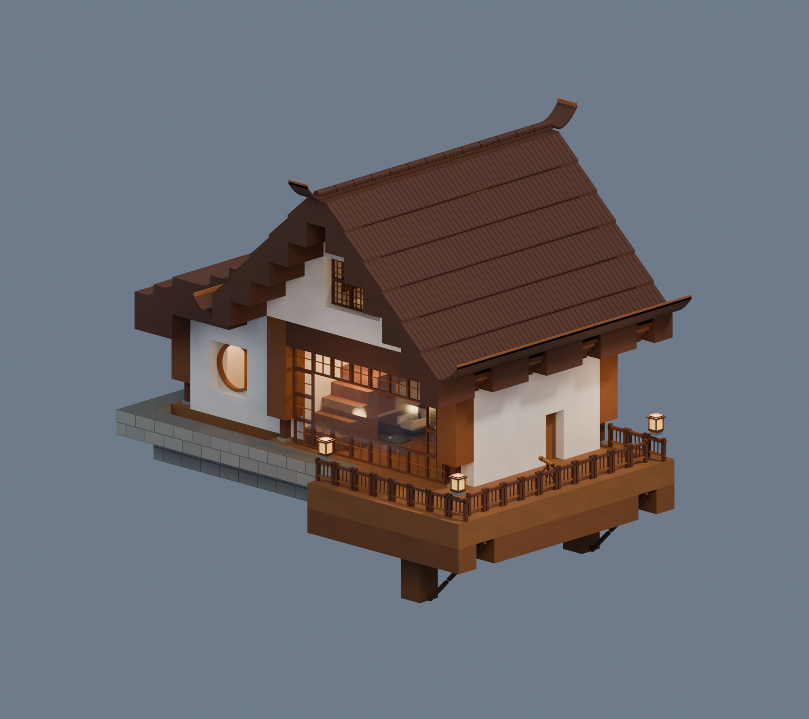
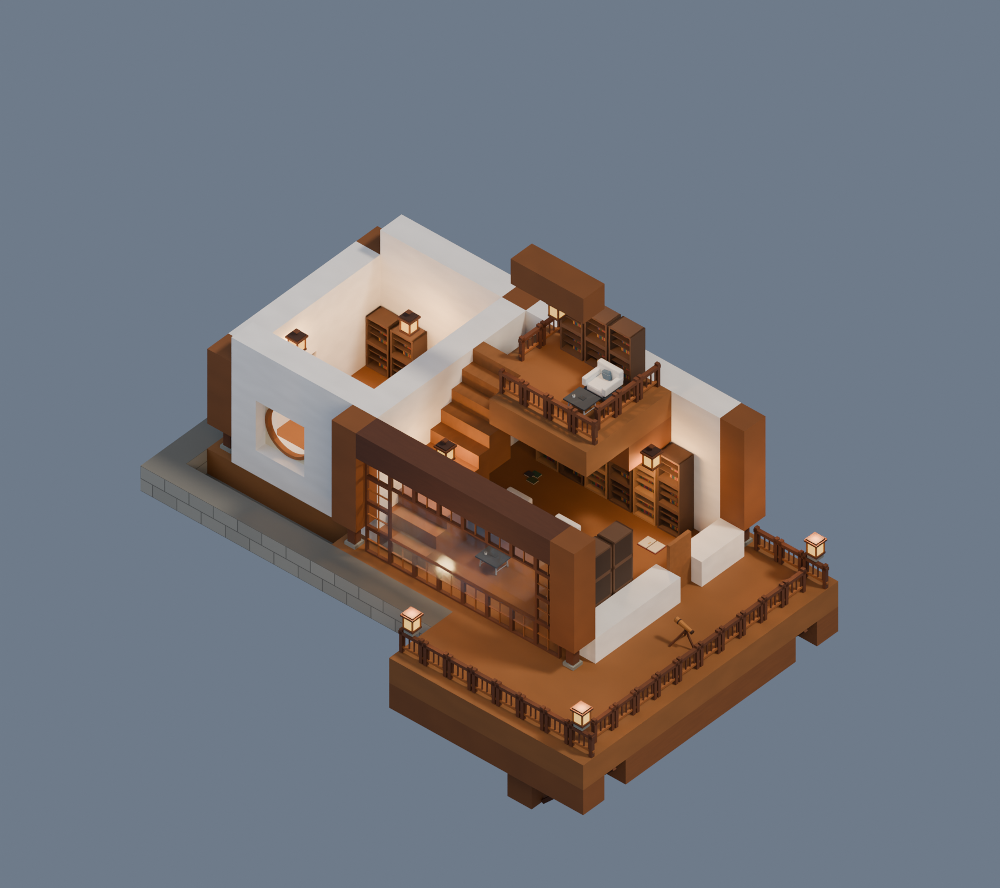

# 云崖书屋·阁楼版 V3

2026-11-15，按用户“规模保留、右侧不用玻璃、增加门和书架、利用屋顶增加阁楼”修改。仍为20宽×16高×15深，1248个JSON根格，沿用荒野探险家0.90.0；没有运行时代码、方块、族、DATA范围或Mod版本变化，不生成新netmod。

## 建筑变化

- 正面大玻璃、左侧茶室月窗、内部木门、茶室后墙与主屋齐平、前墙后退1格以及原L形平台均保留。
- 主屋右侧原玻璃/窗格改成白色实墙，新增一扇通向右平台的木门。右侧内墙前段新增3列×3层现有单格书架；右门内外留通道，书堆移到后方。三扇门分别为茶室侧入口、两屋内部木门、主屋右平台门，正面仍没有门。
- 主屋后半部增加约5×4格的阁楼，楼梯洞口处留空。阁楼地板位于设计Y=5（蓝图相对Y=8）；入口接主屋左侧两格宽、五级的室内木楼梯。阁楼有木梁、栏杆、6格现有自定义书架、沙发、茶几、灯笼与正面木格窗。屋脊、屋面、基础和外包围盒不加高/扩大。
- 不增加外部楼梯或造景。原V2的茶室侧入口继续留给用户自行接楼梯。

门在施工JSON中只写下半根格，上半由游戏生成；3扇门各有1格关联上部。所有家具仍为0.90.0已支持的单格非储物类型，没有写高书架/多格大书柜、隐藏占位或存储实体。

## 坐标与通路

继续使用观看者右向U映射为游戏-X，预览为游戏(x,y,z)→Blender(x,-z,y)，保持正面看“茶室在左、主屋和右平台在右”。原生Engine观察矩阵屏幕X为茶室-6、主屋2、右平台9.5；实际预览相机也检查这个投影顺序。

导入后校验：尺寸与V2完全相同；右墙上无GlassBlock或格栅玻璃窗；右门在相对(3,4,8)；10个WoodenStairsBlock全部位于主屋内部；阁楼入口地板在相对(9,8,8)。生成器对原生整块/楼梯上方两格净空作三维四邻通路检查，单步高差至多1格，木门按打开状态考虑。茶室、主屋、两段平台、右门和阁楼均可到达。这是保守离线拓扑检查，不替代实机人物碰撞与行走。

## 生成与验证

[New-YunyaLoft.py](../scripts/New-YunyaLoft.py)复用本项目[紧凑版生成器](../scripts/New-YunyaCompact.py)的已批准底稿，只修改右墙和屋内。共用导出器增加可选名称/文件名/楼层与检查点，V2默认输出仍与仓库原JSON逐字节相同。新版本独立保存，不覆盖用户已采用的V2。

```powershell
python SCIE-Port/scripts/New-YunyaLoft.py
powershell -NoProfile -ExecutionPolicy Bypass -File scripts/Test-Environment.ps1 -GameDir D:/Games/SCNET-x25.01.17
dotnet build SCIE-Port/tests/SCIEPort.Blueprints.Tests -c Release -p:SCNetGameDir=D:/Games/SCNET-x25.01.17 -p:NuGetAudit=false --nologo -v:q
& SCIE-Port/tests/SCIEPort.Blueprints.Tests/bin/Release/net472/SCIEPort.Blueprints.Tests.exe D:/Games/SCNET-x25.01.17 (Resolve-Path SCIE-Port/artifacts/compact-0.90.0/build/SCIEPort.dll).Path --blueprint (Resolve-Path SCIE-Port/blueprints/yunya-loft-v3.json).Path
powershell -NoProfile -ExecutionPolicy Bypass -File SCIE-Port/scripts/Test-BlueprintJson.ps1 -Path SCIE-Port/blueprints/yunya-loft-v3.json -GameDir D:/Games/SCNET-x25.01.17 -ModDll SCIE-Port/artifacts/compact-0.90.0/build/SCIEPort.dll -ReportPath artifacts/yunya-loft-v3/validation.json
python skills/survivalcraft-blueprints/scripts/publish_blueprints.py --item SCIE-Port/blueprints/yunya-loft-v3.json artifacts/yunya-loft-v3/validation.json --report artifacts/yunya-loft-v3/publication.json
```

测试Release构建0警告/0错误；使用本机net472引用包、DOTNET_ROOT及DOTNET_ROLL_FORWARD=Major。实际执行加载此前干净构建的0.90.0 DLL（SHA256 `eef175d8cb8bb9a34798e3f47dbe0eab22b186a75581b094dfc23f25c1eeaab6` / MVID `0e9c3602-4cdb-4814-beea-92cd5a183bc5`），没有将未提交骨龙资源纳入交付。

固定Windows环境/ABI、真实导入/逐格能力校验、V3的24组Local/Server/Client×旋转×镜像施工/撤销通过；每帧最多32写入，取消/部分写入失败回滚、默认非空气零写入、显式清障后恢复原值、高度边界、四旋转及双镜像还原均通过。V2的24组整屋回归同样通过。地形/房间使用既有内存替身，Android与真实房间仍待验证；用户“当前效果不错”的反馈不扩大为新阁楼已经实测。

预览读取最终JSON；古建与书架使用实际C#网格，沙发/茶几使用已有项目DAE/图集。右门为原生木门的近似评审形状。剖视去掉屋顶、阁楼前木格窗和右墙上部，以展示真实楼梯、阁楼及书架，其他视图保留全屋。图像不是游戏截图。官方Blender MCP仅只读确认既有Scene，独立同版本后台进程渲染，不改当前打开场景。

本次仅蓝图、生成/预览工具、测试和文档。原0.90.0安装包及其214条目/版本/ABI结论保持；源码只本地main提交，不push，不为蓝图重复发布Mod Release。三个骨龙未提交文件保持原样。公开发布ID/revision、SHA、渲染绑定与回读信息见同名机器记录。

## 最终发布

[数字书房蓝图库](https://wxhappylife.top/digital-study/index.html#blueprints) · [直接下载JSON](https://wxhappylife.top/digital-study/api/game-blueprints/v1/blueprints/8d9ea9e5-4a09-440c-b3fd-54b5b67617e9/json?revision=1) · [机器记录](YUNYA-LOFT-V3.json)

生产ID `8d9ea9e5-4a09-440c-b3fd-54b5b67617e9` / revision1；published、匿名目录/详情可见且原始下载字节一致。蓝图SHA256：`fe1a5b540986858cb47f0306abd779e7a093c6f147dca1e5c9a9a32916b8e8a6`。原V2条目保持原样。




