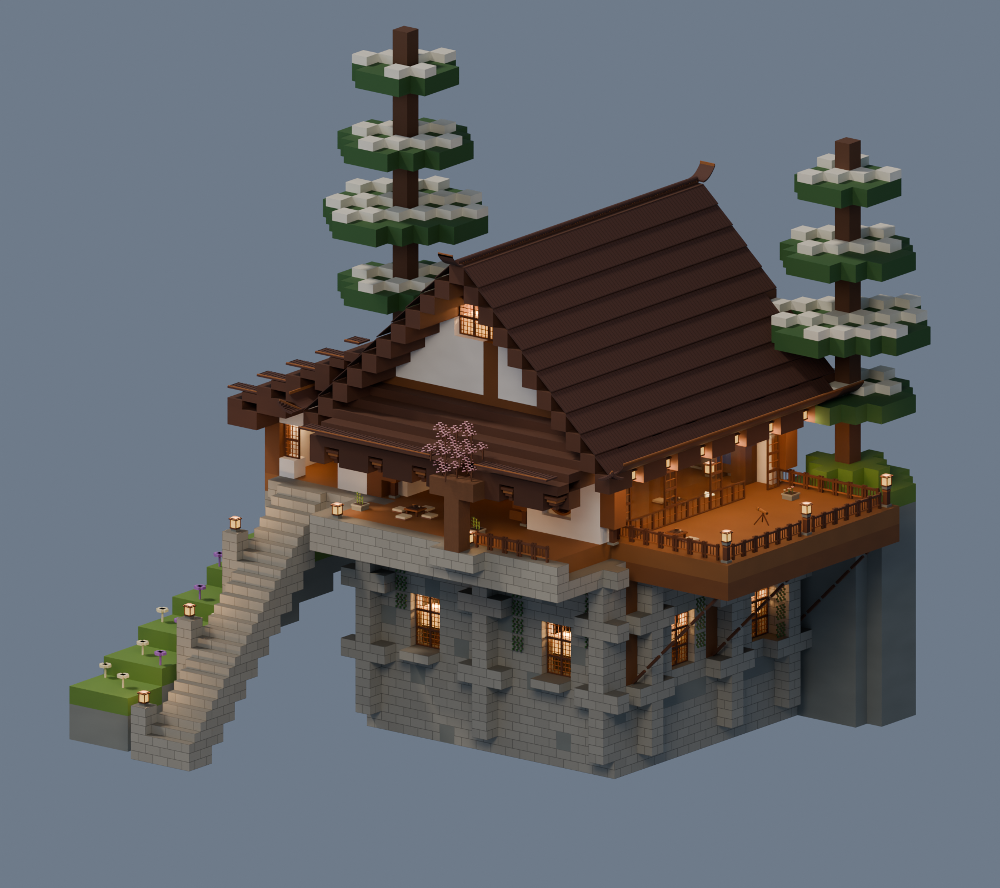
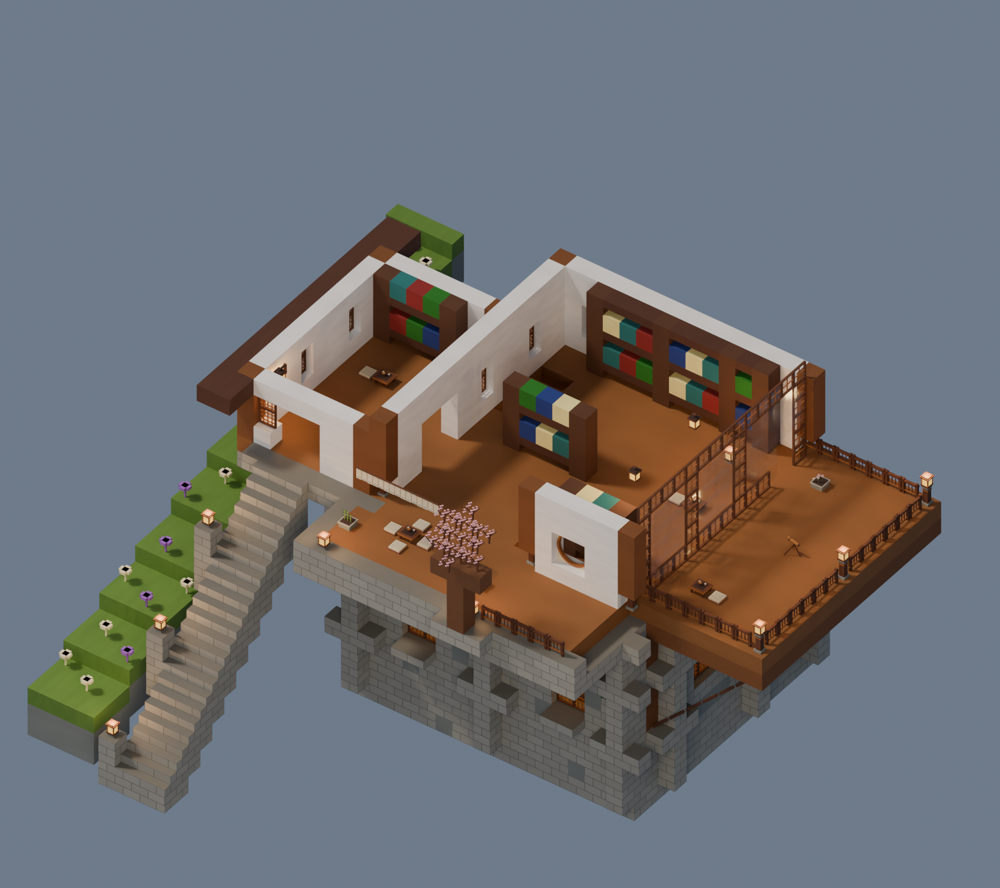

# 云崖书屋·整屋精修 V1

2026-11-15：依据用户的悬崖书屋参考图，独立生成适用于荒野探险家绘卷的整屋蓝图。5372格，X宽38 × Y高34 × Z深36，schema3平铺cells，277347字节，无BOM。需要荒野探险家0.89.0及以上古建部件；Builder Assistant不支持其中detail族。

[数字书房蓝图库](https://wxhappylife.top/digital-study/index.html#blueprints) · [直接下载JSON](https://wxhappylife.top/digital-study/api/game-blueprints/v1/blueprints/dbd55e9b-baf6-483b-8a3f-5fd6bc355d49/json?revision=1) · [仓库JSON](../blueprints/yunya-refined-v1.json) · [机器记录](YUNYA-REFINED-V1.json)

## 设计与范围

保留参考图的主山墙、长坡瓦顶、独立左偏屋、前茶廊、白墙月窗、右侧玻璃书阁、悬挑露台及斜撑、下层石墙、石阶、灯笼、樱花、竹盆、藤蔓和雪松。主屋使用978屋面和原生木底板，檐口使用翘檐；前廊与偏屋为独立半砖坡顶，并有连续底板封住错层缝隙。玻璃面以原生玻璃为大面、980格栅为边框与分隔；月窗由四块真实四分之一圆部件组成。

单张图没有提供背面和室内尺寸。下层藏书室、两道室内楼梯、阁楼、后窗和房间家具按可通行的空间补全，不能视为原图不可见部分的一比一复原。书架采用已验证的原生木材、半砖与彩色木板；现有973–977及963 bit7仍不支持蓝图cells，因此没有写入。茶席和望远镜为古建装饰部件，不增加交互功能。远山、雾海和原图渲染效果不属于施工JSON。



## 空间与放置

尺寸包含石基、阶梯、树冠和园景。归一化坐标从包围盒最小角开始；正立面朝-Z，玻璃书阁和露台在+X。主层地板相对Y=12，玩家站立层Y=13；下层地板Y=2，阁楼地板Y=20。外部楼梯三格宽，室内两道楼梯均两格宽；书阁通往露台有两格宽开口。

以下为相对蓝图原点的地板目标坐标，可用于检查入口与动线；它们不是施工偏移参数。

| 空间 | 相对X,Y,Z | 内容 |
|---|---|---|
| 石阶入口 | 10,1,0 | 三格宽石阶、柱灯、花坡 |
| 左侧偏屋 | 12,12,16 | 小书室、茶桌、侧窗 |
| 茶廊 | 21,12,11 | 矮桌、坐垫、门帘、盆竹 |
| 玻璃书阁 | 26,12,22 | 书架、阅读茶桌、吊灯 |
| 观景露台 | 34,12,24 | 望远镜、围栏、灯笼、花盆 |
| 下层藏书室 | 20,2,20 | 石墙、暖窗、书架、回主层楼梯 |
| 阁楼 | 22,20,23 | 小书架、茶席、栏杆 |

六处空间均通过从外部石阶出发的保守通路检查：原生整块/楼梯支撑，头上两格完全空，四邻移动且单步高差不超过一格。报告记录在机器文件的circulation字段；它是离线拓扑检查，未模拟玩家碰撞、脚步或真实网络。

先在可丢弃的新世界预览，把石基底部放在合适的崖台高度。保持默认不覆盖；若与现有地形冲突，先调整位置和朝向，清障仍按绘卷既有确认流程执行。首次手机放置、行走、撤销和多人请求同步均待实测。



## 生成与验证

生成器[New-YunyaRefined.py](../scripts/New-YunyaRefined.py)不引用建筑助手源码或旧房屋生成器。只读本项目记录的原生材料契约与荒野探险家古建能力矩阵，输出确定性JSON、分组清单、材料统计和通路报告。重新生成字节一致，SHA256：`f3971d6e5ad9bb04bf746902a780f8e13a3a762bdbeeb512a3c4640e955bed79`。

```powershell
python SCIE-Port/scripts/New-YunyaRefined.py
powershell -NoProfile -ExecutionPolicy Bypass -File scripts/Test-Environment.ps1 -GameDir D:/Games/SCNET-x25.01.17
powershell -NoProfile -ExecutionPolicy Bypass -File SCIE-Port/scripts/Test-BlueprintJson.ps1 -Path SCIE-Port/blueprints/yunya-refined-v1.json -GameDir D:/Games/SCNET-x25.01.17 -ModDll SCIE-Port/artifacts/ancient-0.89.0/build/SCIEPort.dll -ReportPath artifacts/yunya-refined-v1/validation.json
$env:FrameworkPathOverride='D:/Dev/Tools/net472/build/.NETFramework/v4.7.2'
$env:DOTNET_ROOT='C:/Users/85196/AppData/Local/Microsoft/dotnet'
$env:DOTNET_ROLL_FORWARD='Major'
$env:PATH=$env:DOTNET_ROOT+';'+$env:PATH
dotnet build SCIE-Port/tests/SCIEPort.Blueprints.Tests -c Release -p:SCNetGameDir=D:/Games/SCNET-x25.01.17 --nologo -v:q
& SCIE-Port/tests/SCIEPort.Blueprints.Tests/bin/Release/net472/SCIEPort.Blueprints.Tests.exe D:/Games/SCNET-x25.01.17 (Resolve-Path SCIE-Port/artifacts/ancient-0.89.0/build/SCIEPort.dll).Path --blueprint (Resolve-Path SCIE-Port/blueprints/yunya-refined-v1.json).Path
```

固定Windows程序集哈希/ABI检查通过。测试程序集Release编译0警告/0错误，实际执行加载已校验0.89.0产物DLL，其SHA256为`d7a1cda384312be471e7530ef85204b108c85578a2c19a286ef1367244ff90f0`。实际导入器逐格材料校验通过；Local/Server/Client三角色×四旋转×两镜像共24次完整施工/撤销通过，所有5372格写入并恢复为空，每帧最多32次写入。24处花卉原生依附支撑谓词、取消回滚、部分写入失败回滚、默认非空气零写入、显式清障后恢复原块、超高拒绝、四次旋转及双镜像序列化还原均通过。地形和网络使用测试替身，不代表Android或真实房间通过。

## 预览和发布证据

[Render-YunyaRefined.py](../scripts/Render-YunyaRefined.py)读取同一最终JSON和生成器分组清单。古建使用Test-Architecture.ps1从已校验C#导出的28个实际部件网格，再按DATA旋转/镜像；原生方块形状与材质为评审近似，没有导出或提交游戏专有纹理。Blender5.1.1/Cycles生成外观、东侧及主层剖视，记录最终JSON和网格SHA。外观预览包括全部5372格；剖视明确去掉屋顶、阁楼和雪松。预览灯光是评审灯光，不用于推断游戏亮度、透明排序或性能。

官方MCP的只读查询确认了当前空白Scene和5.1.1。其后台CLI工具报120秒超时，未生成输出、未改动当前场景；最终用同一本机Blender可执行文件的独立factory-startup后台进程渲染，保留原打开场景。中间预览暴露的悬空脊饰、半砖屋面错层、密集窗格和缺少落脚岩台的后松已在JSON中修正，最终hero/interior/east均按最终SHA复核。

```powershell
powershell -NoProfile -ExecutionPolicy Bypass -File SCIE-Port/scripts/Test-Architecture.ps1 -GameDir D:/Games/SCNET-x25.01.17 -AssemblyPath SCIE-Port/artifacts/ancient-0.89.0/build/SCIEPort.dll -MeshOutput artifacts/yunya-refined-v1/parts.json
& 'D:/Tools/BlenderMCP/blender-5.1.1-windows-x64/blender.exe' --background --factory-startup --disable-autoexec --python-exit-code 1 --python SCIE-Port/scripts/Render-YunyaRefined.py -- --source artifacts/yunya-refined-v1 --parts artifacts/yunya-refined-v1/parts.json
python skills/survivalcraft-blueprints/scripts/publish_blueprints.py --item SCIE-Port/blueprints/yunya-refined-v1.json artifacts/yunya-refined-v1/validation.json --report artifacts/yunya-refined-v1/publication.json
```

正常管理员API预检、草稿与发布成功，ID`dbd55e9b-baf6-483b-8a3f-5fd6bc355d49`，revision1。匿名目录可见、详情published、版本化下载字节与校验文件完全一致；没有覆盖旧蓝图。凭据仅由已有本机技能私有DPAPI配置读取，发布报告没有口令或令牌。本次只新增蓝图、生成/预览脚本与测试/文档，不改变运行时代码、ABI或Mod版本，不生成新netmod/Release，不push源码。共享工作区的骨龙未提交工作保持原样。
