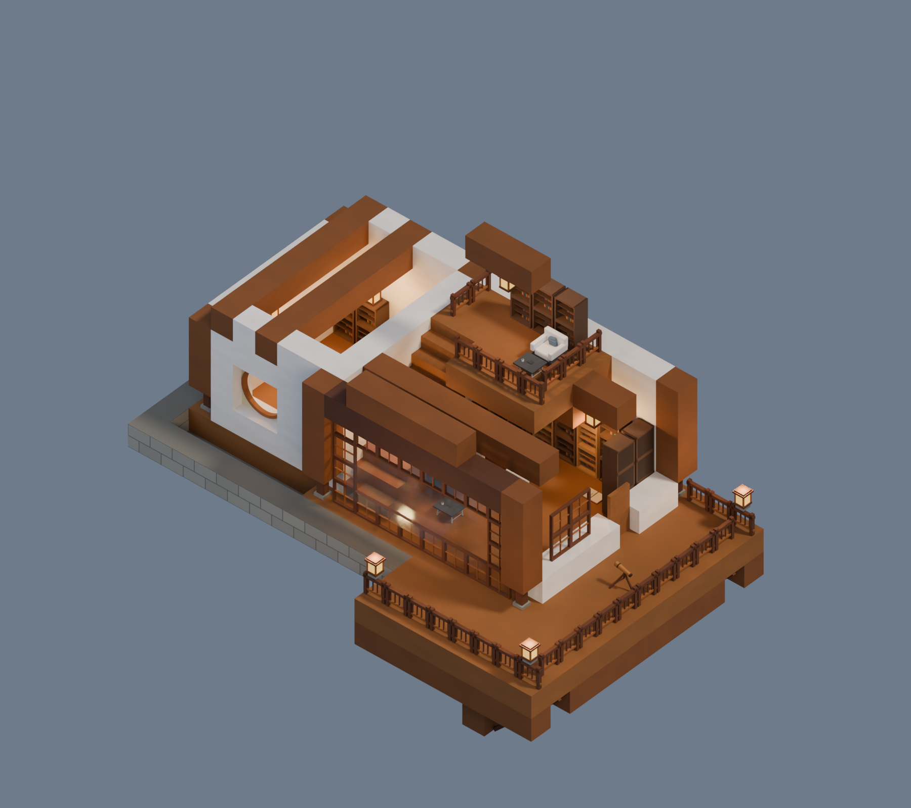

# 云崖书屋·观景阁楼版 V4

2026-11-15，按用户“开始优化，右侧增加一点窗户/玻璃看景色”细化V3。仍为20宽×16高×15深、1249个JSON根格，沿用荒野探险家0.90.0；没有运行时、材料能力、Mod版本或安装包变化。原V2/V3生成器、JSON和云端条目保留。

## 建筑变化

- 右侧新增2×2格细木框玻璃窗，采用现有AncientWindowBlock款式0、侧向朝向。窗下保留实墙，窗与平台木门间保留一格墙垛。挡窗的两列书架移到门后，右墙旁仍有三列×三层单格书架。窗前一格留空，门内两格宽的接近区域留净空。
- 茶室厚重的木块屋面改为平檐和连接坡面，恢复与主屋的坡面衔接，调整左墙顶部使其收在薄檐下。主屋前后封边的整木块衬底改上半木砖，保留封边楔形瓦面、坡度、屋脊高度和翘檐。山墙增加横木梁。
- 阁楼靠楼梯侧补两格地板和下方梁，边栏外移一格；楼梯顶端与相邻平台形成2×2转身区，上方至少两整格净空。五级、两格宽楼梯及阅读家具保持。
- 茶室吊灯上方的木梁贯通前后墙，主屋吊灯上方补与墙体/阁楼相接的梁。L形平台下增加横向搁栅，铺板、标高、栏杆及两段平台连通关系保持。
- 左茶室/月窗、后墙齐平、前墙后退、两屋内部木门、正面大玻璃无门及用户的外部楼梯接口保持；不增加外部楼梯、地形或造景。

JSON只写3个木门下半根格，原生机制派生3个上半格。家具仍限0.90.0允许的单格非储物书架、书堆、对称沙发和茶几，不使用多格书柜、隐藏占位或库存实体。

## 坐标与通行

继续使用观看者U到游戏-X导出，以及游戏(x,y,z)到Blender(x,-z,y)的正交旋转。实际Engine正面屏幕X仍为茶室-6、主屋2、右平台9.5；最终预览同样检查茶室<主屋<右平台投影顺序。

实际导入后的独立语义检查验证：右侧窗位于相对X=3、Y=5..6、Z=5..6，内侧X=4无遮挡；平台门仍在(3,4,8)；转身区地板X=9..10、Y=8、Z=8..9，上方Y=9..10无格占用；新边缘保留栏杆。三扇门、10个屋内直梯、书架保留、瓦檐和半砖屋边均检查。生成器两格净空通路覆盖茶室、主屋、前/右平台、右门、窗前及阁楼出口/转身/阅读区，全部可达。

通路采用木门打开状态的保守格级检查，不能代替Android人物碰撞、实际开门和上下楼体验。

## 生成与验证

[生成器](../scripts/New-YunyaViewLoft.py)复用原V3构造后作局部修改，沿用V2材料校验和坐标导出。最终JSON SHA256：`816a07f319962b17055befd60ae1d2921f9facc05099ef13a09696d7c83e69a0`。

```powershell
python SCIE-Port/scripts/New-YunyaViewLoft.py
powershell -NoProfile -ExecutionPolicy Bypass -File scripts/Test-Environment.ps1 -GameDir D:/Games/SCNET-x25.01.17
dotnet build SCIE-Port/tests/SCIEPort.Blueprints.Tests -c Release -p:SCNetGameDir=D:/Games/SCNET-x25.01.17 -p:NuGetAudit=false --nologo -v:q
& SCIE-Port/tests/SCIEPort.Blueprints.Tests/bin/Release/net472/SCIEPort.Blueprints.Tests.exe D:/Games/SCNET-x25.01.17 (Resolve-Path SCIE-Port/artifacts/compact-0.90.0/build/SCIEPort.dll).Path --blueprint (Resolve-Path SCIE-Port/blueprints/yunya-view-loft-v4.json).Path
powershell -NoProfile -ExecutionPolicy Bypass -File SCIE-Port/scripts/Test-BlueprintJson.ps1 -Path SCIE-Port/blueprints/yunya-view-loft-v4.json -GameDir D:/Games/SCNET-x25.01.17 -ModDll SCIE-Port/artifacts/compact-0.90.0/build/SCIEPort.dll -ReportPath artifacts/yunya-view-loft-v4/validation.json
python skills/survivalcraft-blueprints/scripts/publish_blueprints.py --item SCIE-Port/blueprints/yunya-view-loft-v4.json artifacts/yunya-view-loft-v4/validation.json --report artifacts/yunya-view-loft-v4/publication.json
```

测试采用本机net472引用包与DOTNET_ROOT/DOTNET_ROLL_FORWARD=Major。固定Windows环境/ABI、测试工程Release构建0警告0错误、实际导入及逐格材料校验通过。V4/V3/V2各24组角色×旋转×镜像施工/撤销、32写/帧、取消、部分失败回滚、默认非空气零写入、显式清障恢复、高度边界和朝向还原通过。地形/房间为内存替身，Android7723与真实房间仍待验证。

实际加载干净0.90.0 DLL：SHA256 `eef175d8cb8bb9a34798e3f47dbe0eab22b186a75581b094dfc23f25c1eeaab6`，MVID `0e9c3602-4cdb-4814-beea-92cd5a183bc5`。保留三个未提交骨龙文件，不改统一包/运行源码；现有214条目及包指纹结论保持，不生成新netmod/Release。main继承06bdc64及此前共同成果；本轮两次只读fetch因GitHub连接失败，不能宣称检查到最新远端，源码只本地提交。

预览绑定同一最终JSON，古建/书架采用实际C#网格，沙发/茶几用项目DAE/图集；原生块形状、纹理和灯光为评审近似。官方Blender MCP只读确认既有Scene，同版本Blender5.1.1独立factory-startup后台渲染，不改打开场景。剖视移除屋顶、阁楼前木格窗和右墙上部，保留观景窗，图像不是游戏截图。

V2/V3重生成逐字节等于原文件；V4重生成逐字节等于发布文件。现有0.90.0包SHA256仍为`8fa276dfe30aa55fa54e4165e170b5b44e994a783cdc84aef56ec474e38010c5`，包内214条目/单DLL及其SHA一致。

## 发布与下载

[数字书房蓝图库](https://wxhappylife.top/digital-study/index.html#blueprints) · [下载V4 JSON](https://wxhappylife.top/digital-study/api/game-blueprints/v1/blueprints/872df173-2101-4636-b7a3-a3b926273948/json?revision=1) · [机器回执](YUNYA-VIEW-LOFT-V4.json)

通过正常管理员API创建新条目并发布：ID `872df173-2101-4636-b7a3-a3b926273948` / revision1。published状态、匿名目录/详情和下载原始字节/SHA256均已核对。原V2/V3及其它蓝图保持。回执不含凭据或令牌；无需新Mod安装包。



